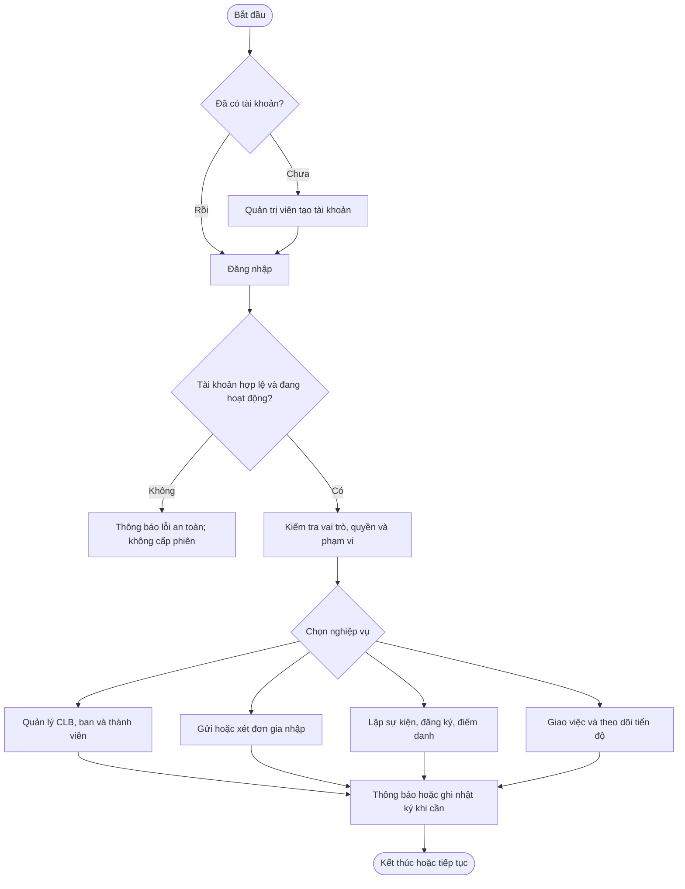
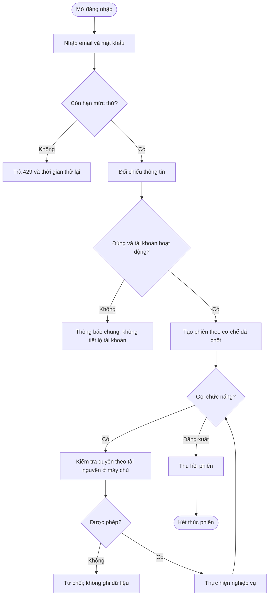
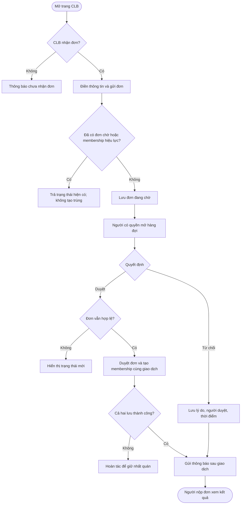
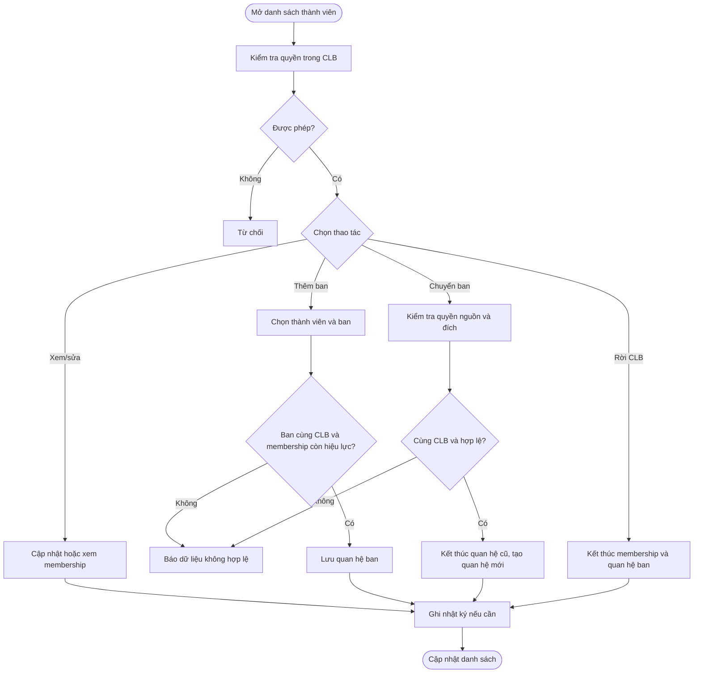
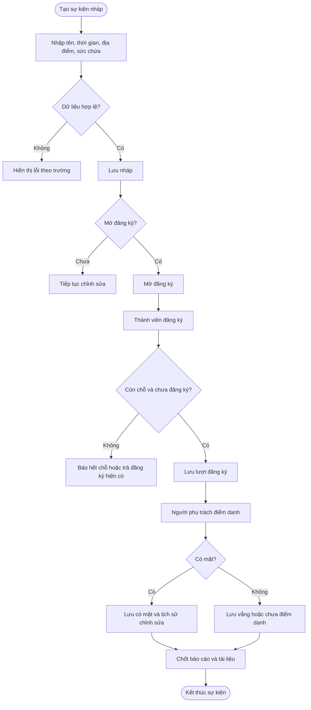
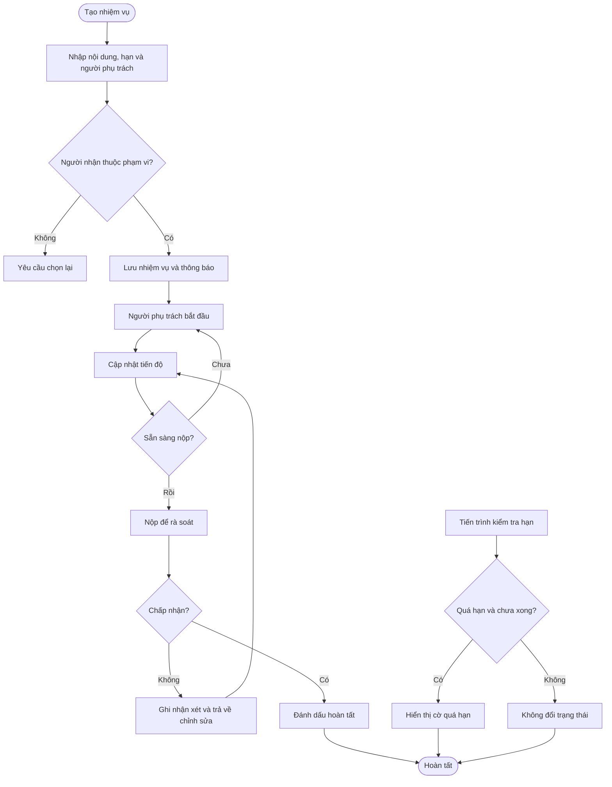
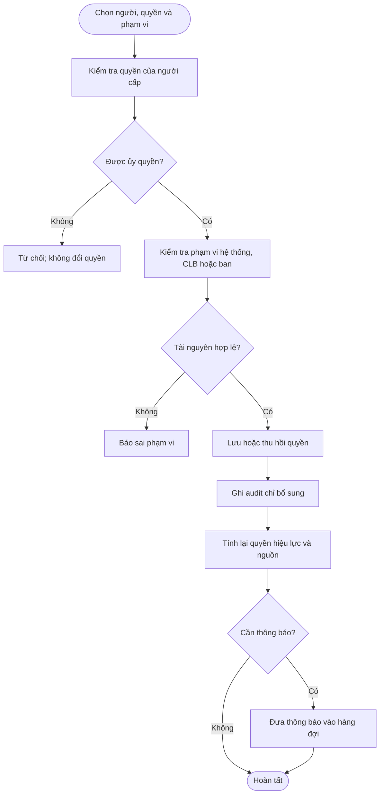

# Tài liệu đặc tả hệ thống quản lý Câu lạc bộ VJU
**Phiên bản 2.0 · Tài liệu phân tích và đặc tả yêu cầu · Ngày 22/10/2026**
> Tài liệu mô tả hệ thống quản lý CLB VJU theo hướng người đọc có thể lần theo từ vai trò, quy trình đến từng chức năng. Nội dung được viết từ README dự án và tài liệu đề tài; phần chưa có bằng chứng triển khai được đánh dấu để phân biệt với chức năng hiện hữu.
**Quy ước:** “Baseline README” là chức năng được README mô tả; “Đề xuất cho đề tài” là phần mở rộng chưa khẳng định đã có trong mã nguồn; “Cần xác nhận” là điểm nguồn chưa thống nhất.
## Nội dung
1. Giới thiệu tổng quan
2. Mô hình phân quyền
3. Tổng quan quy trình nghiệp vụ
4. Đặc tả chi tiết chức năng
5. Yêu cầu phi chức năng
## 1. Giới thiệu tổng quan
### 1.1 Mục đích tài liệu
Tài liệu thống nhất cách hiểu về hệ thống quản lý CLB VJU cho sinh viên, giảng viên, người phân tích, thiết kế, lập trình và kiểm thử. Mỗi yêu cầu chức năng có mã riêng, tác nhân, điều kiện trước khi bắt đầu, các bước xử lý, nhánh thay thế, tình huống lỗi, kết quả và quy tắc nghiệp vụ. Nhóm có thể dùng cùng một mô tả để xây giao diện, API, cơ sở dữ liệu và trường hợp kiểm thử.
Các sơ đồ Mermaid có thể đưa vào GitHub README để hiển thị. Sơ đồ giải thích luồng nghiệp vụ ở mức dễ đọc, không thay thế đặc tả API chi tiết.
### 1.2 Phạm vi hệ thống
Hệ thống hỗ trợ quản lý tài khoản, câu lạc bộ, ban chuyên môn, thành viên, đơn xin gia nhập, quyền truy cập, vai trò, thông báo và nhật ký hoạt động. Phần mở rộng đề tài gồm lập sự kiện, đăng ký tham gia, điểm danh, giao nhiệm vụ, theo dõi tiến độ và lưu tài liệu gắn với hoạt động. Các phần này là yêu cầu cần xác nhận/triển khai, không mặc định đang chạy.
Hệ thống phục vụ quy trình nội bộ CLB; không thay thế hệ thống đào tạo, quản lý điểm, kế toán, thanh toán hay nền tảng dùng chung của trường. README nói tài khoản do quản trị viên tạo, không có tự đăng ký. Nếu cho người chưa có tài khoản nộp đơn, cần thống nhất quy trình xác thực riêng.
### 1.3 Công nghệ sử dụng
| Thành phần | Công nghệ trong README | Vai trò |
|---|---|---|
| Giao diện web | Next.js 16, React 19, TypeScript | Hiển thị màn hình và gửi yêu cầu. |
| Máy chủ | Java 21, Spring Boot 4.1.1 | Kiểm tra nghiệp vụ và quyền. |
| Cơ sở dữ liệu | PostgreSQL 16 | Lưu tài khoản, CLB, quan hệ và lịch sử. |
| Quản lý cấu trúc dữ liệu | Flyway | Áp dụng thay đổi dữ liệu theo phiên bản. |
| Hợp đồng API | OpenAPI 3.1 | Mô tả cách giao diện trao đổi dữ liệu. |
| Kiểm thử | JUnit, Mockito, MockMvc, Testcontainers, Python unittest | Kiểm tra xử lý, API và công cụ đi kèm. |
| Đóng gói/tự động hóa | Docker, CI | Chạy nhất quán và kiểm tra khi thay đổi mã. |
Cần đối chiếu phiên bản với cấu hình thật trước khi phát hành. Tài liệu nguồn nhắc đồng thời JWT access/refresh và cookie session có CSRF. Nhóm cần chốt một hợp đồng xác thực duy nhất: loại phiên, vòng đời, thu hồi, bảo vệ yêu cầu và hành vi khi đổi mật khẩu.
### 1.4 Từ điển thuật ngữ
| Thuật ngữ | Giải thích dễ hiểu |
|---|---|
| Actor / tác nhân | Người hoặc thành phần tự động thực hiện bước nghiệp vụ. |
| API | Cổng để giao diện gửi yêu cầu đến máy chủ. |
| Audit log | Dấu vết ai đã làm gì, khi nào và trên dữ liệu nào. |
| Ban chuyên môn | Nhóm nhỏ thuộc CLB, ví dụ ban truyền thông. |
| CSRF | Kiểu tấn công lợi dụng trình duyệt đăng nhập; token giúp nhận diện yêu cầu hợp lệ. |
| Đơn gia nhập | Yêu cầu tham gia CLB. |
| Membership | Bản ghi thể hiện một người đang hoặc từng là thành viên. |
| Permission / quyền | Cho phép một hành động cụ thể. |
| Role / vai trò | Bộ quyền gắn với nhóm trách nhiệm. |
| Scope / phạm vi | Nơi quyền có hiệu lực: hệ thống, CLB hoặc ban. |
| Direct permission | Quyền cấp trực tiếp cho tài khoản. |
| Effective permission | Tổng quyền từ quyền trực tiếp và vai trò. |
| Transaction / giao dịch | Nhóm thay đổi được lưu cùng nhau hoặc cùng hủy. |
| DTO | Dữ liệu đã chọn lọc để trả về giao diện. |
| CI | Quy trình tự động kiểm tra mã nguồn khi có thay đổi. |
| OpenAPI | Định dạng mô tả đường dẫn và dữ liệu API. |
| PENDING | Đang chờ xử lý. |
| Active / inactive | Đang hoạt động / tạm ngưng. |
## 2. Mô hình phân quyền
### 2.1 Các vai trò trong hệ thống
README nêu năm vai trò kỹ thuật. Người nộp đơn là tác nhân nghiệp vụ, chưa được xác định là role riêng. Quyền thực tế còn phụ thuộc quyền cụ thể và phạm vi tài nguyên.
| Vai trò | Mô tả | Phạm vi thường dùng |
|---|---|---|
| SYSTEM_ADMIN | Quản trị tài khoản, quyền, vai trò và dữ liệu chung. | Toàn hệ thống. |
| CLUB_PRESIDENT | Quản lý hoạt động và thành viên CLB được giao. | Một CLB. |
| CLUB_VICE_PRESIDENT | Hỗ trợ chủ nhiệm theo quyền được cấp. | Một CLB. |
| DEPARTMENT_HEAD | Quản lý công việc và thành viên của ban. | Một ban trong CLB cha. |
| CLUB_MEMBER | Xem thông tin và tham gia hoạt động được cho phép. | CLB đang tham gia. |
| Người nộp đơn | Gửi, xem hoặc hủy đơn của chính mình theo trạng thái. | Đơn của bản thân. |
### 2.2 Nguyên tắc kiểm tra quyền
Quyền được kiểm tra tại máy chủ mỗi lần đọc hoặc ghi. GLOBAL áp dụng toàn hệ thống; CLUB áp dụng trong một CLB; DEPARTMENT áp dụng trong một ban. Quyền ở ban không cho thao tác trên CLB khác. Quyền trực tiếp và quyền từ vai trò cần giải thích được nguồn. Vai trò mặc định của hệ thống không được sửa như vai trò tùy chỉnh. Khóa tài khoản ngăn truy cập tiếp theo. Khi rời CLB, quan hệ ban thuộc CLB đó cũng kết thúc. Nhật ký không lưu mật khẩu, token hay bí mật cấu hình.
### 2.3 Ma trận quyền chức năng
Ký hiệu: ✓ được sử dụng trong phạm vi được giao; △ giới hạn theo sở hữu/phạm vi hoặc cần quyền riêng; — không mặc định được dùng. Ma trận là mặc định nghiệp vụ; máy chủ là nơi quyết định cuối cùng.
| Nhóm chức năng | SYSTEM_ADMIN | CLUB_PRESIDENT | CLUB_VICE_PRESIDENT | DEPARTMENT_HEAD | CLUB_MEMBER | Người nộp đơn |
|---|---:|---:|---:|---:|---:|---:|
| Đăng nhập/đăng xuất/đổi mật khẩu | ✓ | ✓ | ✓ | ✓ | ✓ | △ |
| Hồ sơ cá nhân | ✓ | ✓ | ✓ | ✓ | ✓ | △ |
| Tạo/khóa tài khoản | ✓ | — | — | — | — | — |
| Quản lý câu lạc bộ | ✓ | △ | — | — | — | — |
| Xem thông tin CLB | ✓ | ✓ | ✓ | ✓ | ✓ | △ |
| Quản lý ban | ✓ | ✓ | △ | △ | — | — |
| Xem thành viên | ✓ | ✓ | △ | △ | △ | — |
| Thêm/sửa/gỡ thành viên | ✓ | ✓ | △ | △ | — | — |
| Gửi/xem/hủy đơn của mình | △ | △ | △ | △ | △ | ✓ |
| Xem/xử lý đơn trong CLB | ✓ | ✓ | △ | — | — | — |
| Cấp quyền và vai trò | ✓ | △ | △ | — | — | — |
| Thông báo cá nhân | ✓ | ✓ | ✓ | ✓ | ✓ | △ |
| Tra cứu audit | ✓ | — | — | — | — | — |
| Quản lý sự kiện | ✓ | ✓ | △ | △ | — | — |
| Đăng ký sự kiện | ✓ | △ | △ | △ | ✓ | △ |
| Điểm danh/chốt báo cáo | ✓ | ✓ | △ | △ | — | — |
| Giao/review nhiệm vụ | ✓ | ✓ | △ | △ | — | — |
| Cập nhật việc được giao | ✓ | △ | △ | △ | △ | — |
| Tải tài liệu hoạt động | ✓ | ✓ | △ | △ | △ | — |
| Vận hành/backup | ✓ | — | — | — | — | — |
Sự kiện, nhiệm vụ và tệp là phần mở rộng. Dấu quyền trong các hàng này là đề xuất để thảo luận; cần chốt permission cụ thể trước khi triển khai.
## 3. Tổng quan quy trình nghiệp vụ
### 3.1 Danh mục sơ đồ
- Sơ đồ 1 — Vòng đời từ tài khoản đến hoạt động CLB
- Sơ đồ 2 — Đăng nhập, kiểm tra quyền và kết thúc phiên
- Sơ đồ 3 — Gửi đơn gia nhập và xét duyệt thành viên
- Sơ đồ 4 — Quản lý membership và phân công vào ban
- Sơ đồ 5 — Lập sự kiện, đăng ký và điểm danh
- Sơ đồ 6 — Giao nhiệm vụ, nộp kết quả và rà soát
- Sơ đồ 7 — Cấp quyền, audit và thông báo
### Sơ đồ 1 — Vòng đời từ tài khoản đến hoạt động CLB

### Sơ đồ 2 — Đăng nhập, kiểm tra quyền và kết thúc phiên

### Sơ đồ 3 — Gửi đơn gia nhập và xét duyệt thành viên

### Sơ đồ 4 — Quản lý membership và phân công vào ban

### Sơ đồ 5 — Lập sự kiện, đăng ký và điểm danh

### Sơ đồ 6 — Giao nhiệm vụ, nộp kết quả và rà soát

### Sơ đồ 7 — Cấp quyền, audit và thông báo

## 4. Đặc tả chi tiết chức năng
### 4.1 Danh mục nhóm chức năng và dải mã
| Mã nhóm | Nhóm chức năng | Dải mã | Số lượng | Nguồn |
|---|---|---|---:|---|
| AUTH | Xác thực và phiên truy cập | AUTH-01 đến AUTH-06 | 6 | Baseline README; riêng cơ chế phiên/JWT đang có mô tả chưa thống nhất. |
| USER | Tài khoản và hồ sơ | USER-01 đến USER-07 | 7 | Baseline README. |
| CLUB | Câu lạc bộ | CLUB-01 đến CLUB-05 | 5 | Baseline README. |
| DEPT | Ban chuyên môn và thành viên ban | DEPT-01 đến DEPT-09 | 9 | Baseline README. |
| MEM | Membership và lịch sử thành viên | MEM-01 đến MEM-06 | 6 | Baseline README. |
| APP | Đơn gia nhập câu lạc bộ | APP-01 đến APP-07 | 7 | Baseline README. |
| RBAC | Vai trò, quyền và ủy quyền | RBAC-01 đến RBAC-18 | 18 | Baseline README. |
| NOTI | Thông báo | NOTI-01 đến NOTI-04 | 4 | Baseline một phần; trigger cần xác nhận. |
| AUDIT | Nhật ký hoạt động | AUDIT-01 đến AUDIT-03 | 3 | Baseline README. |
| EVENT | Sự kiện và điểm danh | EVENT-01 đến EVENT-11 | 11 | Đề xuất cho phạm vi đề tài; chưa xác nhận đã triển khai. |
| TASK | Nhiệm vụ và tiến độ | TASK-01 đến TASK-08 | 8 | Đề xuất cho phạm vi đề tài; chưa xác nhận đã triển khai. |
| FILE | Tài liệu hoạt động | FILE-01 đến FILE-03 | 3 | Đề xuất cho phạm vi đề tài; cần chốt nơi lưu và chính sách truy cập. |
| OPS | Vận hành và tích hợp | OPS-01 đến OPS-08 | 8 | Một phần baseline README, một phần cần xác nhận. |
| **Tổng** | **13 nhóm chức năng** | **AUTH-01 đến OPS-08** | **95** | **Baseline và đề xuất** |
### 4.2 Cách đọc đặc tả
Mỗi mã đại diện cho một hành vi có thể kiểm thử. Luồng chính là con đường thường gặp; luồng thay thế mô tả trường hợp hợp lệ khác; luồng ngoại lệ nêu khi hệ thống phải từ chối hoặc chưa thể hoàn tất. Chức năng đề xuất cần được xác nhận trước khi xem là cam kết sản phẩm.
### 4.3 Xác thực và phiên truy cập
**Dải mã:** AUTH-01 đến AUTH-06. **Nguồn:** Baseline README; riêng cơ chế phiên/JWT đang có mô tả chưa thống nhất.
#### AUTH-01 — Lấy CSRF token
**Trạng thái:** README baseline.  
**Mã chức năng:** AUTH-01  
**Tác nhân (actor):** Ứng dụng web chưa đăng nhập.  
**Mô tả chức năng:** Hỗ trợ đăng nhập và phiên người dùng. Người dùng thực hiện “Lấy CSRF token” để xử lý tài khoản, thông tin xác thực và trạng thái phiên. Hệ thống chỉ hoàn tất khi quyền, phạm vi và quy tắc phù hợp.
**Tiền điều kiện:** Frontend cần token trước request thay đổi trạng thái nếu contract cookie/CSRF đang bật. Tài nguyên liên quan còn tồn tại và người thao tác truy cập được chức năng theo chính sách.
**Luồng chính:**
1. Tác nhân ứng dụng web chưa đăng nhập. mở đúng màn hình hoặc gửi yêu cầu “Lấy CSRF token”.
2. Máy chủ nhận diện người dùng từ phiên đã xác thực, kiểm tra quyền “`Endpoint công khai có giới hạn`. **Tiền điều kiện:** Frontend cần token trước request thay đổi trạng thái nếu contract cookie/CSRF đang bật.” và xác định tài nguyên trong phạm vi.
3. Hệ thống kiểm tra tiền điều kiện: Frontend cần token trước request thay đổi trạng thái nếu contract cookie/CSRF đang bật.
4. Hệ thống kiểm tra dữ liệu bắt buộc, định dạng, giới hạn và quy tắc của tài khoản, thông tin xác thực và trạng thái phiên.
5. Nếu hợp lệ, hệ thống thực hiện thao tác trong giao dịch phù hợp; các thay đổi liên quan được lưu cùng nhau.
6. Hệ thống ghi nhận người thực hiện và thời điểm nếu có thay đổi, rồi trả kết quả dễ hiểu. Dữ liệu chuyển sang trạng thái hợp lệ; thay đổi quan trọng có thể tra cứu lại.
**Luồng thay thế:**
1. Trường tùy chọn bị bỏ trống: áp dụng giá trị mặc định đã công bố hoặc giữ nguyên dữ liệu cũ.
2. Tài nguyên vừa được cập nhật bởi yêu cầu khác: yêu cầu tải lại và không ghi đè âm thầm.
**Luồng ngoại lệ:**
1. Chưa đăng nhập: yêu cầu đăng nhập và không thay đổi dữ liệu.
2. Không đủ quyền hoặc tài nguyên ngoài phạm vi: từ chối và không tiết lộ dữ liệu riêng tư.
3. Dữ liệu sai, bản ghi trùng hoặc trạng thái không còn phù hợp: nêu lý do cần sửa; không lưu một phần.
4. Lỗi kết nối hoặc lưu trữ: trả mã tham chiếu; giao dịch được hoàn tác nếu chưa hoàn tất.
**Hậu điều kiện:** Dữ liệu chuyển sang trạng thái hợp lệ; thay đổi quan trọng có thể tra cứu lại. Nếu chỉ đọc, dữ liệu không đổi; nếu ghi, người dùng thấy kết quả khi tải lại trang.
**Business rules:** (quy tắc nghiệp vụ)
- chỉ cấp hoặc duy trì phiên cho tài khoản hợp lệ; không để lộ việc tài khoản có tồn tại qua thông báo lỗi
- Mọi kiểm tra quyền diễn ra ở máy chủ; ẩn nút trên giao diện không thay thế kiểm soát truy cập.
- Định danh duy nhất được so sánh không phân biệt hoa/thường khi quy tắc dữ liệu yêu cầu.
- Thay đổi trạng thái phải có người thực hiện, thời điểm và lý do nếu nghiệp vụ cần.
- Nhiều bảng phụ thuộc phải cùng thành công hoặc cùng thất bại; không để dữ liệu dở dang.

#### AUTH-02 — Đăng nhập
**Trạng thái:** README baseline.  
**Mã chức năng:** AUTH-02  
**Tác nhân (actor):** Người dùng có tài khoản do quản trị viên cấp.  
**Mô tả chức năng:** Hỗ trợ đăng nhập và phiên người dùng. Người dùng thực hiện “Đăng nhập” để xử lý tài khoản, thông tin xác thực và trạng thái phiên. Hệ thống chỉ hoàn tất khi quyền, phạm vi và quy tắc phù hợp.
**Tiền điều kiện:** Tài khoản tồn tại, active; credential chính xác; rate limit còn hạn mức. Tài nguyên liên quan còn tồn tại và người thao tác truy cập được chức năng theo chính sách.
**Luồng chính:**
1. Tác nhân người dùng có tài khoản do quản trị viên cấp. mở đúng màn hình hoặc gửi yêu cầu “Đăng nhập”.
2. Máy chủ nhận diện người dùng từ phiên đã xác thực, kiểm tra quyền “`Không cần quyền nghiệp vụ`. **Tiền điều kiện:** Tài khoản tồn tại, active; credential chính xác; rate limit còn hạn mức.” và xác định tài nguyên trong phạm vi.
3. Hệ thống kiểm tra tiền điều kiện: Tài khoản tồn tại, active; credential chính xác; rate limit còn hạn mức.
4. Hệ thống kiểm tra dữ liệu bắt buộc, định dạng, giới hạn và quy tắc của tài khoản, thông tin xác thực và trạng thái phiên.
5. Nếu hợp lệ, hệ thống thực hiện thao tác trong giao dịch phù hợp; các thay đổi liên quan được lưu cùng nhau.
6. Hệ thống ghi nhận người thực hiện và thời điểm nếu có thay đổi, rồi trả kết quả dễ hiểu. Dữ liệu chuyển sang trạng thái hợp lệ; thay đổi quan trọng có thể tra cứu lại.
**Luồng thay thế:**
1. Trường tùy chọn bị bỏ trống: áp dụng giá trị mặc định đã công bố hoặc giữ nguyên dữ liệu cũ.
2. Tài nguyên vừa được cập nhật bởi yêu cầu khác: yêu cầu tải lại và không ghi đè âm thầm.
**Luồng ngoại lệ:**
1. Chưa đăng nhập: yêu cầu đăng nhập và không thay đổi dữ liệu.
2. Không đủ quyền hoặc tài nguyên ngoài phạm vi: từ chối và không tiết lộ dữ liệu riêng tư.
3. Dữ liệu sai, bản ghi trùng hoặc trạng thái không còn phù hợp: nêu lý do cần sửa; không lưu một phần.
4. Lỗi kết nối hoặc lưu trữ: trả mã tham chiếu; giao dịch được hoàn tác nếu chưa hoàn tất.
**Hậu điều kiện:** Dữ liệu chuyển sang trạng thái hợp lệ; thay đổi quan trọng có thể tra cứu lại. Nếu chỉ đọc, dữ liệu không đổi; nếu ghi, người dùng thấy kết quả khi tải lại trang.
**Business rules:** (quy tắc nghiệp vụ)
- chỉ cấp hoặc duy trì phiên cho tài khoản hợp lệ; không để lộ việc tài khoản có tồn tại qua thông báo lỗi
- Mọi kiểm tra quyền diễn ra ở máy chủ; ẩn nút trên giao diện không thay thế kiểm soát truy cập.
- Định danh duy nhất được so sánh không phân biệt hoa/thường khi quy tắc dữ liệu yêu cầu.
- Thay đổi trạng thái phải có người thực hiện, thời điểm và lý do nếu nghiệp vụ cần.
- Nhiều bảng phụ thuộc phải cùng thành công hoặc cùng thất bại; không để dữ liệu dở dang.

#### AUTH-03 — Đăng xuất và thu hồi phiên
**Trạng thái:** README baseline.  
**Mã chức năng:** AUTH-03  
**Tác nhân (actor):** Người dùng đang đăng nhập.  
**Mô tả chức năng:** Hỗ trợ đăng nhập và phiên người dùng. Người dùng thực hiện “Đăng xuất và thu hồi phiên” để xử lý tài khoản, thông tin xác thực và trạng thái phiên. Hệ thống chỉ hoàn tất khi quyền, phạm vi và quy tắc phù hợp.
**Tiền điều kiện:** Client gửi logout với credential/CSRF đúng. Tài nguyên liên quan còn tồn tại và người thao tác truy cập được chức năng theo chính sách.
**Luồng chính:**
1. Tác nhân người dùng đang đăng nhập. mở đúng màn hình hoặc gửi yêu cầu “Đăng xuất và thu hồi phiên”.
2. Máy chủ nhận diện người dùng từ phiên đã xác thực, kiểm tra quyền “`Phiên hiện tại`. **Tiền điều kiện:** Client gửi logout với credential/CSRF đúng.” và xác định tài nguyên trong phạm vi.
3. Hệ thống kiểm tra tiền điều kiện: Client gửi logout với credential/CSRF đúng.
4. Hệ thống kiểm tra dữ liệu bắt buộc, định dạng, giới hạn và quy tắc của tài khoản, thông tin xác thực và trạng thái phiên.
5. Nếu hợp lệ, hệ thống thực hiện thao tác trong giao dịch phù hợp; các thay đổi liên quan được lưu cùng nhau.
6. Hệ thống ghi nhận người thực hiện và thời điểm nếu có thay đổi, rồi trả kết quả dễ hiểu. Thao tác kết thúc hoặc thu hồi quan hệ theo quy tắc; lịch sử cần lưu vẫn được bảo toàn.
**Luồng thay thế:**
1. Trường tùy chọn bị bỏ trống: áp dụng giá trị mặc định đã công bố hoặc giữ nguyên dữ liệu cũ.
2. Tài nguyên vừa được cập nhật bởi yêu cầu khác: yêu cầu tải lại và không ghi đè âm thầm.
**Luồng ngoại lệ:**
1. Chưa đăng nhập: yêu cầu đăng nhập và không thay đổi dữ liệu.
2. Không đủ quyền hoặc tài nguyên ngoài phạm vi: từ chối và không tiết lộ dữ liệu riêng tư.
3. Dữ liệu sai, bản ghi trùng hoặc trạng thái không còn phù hợp: nêu lý do cần sửa; không lưu một phần.
4. Lỗi kết nối hoặc lưu trữ: trả mã tham chiếu; giao dịch được hoàn tác nếu chưa hoàn tất.
**Hậu điều kiện:** Thao tác kết thúc hoặc thu hồi quan hệ theo quy tắc; lịch sử cần lưu vẫn được bảo toàn. Nếu chỉ đọc, dữ liệu không đổi; nếu ghi, người dùng thấy kết quả khi tải lại trang.
**Business rules:** (quy tắc nghiệp vụ)
- chỉ cấp hoặc duy trì phiên cho tài khoản hợp lệ; không để lộ việc tài khoản có tồn tại qua thông báo lỗi
- Mọi kiểm tra quyền diễn ra ở máy chủ; ẩn nút trên giao diện không thay thế kiểm soát truy cập.
- Định danh duy nhất được so sánh không phân biệt hoa/thường khi quy tắc dữ liệu yêu cầu.
- Thay đổi trạng thái phải có người thực hiện, thời điểm và lý do nếu nghiệp vụ cần.
- Nhiều bảng phụ thuộc phải cùng thành công hoặc cùng thất bại; không để dữ liệu dở dang.

#### AUTH-04 — Đổi mật khẩu
**Trạng thái:** README baseline.  
**Mã chức năng:** AUTH-04  
**Tác nhân (actor):** Người dùng đang đăng nhập và biết mật khẩu hiện tại.  
**Mô tả chức năng:** Hỗ trợ đăng nhập và phiên người dùng. Người dùng thực hiện “Đổi mật khẩu” để xử lý tài khoản, thông tin xác thực và trạng thái phiên. Hệ thống chỉ hoàn tất khi quyền, phạm vi và quy tắc phù hợp.
**Tiền điều kiện:** Mật khẩu hiện tại đúng; mật khẩu mới đạt policy. Tài nguyên liên quan còn tồn tại và người thao tác truy cập được chức năng theo chính sách.
**Luồng chính:**
1. Tác nhân người dùng đang đăng nhập và biết mật khẩu hiện tại. mở đúng màn hình hoặc gửi yêu cầu “Đổi mật khẩu”.
2. Máy chủ nhận diện người dùng từ phiên đã xác thực, kiểm tra quyền “`Tự quản lý credential`. **Tiền điều kiện:** Mật khẩu hiện tại đúng; mật khẩu mới đạt policy.” và xác định tài nguyên trong phạm vi.
3. Hệ thống kiểm tra tiền điều kiện: Mật khẩu hiện tại đúng; mật khẩu mới đạt policy.
4. Hệ thống kiểm tra dữ liệu bắt buộc, định dạng, giới hạn và quy tắc của tài khoản, thông tin xác thực và trạng thái phiên.
5. Nếu hợp lệ, hệ thống thực hiện thao tác trong giao dịch phù hợp; các thay đổi liên quan được lưu cùng nhau.
6. Hệ thống ghi nhận người thực hiện và thời điểm nếu có thay đổi, rồi trả kết quả dễ hiểu. Dữ liệu chuyển sang trạng thái hợp lệ; thay đổi quan trọng có thể tra cứu lại.
**Luồng thay thế:**
1. Trường tùy chọn bị bỏ trống: áp dụng giá trị mặc định đã công bố hoặc giữ nguyên dữ liệu cũ.
2. Tài nguyên vừa được cập nhật bởi yêu cầu khác: yêu cầu tải lại và không ghi đè âm thầm.
**Luồng ngoại lệ:**
1. Chưa đăng nhập: yêu cầu đăng nhập và không thay đổi dữ liệu.
2. Không đủ quyền hoặc tài nguyên ngoài phạm vi: từ chối và không tiết lộ dữ liệu riêng tư.
3. Dữ liệu sai, bản ghi trùng hoặc trạng thái không còn phù hợp: nêu lý do cần sửa; không lưu một phần.
4. Lỗi kết nối hoặc lưu trữ: trả mã tham chiếu; giao dịch được hoàn tác nếu chưa hoàn tất.
**Hậu điều kiện:** Dữ liệu chuyển sang trạng thái hợp lệ; thay đổi quan trọng có thể tra cứu lại. Nếu chỉ đọc, dữ liệu không đổi; nếu ghi, người dùng thấy kết quả khi tải lại trang.
**Business rules:** (quy tắc nghiệp vụ)
- chỉ cấp hoặc duy trì phiên cho tài khoản hợp lệ; không để lộ việc tài khoản có tồn tại qua thông báo lỗi
- Mọi kiểm tra quyền diễn ra ở máy chủ; ẩn nút trên giao diện không thay thế kiểm soát truy cập.
- Định danh duy nhất được so sánh không phân biệt hoa/thường khi quy tắc dữ liệu yêu cầu.
- Thay đổi trạng thái phải có người thực hiện, thời điểm và lý do nếu nghiệp vụ cần.
- Nhiều bảng phụ thuộc phải cùng thành công hoặc cùng thất bại; không để dữ liệu dở dang.

#### AUTH-05 — Refresh hoặc xác thực lại phiên
**Trạng thái:** README baseline.  
**Mã chức năng:** AUTH-05  
**Tác nhân (actor):** Ứng dụng web và người dùng có phiên cần làm mới.  
**Mô tả chức năng:** Hỗ trợ đăng nhập và phiên người dùng. Người dùng thực hiện “Refresh hoặc xác thực lại phiên” để xử lý tài khoản, thông tin xác thực và trạng thái phiên. Hệ thống chỉ hoàn tất khi quyền, phạm vi và quy tắc phù hợp.
**Tiền điều kiện:** Credential chưa hết hạn/thu hồi và tài khoản vẫn active. Tài nguyên liên quan còn tồn tại và người thao tác truy cập được chức năng theo chính sách.
**Luồng chính:**
1. Tác nhân ứng dụng web và người dùng có phiên cần làm mới. mở đúng màn hình hoặc gửi yêu cầu “Refresh hoặc xác thực lại phiên”.
2. Máy chủ nhận diện người dùng từ phiên đã xác thực, kiểm tra quyền “`Refresh route theo contract`. **Tiền điều kiện:** Credential chưa hết hạn/thu hồi và tài khoản vẫn active.” và xác định tài nguyên trong phạm vi.
3. Hệ thống kiểm tra tiền điều kiện: Credential chưa hết hạn/thu hồi và tài khoản vẫn active.
4. Hệ thống kiểm tra dữ liệu bắt buộc, định dạng, giới hạn và quy tắc của tài khoản, thông tin xác thực và trạng thái phiên.
5. Nếu hợp lệ, hệ thống thực hiện thao tác trong giao dịch phù hợp; các thay đổi liên quan được lưu cùng nhau.
6. Hệ thống ghi nhận người thực hiện và thời điểm nếu có thay đổi, rồi trả kết quả dễ hiểu. Dữ liệu chuyển sang trạng thái hợp lệ; thay đổi quan trọng có thể tra cứu lại.
**Luồng thay thế:**
1. Trường tùy chọn bị bỏ trống: áp dụng giá trị mặc định đã công bố hoặc giữ nguyên dữ liệu cũ.
2. Tài nguyên vừa được cập nhật bởi yêu cầu khác: yêu cầu tải lại và không ghi đè âm thầm.
**Luồng ngoại lệ:**
1. Chưa đăng nhập: yêu cầu đăng nhập và không thay đổi dữ liệu.
2. Không đủ quyền hoặc tài nguyên ngoài phạm vi: từ chối và không tiết lộ dữ liệu riêng tư.
3. Dữ liệu sai, bản ghi trùng hoặc trạng thái không còn phù hợp: nêu lý do cần sửa; không lưu một phần.
4. Lỗi kết nối hoặc lưu trữ: trả mã tham chiếu; giao dịch được hoàn tác nếu chưa hoàn tất.
**Hậu điều kiện:** Dữ liệu chuyển sang trạng thái hợp lệ; thay đổi quan trọng có thể tra cứu lại. Nếu chỉ đọc, dữ liệu không đổi; nếu ghi, người dùng thấy kết quả khi tải lại trang.
**Business rules:** (quy tắc nghiệp vụ)
- chỉ cấp hoặc duy trì phiên cho tài khoản hợp lệ; không để lộ việc tài khoản có tồn tại qua thông báo lỗi
- Mọi kiểm tra quyền diễn ra ở máy chủ; ẩn nút trên giao diện không thay thế kiểm soát truy cập.
- Định danh duy nhất được so sánh không phân biệt hoa/thường khi quy tắc dữ liệu yêu cầu.
- Thay đổi trạng thái phải có người thực hiện, thời điểm và lý do nếu nghiệp vụ cần.
- Nhiều bảng phụ thuộc phải cùng thành công hoặc cùng thất bại; không để dữ liệu dở dang.

#### AUTH-06 — Áp dụng rate limit cho endpoint xác thực
**Trạng thái:** README baseline.  
**Mã chức năng:** AUTH-06  
**Tác nhân (actor):** Dịch vụ xác thực và người gửi yêu cầu.  
**Mô tả chức năng:** Hỗ trợ đăng nhập và phiên người dùng. Người dùng thực hiện “Áp dụng rate limit cho endpoint xác thực” để xử lý tài khoản, thông tin xác thực và trạng thái phiên. Hệ thống chỉ hoàn tất khi quyền, phạm vi và quy tắc phù hợp.
**Tiền điều kiện:** Rate limit bật cho login/register/refresh; nhận diện IP qua trusted proxy. Tài nguyên liên quan còn tồn tại và người thao tác truy cập được chức năng theo chính sách.
**Luồng chính:**
1. Tác nhân dịch vụ xác thực và người gửi yêu cầu. mở đúng màn hình hoặc gửi yêu cầu “Áp dụng rate limit cho endpoint xác thực”.
2. Máy chủ nhận diện người dùng từ phiên đã xác thực, kiểm tra quyền “`Rate limiter cấu hình`. **Tiền điều kiện:** Rate limit bật cho login/register/refresh; nhận diện IP qua trusted proxy.” và xác định tài nguyên trong phạm vi.
3. Hệ thống kiểm tra tiền điều kiện: Rate limit bật cho login/register/refresh; nhận diện IP qua trusted proxy.
4. Hệ thống kiểm tra dữ liệu bắt buộc, định dạng, giới hạn và quy tắc của tài khoản, thông tin xác thực và trạng thái phiên.
5. Nếu hợp lệ, hệ thống thực hiện thao tác trong giao dịch phù hợp; các thay đổi liên quan được lưu cùng nhau.
6. Hệ thống ghi nhận người thực hiện và thời điểm nếu có thay đổi, rồi trả kết quả dễ hiểu. Dữ liệu chuyển sang trạng thái hợp lệ; thay đổi quan trọng có thể tra cứu lại.
**Luồng thay thế:**
1. Trường tùy chọn bị bỏ trống: áp dụng giá trị mặc định đã công bố hoặc giữ nguyên dữ liệu cũ.
2. Tài nguyên vừa được cập nhật bởi yêu cầu khác: yêu cầu tải lại và không ghi đè âm thầm.
**Luồng ngoại lệ:**
1. Chưa đăng nhập: yêu cầu đăng nhập và không thay đổi dữ liệu.
2. Không đủ quyền hoặc tài nguyên ngoài phạm vi: từ chối và không tiết lộ dữ liệu riêng tư.
3. Dữ liệu sai, bản ghi trùng hoặc trạng thái không còn phù hợp: nêu lý do cần sửa; không lưu một phần.
4. Lỗi kết nối hoặc lưu trữ: trả mã tham chiếu; giao dịch được hoàn tác nếu chưa hoàn tất.
**Hậu điều kiện:** Dữ liệu chuyển sang trạng thái hợp lệ; thay đổi quan trọng có thể tra cứu lại. Nếu chỉ đọc, dữ liệu không đổi; nếu ghi, người dùng thấy kết quả khi tải lại trang.
**Business rules:** (quy tắc nghiệp vụ)
- chỉ cấp hoặc duy trì phiên cho tài khoản hợp lệ; không để lộ việc tài khoản có tồn tại qua thông báo lỗi
- Mọi kiểm tra quyền diễn ra ở máy chủ; ẩn nút trên giao diện không thay thế kiểm soát truy cập.
- Định danh duy nhất được so sánh không phân biệt hoa/thường khi quy tắc dữ liệu yêu cầu.
- Thay đổi trạng thái phải có người thực hiện, thời điểm và lý do nếu nghiệp vụ cần.
- Nhiều bảng phụ thuộc phải cùng thành công hoặc cùng thất bại; không để dữ liệu dở dang.

### 4.4 Tài khoản và hồ sơ
**Dải mã:** USER-01 đến USER-07. **Nguồn:** Baseline README.
#### USER-01 — Xem hồ sơ của tôi
**Trạng thái:** README baseline.  
**Mã chức năng:** USER-01  
**Tác nhân (actor):** User đã xác thực. **Permission/scope:** `Chủ sở hữu hồ sơ`. **Tiền điều kiện:** Principal hợp lệ.  
**Mô tả chức năng:** Hỗ trợ quản lý tài khoản và hồ sơ. Người dùng thực hiện “Xem hồ sơ của tôi” để xử lý hồ sơ người dùng, trạng thái tài khoản và thông tin định danh. Hệ thống chỉ hoàn tất khi quyền, phạm vi và quy tắc phù hợp.
**Tiền điều kiện:** Principal hợp lệ. Tài nguyên liên quan còn tồn tại và người thao tác truy cập được chức năng theo chính sách.
**Luồng chính:**
1. Tác nhân user đã xác thực. **permission/scope:** `chủ sở hữu hồ sơ`. **tiền điều kiện:** principal hợp lệ. mở đúng màn hình hoặc gửi yêu cầu “Xem hồ sơ của tôi”.
2. Máy chủ nhận diện người dùng từ phiên đã xác thực, kiểm tra quyền “`Chủ sở hữu hồ sơ`. **Tiền điều kiện:** Principal hợp lệ.” và xác định tài nguyên trong phạm vi.
3. Hệ thống kiểm tra tiền điều kiện: Principal hợp lệ.
4. Hệ thống kiểm tra dữ liệu bắt buộc, định dạng, giới hạn và quy tắc của hồ sơ người dùng, trạng thái tài khoản và thông tin định danh.
5. Nếu hợp lệ, hệ thống thực hiện thao tác trong giao dịch phù hợp; các thay đổi liên quan được lưu cùng nhau.
6. Hệ thống ghi nhận người thực hiện và thời điểm nếu có thay đổi, rồi trả kết quả dễ hiểu. Kết quả phù hợp được trả theo đúng phạm vi; dữ liệu không bị thay đổi.
**Luồng thay thế:**
1. Trường tùy chọn bị bỏ trống: áp dụng giá trị mặc định đã công bố hoặc giữ nguyên dữ liệu cũ.
2. Tài nguyên vừa được cập nhật bởi yêu cầu khác: yêu cầu tải lại và không ghi đè âm thầm.
**Luồng ngoại lệ:**
1. Chưa đăng nhập: yêu cầu đăng nhập và không thay đổi dữ liệu.
2. Không đủ quyền hoặc tài nguyên ngoài phạm vi: từ chối và không tiết lộ dữ liệu riêng tư.
3. Dữ liệu sai, bản ghi trùng hoặc trạng thái không còn phù hợp: nêu lý do cần sửa; không lưu một phần.
4. Lỗi kết nối hoặc lưu trữ: trả mã tham chiếu; giao dịch được hoàn tác nếu chưa hoàn tất.
**Hậu điều kiện:** Kết quả phù hợp được trả theo đúng phạm vi; dữ liệu không bị thay đổi. Nếu chỉ đọc, dữ liệu không đổi; nếu ghi, người dùng thấy kết quả khi tải lại trang.
**Business rules:** (quy tắc nghiệp vụ)
- chỉ người có quyền phù hợp được xem hoặc đổi dữ liệu; khóa tài khoản phải ngăn các lần truy cập tiếp theo
- Mọi kiểm tra quyền diễn ra ở máy chủ; ẩn nút trên giao diện không thay thế kiểm soát truy cập.
- Định danh duy nhất được so sánh không phân biệt hoa/thường khi quy tắc dữ liệu yêu cầu.
- Thay đổi trạng thái phải có người thực hiện, thời điểm và lý do nếu nghiệp vụ cần.
- Nhiều bảng phụ thuộc phải cùng thành công hoặc cùng thất bại; không để dữ liệu dở dang.

#### USER-02 — Cập nhật hồ sơ cá nhân
**Trạng thái:** README baseline.  
**Mã chức năng:** USER-02  
**Tác nhân (actor):** User đã xác thực. **Permission/scope:** `Trường profile được phép`. **Tiền điều kiện:** Request PATCH có ít nhất một field có thể sửa.  
**Mô tả chức năng:** Hỗ trợ quản lý tài khoản và hồ sơ. Người dùng thực hiện “Cập nhật hồ sơ cá nhân” để xử lý hồ sơ người dùng, trạng thái tài khoản và thông tin định danh. Hệ thống chỉ hoàn tất khi quyền, phạm vi và quy tắc phù hợp.
**Tiền điều kiện:** Request PATCH có ít nhất một field có thể sửa. Tài nguyên liên quan còn tồn tại và người thao tác truy cập được chức năng theo chính sách.
**Luồng chính:**
1. Tác nhân user đã xác thực. **permission/scope:** `trường profile được phép`. **tiền điều kiện:** request patch có ít nhất một field có thể sửa. mở đúng màn hình hoặc gửi yêu cầu “Cập nhật hồ sơ cá nhân”.
2. Máy chủ nhận diện người dùng từ phiên đã xác thực, kiểm tra quyền “`Trường profile được phép`. **Tiền điều kiện:** Request PATCH có ít nhất một field có thể sửa.” và xác định tài nguyên trong phạm vi.
3. Hệ thống kiểm tra tiền điều kiện: Request PATCH có ít nhất một field có thể sửa.
4. Hệ thống kiểm tra dữ liệu bắt buộc, định dạng, giới hạn và quy tắc của hồ sơ người dùng, trạng thái tài khoản và thông tin định danh.
5. Nếu hợp lệ, hệ thống thực hiện thao tác trong giao dịch phù hợp; các thay đổi liên quan được lưu cùng nhau.
6. Hệ thống ghi nhận người thực hiện và thời điểm nếu có thay đổi, rồi trả kết quả dễ hiểu. Dữ liệu chuyển sang trạng thái hợp lệ; thay đổi quan trọng có thể tra cứu lại.
**Luồng thay thế:**
1. Trường tùy chọn bị bỏ trống: áp dụng giá trị mặc định đã công bố hoặc giữ nguyên dữ liệu cũ.
2. Tài nguyên vừa được cập nhật bởi yêu cầu khác: yêu cầu tải lại và không ghi đè âm thầm.
**Luồng ngoại lệ:**
1. Chưa đăng nhập: yêu cầu đăng nhập và không thay đổi dữ liệu.
2. Không đủ quyền hoặc tài nguyên ngoài phạm vi: từ chối và không tiết lộ dữ liệu riêng tư.
3. Dữ liệu sai, bản ghi trùng hoặc trạng thái không còn phù hợp: nêu lý do cần sửa; không lưu một phần.
4. Lỗi kết nối hoặc lưu trữ: trả mã tham chiếu; giao dịch được hoàn tác nếu chưa hoàn tất.
**Hậu điều kiện:** Dữ liệu chuyển sang trạng thái hợp lệ; thay đổi quan trọng có thể tra cứu lại. Nếu chỉ đọc, dữ liệu không đổi; nếu ghi, người dùng thấy kết quả khi tải lại trang.
**Business rules:** (quy tắc nghiệp vụ)
- chỉ người có quyền phù hợp được xem hoặc đổi dữ liệu; khóa tài khoản phải ngăn các lần truy cập tiếp theo
- Mọi kiểm tra quyền diễn ra ở máy chủ; ẩn nút trên giao diện không thay thế kiểm soát truy cập.
- Định danh duy nhất được so sánh không phân biệt hoa/thường khi quy tắc dữ liệu yêu cầu.
- Thay đổi trạng thái phải có người thực hiện, thời điểm và lý do nếu nghiệp vụ cần.
- Nhiều bảng phụ thuộc phải cùng thành công hoặc cùng thất bại; không để dữ liệu dở dang.

#### USER-03 — Tìm kiếm, lọc, sort và phân trang user
**Trạng thái:** README baseline.  
**Mã chức năng:** USER-03  
**Tác nhân (actor):** Admin hoặc actor có user.view. **Permission/scope:** `GLOBAL user.view`. **Tiền điều kiện:** Query/page/limit/order hợp lệ theo README.  
**Mô tả chức năng:** Hỗ trợ quản lý tài khoản và hồ sơ. Người dùng thực hiện “Tìm kiếm, lọc, sort và phân trang user” để xử lý hồ sơ người dùng, trạng thái tài khoản và thông tin định danh. Hệ thống chỉ hoàn tất khi quyền, phạm vi và quy tắc phù hợp.
**Tiền điều kiện:** Query/page/limit/order hợp lệ theo README. Tài nguyên liên quan còn tồn tại và người thao tác truy cập được chức năng theo chính sách.
**Luồng chính:**
1. Tác nhân admin hoặc actor có user.view. **permission/scope:** `global user.view`. **tiền điều kiện:** query/page/limit/order hợp lệ theo readme. mở đúng màn hình hoặc gửi yêu cầu “Tìm kiếm, lọc, sort và phân trang user”.
2. Máy chủ nhận diện người dùng từ phiên đã xác thực, kiểm tra quyền “`GLOBAL user.view`. **Tiền điều kiện:** Query/page/limit/order hợp lệ theo README.” và xác định tài nguyên trong phạm vi.
3. Hệ thống kiểm tra tiền điều kiện: Query/page/limit/order hợp lệ theo README.
4. Hệ thống kiểm tra dữ liệu bắt buộc, định dạng, giới hạn và quy tắc của hồ sơ người dùng, trạng thái tài khoản và thông tin định danh.
5. Nếu hợp lệ, hệ thống thực hiện thao tác trong giao dịch phù hợp; các thay đổi liên quan được lưu cùng nhau.
6. Hệ thống ghi nhận người thực hiện và thời điểm nếu có thay đổi, rồi trả kết quả dễ hiểu. Kết quả phù hợp được trả theo đúng phạm vi; dữ liệu không bị thay đổi.
**Luồng thay thế:**
1. Trường tùy chọn bị bỏ trống: áp dụng giá trị mặc định đã công bố hoặc giữ nguyên dữ liệu cũ.
2. Tài nguyên vừa được cập nhật bởi yêu cầu khác: yêu cầu tải lại và không ghi đè âm thầm.
**Luồng ngoại lệ:**
1. Chưa đăng nhập: yêu cầu đăng nhập và không thay đổi dữ liệu.
2. Không đủ quyền hoặc tài nguyên ngoài phạm vi: từ chối và không tiết lộ dữ liệu riêng tư.
3. Dữ liệu sai, bản ghi trùng hoặc trạng thái không còn phù hợp: nêu lý do cần sửa; không lưu một phần.
4. Lỗi kết nối hoặc lưu trữ: trả mã tham chiếu; giao dịch được hoàn tác nếu chưa hoàn tất.
**Hậu điều kiện:** Kết quả phù hợp được trả theo đúng phạm vi; dữ liệu không bị thay đổi. Nếu chỉ đọc, dữ liệu không đổi; nếu ghi, người dùng thấy kết quả khi tải lại trang.
**Business rules:** (quy tắc nghiệp vụ)
- chỉ người có quyền phù hợp được xem hoặc đổi dữ liệu; khóa tài khoản phải ngăn các lần truy cập tiếp theo
- Mọi kiểm tra quyền diễn ra ở máy chủ; ẩn nút trên giao diện không thay thế kiểm soát truy cập.
- Định danh duy nhất được so sánh không phân biệt hoa/thường khi quy tắc dữ liệu yêu cầu.
- Thay đổi trạng thái phải có người thực hiện, thời điểm và lý do nếu nghiệp vụ cần.
- Nhiều bảng phụ thuộc phải cùng thành công hoặc cùng thất bại; không để dữ liệu dở dang.

#### USER-04 — Admin tạo tài khoản
**Trạng thái:** README baseline.  
**Mã chức năng:** USER-04  
**Tác nhân (actor):** System Admin. **Permission/scope:** `user.active hoặc quyền quản trị tương ứng`. **Tiền điều kiện:** Email và mã sinh viên unique theo policy; thông tin bắt buộc đủ.  
**Mô tả chức năng:** Hỗ trợ quản lý tài khoản và hồ sơ. Người dùng thực hiện “Admin tạo tài khoản” để xử lý hồ sơ người dùng, trạng thái tài khoản và thông tin định danh. Hệ thống chỉ hoàn tất khi quyền, phạm vi và quy tắc phù hợp.
**Tiền điều kiện:** Email và mã sinh viên unique theo policy; thông tin bắt buộc đủ. Tài nguyên liên quan còn tồn tại và người thao tác truy cập được chức năng theo chính sách.
**Luồng chính:**
1. Tác nhân system admin. **permission/scope:** `user.active hoặc quyền quản trị tương ứng`. **tiền điều kiện:** email và mã sinh viên unique theo policy; thông tin bắt buộc đủ. mở đúng màn hình hoặc gửi yêu cầu “Admin tạo tài khoản”.
2. Máy chủ nhận diện người dùng từ phiên đã xác thực, kiểm tra quyền “`user.active hoặc quyền quản trị tương ứng`. **Tiền điều kiện:** Email và mã sinh viên unique theo policy; thông tin bắt buộc đủ.” và xác định tài nguyên trong phạm vi.
3. Hệ thống kiểm tra tiền điều kiện: Email và mã sinh viên unique theo policy; thông tin bắt buộc đủ.
4. Hệ thống kiểm tra dữ liệu bắt buộc, định dạng, giới hạn và quy tắc của hồ sơ người dùng, trạng thái tài khoản và thông tin định danh.
5. Nếu hợp lệ, hệ thống thực hiện thao tác trong giao dịch phù hợp; các thay đổi liên quan được lưu cùng nhau.
6. Hệ thống ghi nhận người thực hiện và thời điểm nếu có thay đổi, rồi trả kết quả dễ hiểu. Bản ghi hoặc quan hệ mới được lưu hợp lệ, có dấu thời gian và người thực hiện khi cần.
**Luồng thay thế:**
1. Trường tùy chọn bị bỏ trống: áp dụng giá trị mặc định đã công bố hoặc giữ nguyên dữ liệu cũ.
2. Tài nguyên vừa được cập nhật bởi yêu cầu khác: yêu cầu tải lại và không ghi đè âm thầm.
**Luồng ngoại lệ:**
1. Chưa đăng nhập: yêu cầu đăng nhập và không thay đổi dữ liệu.
2. Không đủ quyền hoặc tài nguyên ngoài phạm vi: từ chối và không tiết lộ dữ liệu riêng tư.
3. Dữ liệu sai, bản ghi trùng hoặc trạng thái không còn phù hợp: nêu lý do cần sửa; không lưu một phần.
4. Lỗi kết nối hoặc lưu trữ: trả mã tham chiếu; giao dịch được hoàn tác nếu chưa hoàn tất.
**Hậu điều kiện:** Bản ghi hoặc quan hệ mới được lưu hợp lệ, có dấu thời gian và người thực hiện khi cần. Nếu chỉ đọc, dữ liệu không đổi; nếu ghi, người dùng thấy kết quả khi tải lại trang.
**Business rules:** (quy tắc nghiệp vụ)
- chỉ người có quyền phù hợp được xem hoặc đổi dữ liệu; khóa tài khoản phải ngăn các lần truy cập tiếp theo
- Mọi kiểm tra quyền diễn ra ở máy chủ; ẩn nút trên giao diện không thay thế kiểm soát truy cập.
- Định danh duy nhất được so sánh không phân biệt hoa/thường khi quy tắc dữ liệu yêu cầu.
- Thay đổi trạng thái phải có người thực hiện, thời điểm và lý do nếu nghiệp vụ cần.
- Nhiều bảng phụ thuộc phải cùng thành công hoặc cùng thất bại; không để dữ liệu dở dang.

#### USER-05 — Xem chi tiết người dùng khác
**Trạng thái:** README baseline.  
**Mã chức năng:** USER-05  
**Tác nhân (actor):** Admin hoặc người được cấp quyền. **Permission/scope:** `user.view theo GLOBAL`. **Tiền điều kiện:** Target tồn tại và actor đủ scope.  
**Mô tả chức năng:** Hỗ trợ quản lý tài khoản và hồ sơ. Người dùng thực hiện “Xem chi tiết người dùng khác” để xử lý hồ sơ người dùng, trạng thái tài khoản và thông tin định danh. Hệ thống chỉ hoàn tất khi quyền, phạm vi và quy tắc phù hợp.
**Tiền điều kiện:** Target tồn tại và actor đủ scope. Tài nguyên liên quan còn tồn tại và người thao tác truy cập được chức năng theo chính sách.
**Luồng chính:**
1. Tác nhân admin hoặc người được cấp quyền. **permission/scope:** `user.view theo global`. **tiền điều kiện:** target tồn tại và actor đủ scope. mở đúng màn hình hoặc gửi yêu cầu “Xem chi tiết người dùng khác”.
2. Máy chủ nhận diện người dùng từ phiên đã xác thực, kiểm tra quyền “`user.view theo GLOBAL`. **Tiền điều kiện:** Target tồn tại và actor đủ scope.” và xác định tài nguyên trong phạm vi.
3. Hệ thống kiểm tra tiền điều kiện: Target tồn tại và actor đủ scope.
4. Hệ thống kiểm tra dữ liệu bắt buộc, định dạng, giới hạn và quy tắc của hồ sơ người dùng, trạng thái tài khoản và thông tin định danh.
5. Nếu hợp lệ, hệ thống thực hiện thao tác trong giao dịch phù hợp; các thay đổi liên quan được lưu cùng nhau.
6. Hệ thống ghi nhận người thực hiện và thời điểm nếu có thay đổi, rồi trả kết quả dễ hiểu. Kết quả phù hợp được trả theo đúng phạm vi; dữ liệu không bị thay đổi.
**Luồng thay thế:**
1. Trường tùy chọn bị bỏ trống: áp dụng giá trị mặc định đã công bố hoặc giữ nguyên dữ liệu cũ.
2. Tài nguyên vừa được cập nhật bởi yêu cầu khác: yêu cầu tải lại và không ghi đè âm thầm.
**Luồng ngoại lệ:**
1. Chưa đăng nhập: yêu cầu đăng nhập và không thay đổi dữ liệu.
2. Không đủ quyền hoặc tài nguyên ngoài phạm vi: từ chối và không tiết lộ dữ liệu riêng tư.
3. Dữ liệu sai, bản ghi trùng hoặc trạng thái không còn phù hợp: nêu lý do cần sửa; không lưu một phần.
4. Lỗi kết nối hoặc lưu trữ: trả mã tham chiếu; giao dịch được hoàn tác nếu chưa hoàn tất.
**Hậu điều kiện:** Kết quả phù hợp được trả theo đúng phạm vi; dữ liệu không bị thay đổi. Nếu chỉ đọc, dữ liệu không đổi; nếu ghi, người dùng thấy kết quả khi tải lại trang.
**Business rules:** (quy tắc nghiệp vụ)
- chỉ người có quyền phù hợp được xem hoặc đổi dữ liệu; khóa tài khoản phải ngăn các lần truy cập tiếp theo
- Mọi kiểm tra quyền diễn ra ở máy chủ; ẩn nút trên giao diện không thay thế kiểm soát truy cập.
- Định danh duy nhất được so sánh không phân biệt hoa/thường khi quy tắc dữ liệu yêu cầu.
- Thay đổi trạng thái phải có người thực hiện, thời điểm và lý do nếu nghiệp vụ cần.
- Nhiều bảng phụ thuộc phải cùng thành công hoặc cùng thất bại; không để dữ liệu dở dang.

#### USER-06 — Admin đặt lại mật khẩu
**Trạng thái:** README baseline.  
**Mã chức năng:** USER-06  
**Tác nhân (actor):** System Admin. **Permission/scope:** `Quyền quản trị user`. **Tiền điều kiện:** Target xác định; policy reset đã cấu hình.  
**Mô tả chức năng:** Hỗ trợ quản lý tài khoản và hồ sơ. Người dùng thực hiện “Admin đặt lại mật khẩu” để xử lý hồ sơ người dùng, trạng thái tài khoản và thông tin định danh. Hệ thống chỉ hoàn tất khi quyền, phạm vi và quy tắc phù hợp.
**Tiền điều kiện:** Target xác định; policy reset đã cấu hình. Tài nguyên liên quan còn tồn tại và người thao tác truy cập được chức năng theo chính sách.
**Luồng chính:**
1. Tác nhân system admin. **permission/scope:** `quyền quản trị user`. **tiền điều kiện:** target xác định; policy reset đã cấu hình. mở đúng màn hình hoặc gửi yêu cầu “Admin đặt lại mật khẩu”.
2. Máy chủ nhận diện người dùng từ phiên đã xác thực, kiểm tra quyền “`Quyền quản trị user`. **Tiền điều kiện:** Target xác định; policy reset đã cấu hình.” và xác định tài nguyên trong phạm vi.
3. Hệ thống kiểm tra tiền điều kiện: Target xác định; policy reset đã cấu hình.
4. Hệ thống kiểm tra dữ liệu bắt buộc, định dạng, giới hạn và quy tắc của hồ sơ người dùng, trạng thái tài khoản và thông tin định danh.
5. Nếu hợp lệ, hệ thống thực hiện thao tác trong giao dịch phù hợp; các thay đổi liên quan được lưu cùng nhau.
6. Hệ thống ghi nhận người thực hiện và thời điểm nếu có thay đổi, rồi trả kết quả dễ hiểu. Dữ liệu chuyển sang trạng thái hợp lệ; thay đổi quan trọng có thể tra cứu lại.
**Luồng thay thế:**
1. Trường tùy chọn bị bỏ trống: áp dụng giá trị mặc định đã công bố hoặc giữ nguyên dữ liệu cũ.
2. Tài nguyên vừa được cập nhật bởi yêu cầu khác: yêu cầu tải lại và không ghi đè âm thầm.
**Luồng ngoại lệ:**
1. Chưa đăng nhập: yêu cầu đăng nhập và không thay đổi dữ liệu.
2. Không đủ quyền hoặc tài nguyên ngoài phạm vi: từ chối và không tiết lộ dữ liệu riêng tư.
3. Dữ liệu sai, bản ghi trùng hoặc trạng thái không còn phù hợp: nêu lý do cần sửa; không lưu một phần.
4. Lỗi kết nối hoặc lưu trữ: trả mã tham chiếu; giao dịch được hoàn tác nếu chưa hoàn tất.
**Hậu điều kiện:** Dữ liệu chuyển sang trạng thái hợp lệ; thay đổi quan trọng có thể tra cứu lại. Nếu chỉ đọc, dữ liệu không đổi; nếu ghi, người dùng thấy kết quả khi tải lại trang.
**Business rules:** (quy tắc nghiệp vụ)
- chỉ người có quyền phù hợp được xem hoặc đổi dữ liệu; khóa tài khoản phải ngăn các lần truy cập tiếp theo
- Mọi kiểm tra quyền diễn ra ở máy chủ; ẩn nút trên giao diện không thay thế kiểm soát truy cập.
- Định danh duy nhất được so sánh không phân biệt hoa/thường khi quy tắc dữ liệu yêu cầu.
- Thay đổi trạng thái phải có người thực hiện, thời điểm và lý do nếu nghiệp vụ cần.
- Nhiều bảng phụ thuộc phải cùng thành công hoặc cùng thất bại; không để dữ liệu dở dang.

#### USER-07 — Khóa hoặc mở tài khoản
**Trạng thái:** README baseline.  
**Mã chức năng:** USER-07  
**Tác nhân (actor):** System Admin. **Permission/scope:** `user.inactive / user.active`. **Tiền điều kiện:** Target hợp lệ và actor không vi phạm guardrail admin cuối cùng nếu có.  
**Mô tả chức năng:** Hỗ trợ quản lý tài khoản và hồ sơ. Người dùng thực hiện “Khóa hoặc mở tài khoản” để xử lý hồ sơ người dùng, trạng thái tài khoản và thông tin định danh. Hệ thống chỉ hoàn tất khi quyền, phạm vi và quy tắc phù hợp.
**Tiền điều kiện:** Target hợp lệ và actor không vi phạm guardrail admin cuối cùng nếu có. Tài nguyên liên quan còn tồn tại và người thao tác truy cập được chức năng theo chính sách.
**Luồng chính:**
1. Tác nhân system admin. **permission/scope:** `user.inactive / user.active`. **tiền điều kiện:** target hợp lệ và actor không vi phạm guardrail admin cuối cùng nếu có. mở đúng màn hình hoặc gửi yêu cầu “Khóa hoặc mở tài khoản”.
2. Máy chủ nhận diện người dùng từ phiên đã xác thực, kiểm tra quyền “`user.inactive / user.active`. **Tiền điều kiện:** Target hợp lệ và actor không vi phạm guardrail admin cuối cùng nếu có.” và xác định tài nguyên trong phạm vi.
3. Hệ thống kiểm tra tiền điều kiện: Target hợp lệ và actor không vi phạm guardrail admin cuối cùng nếu có.
4. Hệ thống kiểm tra dữ liệu bắt buộc, định dạng, giới hạn và quy tắc của hồ sơ người dùng, trạng thái tài khoản và thông tin định danh.
5. Nếu hợp lệ, hệ thống thực hiện thao tác trong giao dịch phù hợp; các thay đổi liên quan được lưu cùng nhau.
6. Hệ thống ghi nhận người thực hiện và thời điểm nếu có thay đổi, rồi trả kết quả dễ hiểu. Dữ liệu chuyển sang trạng thái hợp lệ; thay đổi quan trọng có thể tra cứu lại.
**Luồng thay thế:**
1. Trường tùy chọn bị bỏ trống: áp dụng giá trị mặc định đã công bố hoặc giữ nguyên dữ liệu cũ.
2. Tài nguyên vừa được cập nhật bởi yêu cầu khác: yêu cầu tải lại và không ghi đè âm thầm.
**Luồng ngoại lệ:**
1. Chưa đăng nhập: yêu cầu đăng nhập và không thay đổi dữ liệu.
2. Không đủ quyền hoặc tài nguyên ngoài phạm vi: từ chối và không tiết lộ dữ liệu riêng tư.
3. Dữ liệu sai, bản ghi trùng hoặc trạng thái không còn phù hợp: nêu lý do cần sửa; không lưu một phần.
4. Lỗi kết nối hoặc lưu trữ: trả mã tham chiếu; giao dịch được hoàn tác nếu chưa hoàn tất.
**Hậu điều kiện:** Dữ liệu chuyển sang trạng thái hợp lệ; thay đổi quan trọng có thể tra cứu lại. Nếu chỉ đọc, dữ liệu không đổi; nếu ghi, người dùng thấy kết quả khi tải lại trang.
**Business rules:** (quy tắc nghiệp vụ)
- chỉ người có quyền phù hợp được xem hoặc đổi dữ liệu; khóa tài khoản phải ngăn các lần truy cập tiếp theo
- Mọi kiểm tra quyền diễn ra ở máy chủ; ẩn nút trên giao diện không thay thế kiểm soát truy cập.
- Định danh duy nhất được so sánh không phân biệt hoa/thường khi quy tắc dữ liệu yêu cầu.
- Thay đổi trạng thái phải có người thực hiện, thời điểm và lý do nếu nghiệp vụ cần.
- Nhiều bảng phụ thuộc phải cùng thành công hoặc cùng thất bại; không để dữ liệu dở dang.

### 4.5 Câu lạc bộ
**Dải mã:** CLUB-01 đến CLUB-05. **Nguồn:** Baseline README.
#### CLUB-01 — Tìm kiếm và liệt kê CLB
**Trạng thái:** README baseline.  
**Mã chức năng:** CLUB-01  
**Tác nhân (actor):** Student, Member, manager. **Permission/scope:** `club.view hoặc quyền xem công khai theo API`. **Tiền điều kiện:** offset/limit/query/order hợp lệ.  
**Mô tả chức năng:** Hỗ trợ quản lý câu lạc bộ. Người dùng thực hiện “Tìm kiếm và liệt kê CLB” để xử lý thông tin, mã định danh và trạng thái câu lạc bộ. Hệ thống chỉ hoàn tất khi quyền, phạm vi và quy tắc phù hợp.
**Tiền điều kiện:** offset/limit/query/order hợp lệ. Tài nguyên liên quan còn tồn tại và người thao tác truy cập được chức năng theo chính sách.
**Luồng chính:**
1. Tác nhân student, member, manager. **permission/scope:** `club.view hoặc quyền xem công khai theo api`. **tiền điều kiện:** offset/limit/query/order hợp lệ. mở đúng màn hình hoặc gửi yêu cầu “Tìm kiếm và liệt kê CLB”.
2. Máy chủ nhận diện người dùng từ phiên đã xác thực, kiểm tra quyền “`club.view hoặc quyền xem công khai theo API`. **Tiền điều kiện:** offset/limit/query/order hợp lệ.” và xác định tài nguyên trong phạm vi.
3. Hệ thống kiểm tra tiền điều kiện: offset/limit/query/order hợp lệ.
4. Hệ thống kiểm tra dữ liệu bắt buộc, định dạng, giới hạn và quy tắc của thông tin, mã định danh và trạng thái câu lạc bộ.
5. Nếu hợp lệ, hệ thống thực hiện thao tác trong giao dịch phù hợp; các thay đổi liên quan được lưu cùng nhau.
6. Hệ thống ghi nhận người thực hiện và thời điểm nếu có thay đổi, rồi trả kết quả dễ hiểu. Kết quả phù hợp được trả theo đúng phạm vi; dữ liệu không bị thay đổi.
**Luồng thay thế:**
1. Trường tùy chọn bị bỏ trống: áp dụng giá trị mặc định đã công bố hoặc giữ nguyên dữ liệu cũ.
2. Tài nguyên vừa được cập nhật bởi yêu cầu khác: yêu cầu tải lại và không ghi đè âm thầm.
**Luồng ngoại lệ:**
1. Chưa đăng nhập: yêu cầu đăng nhập và không thay đổi dữ liệu.
2. Không đủ quyền hoặc tài nguyên ngoài phạm vi: từ chối và không tiết lộ dữ liệu riêng tư.
3. Dữ liệu sai, bản ghi trùng hoặc trạng thái không còn phù hợp: nêu lý do cần sửa; không lưu một phần.
4. Lỗi kết nối hoặc lưu trữ: trả mã tham chiếu; giao dịch được hoàn tác nếu chưa hoàn tất.
**Hậu điều kiện:** Kết quả phù hợp được trả theo đúng phạm vi; dữ liệu không bị thay đổi. Nếu chỉ đọc, dữ liệu không đổi; nếu ghi, người dùng thấy kết quả khi tải lại trang.
**Business rules:** (quy tắc nghiệp vụ)
- mã câu lạc bộ không trùng; thao tác trạng thái phải được kiểm tra trước khi cho phép hoạt động liên quan
- Mọi kiểm tra quyền diễn ra ở máy chủ; ẩn nút trên giao diện không thay thế kiểm soát truy cập.
- Định danh duy nhất được so sánh không phân biệt hoa/thường khi quy tắc dữ liệu yêu cầu.
- Thay đổi trạng thái phải có người thực hiện, thời điểm và lý do nếu nghiệp vụ cần.
- Nhiều bảng phụ thuộc phải cùng thành công hoặc cùng thất bại; không để dữ liệu dở dang.

#### CLUB-02 — Tạo CLB
**Trạng thái:** README baseline.  
**Mã chức năng:** CLUB-02  
**Tác nhân (actor):** System Admin. **Permission/scope:** `club.create GLOBAL`. **Tiền điều kiện:** Code/name bắt buộc và chưa được dùng.  
**Mô tả chức năng:** Hỗ trợ quản lý câu lạc bộ. Người dùng thực hiện “Tạo CLB” để xử lý thông tin, mã định danh và trạng thái câu lạc bộ. Hệ thống chỉ hoàn tất khi quyền, phạm vi và quy tắc phù hợp.
**Tiền điều kiện:** Code/name bắt buộc và chưa được dùng. Tài nguyên liên quan còn tồn tại và người thao tác truy cập được chức năng theo chính sách.
**Luồng chính:**
1. Tác nhân system admin. **permission/scope:** `club.create global`. **tiền điều kiện:** code/name bắt buộc và chưa được dùng. mở đúng màn hình hoặc gửi yêu cầu “Tạo CLB”.
2. Máy chủ nhận diện người dùng từ phiên đã xác thực, kiểm tra quyền “`club.create GLOBAL`. **Tiền điều kiện:** Code/name bắt buộc và chưa được dùng.” và xác định tài nguyên trong phạm vi.
3. Hệ thống kiểm tra tiền điều kiện: Code/name bắt buộc và chưa được dùng.
4. Hệ thống kiểm tra dữ liệu bắt buộc, định dạng, giới hạn và quy tắc của thông tin, mã định danh và trạng thái câu lạc bộ.
5. Nếu hợp lệ, hệ thống thực hiện thao tác trong giao dịch phù hợp; các thay đổi liên quan được lưu cùng nhau.
6. Hệ thống ghi nhận người thực hiện và thời điểm nếu có thay đổi, rồi trả kết quả dễ hiểu. Bản ghi hoặc quan hệ mới được lưu hợp lệ, có dấu thời gian và người thực hiện khi cần.
**Luồng thay thế:**
1. Trường tùy chọn bị bỏ trống: áp dụng giá trị mặc định đã công bố hoặc giữ nguyên dữ liệu cũ.
2. Tài nguyên vừa được cập nhật bởi yêu cầu khác: yêu cầu tải lại và không ghi đè âm thầm.
**Luồng ngoại lệ:**
1. Chưa đăng nhập: yêu cầu đăng nhập và không thay đổi dữ liệu.
2. Không đủ quyền hoặc tài nguyên ngoài phạm vi: từ chối và không tiết lộ dữ liệu riêng tư.
3. Dữ liệu sai, bản ghi trùng hoặc trạng thái không còn phù hợp: nêu lý do cần sửa; không lưu một phần.
4. Lỗi kết nối hoặc lưu trữ: trả mã tham chiếu; giao dịch được hoàn tác nếu chưa hoàn tất.
**Hậu điều kiện:** Bản ghi hoặc quan hệ mới được lưu hợp lệ, có dấu thời gian và người thực hiện khi cần. Nếu chỉ đọc, dữ liệu không đổi; nếu ghi, người dùng thấy kết quả khi tải lại trang.
**Business rules:** (quy tắc nghiệp vụ)
- mã câu lạc bộ không trùng; thao tác trạng thái phải được kiểm tra trước khi cho phép hoạt động liên quan
- Mọi kiểm tra quyền diễn ra ở máy chủ; ẩn nút trên giao diện không thay thế kiểm soát truy cập.
- Định danh duy nhất được so sánh không phân biệt hoa/thường khi quy tắc dữ liệu yêu cầu.
- Thay đổi trạng thái phải có người thực hiện, thời điểm và lý do nếu nghiệp vụ cần.
- Nhiều bảng phụ thuộc phải cùng thành công hoặc cùng thất bại; không để dữ liệu dở dang.

#### CLUB-03 — Xem chi tiết CLB
**Trạng thái:** README baseline.  
**Mã chức năng:** CLUB-03  
**Tác nhân (actor):** Người dùng có quyền xem. **Permission/scope:** `club.view trong scope`. **Tiền điều kiện:** CLB tồn tại và visible theo policy.  
**Mô tả chức năng:** Hỗ trợ quản lý câu lạc bộ. Người dùng thực hiện “Xem chi tiết CLB” để xử lý thông tin, mã định danh và trạng thái câu lạc bộ. Hệ thống chỉ hoàn tất khi quyền, phạm vi và quy tắc phù hợp.
**Tiền điều kiện:** CLB tồn tại và visible theo policy. Tài nguyên liên quan còn tồn tại và người thao tác truy cập được chức năng theo chính sách.
**Luồng chính:**
1. Tác nhân người dùng có quyền xem. **permission/scope:** `club.view trong scope`. **tiền điều kiện:** clb tồn tại và visible theo policy. mở đúng màn hình hoặc gửi yêu cầu “Xem chi tiết CLB”.
2. Máy chủ nhận diện người dùng từ phiên đã xác thực, kiểm tra quyền “`club.view trong scope`. **Tiền điều kiện:** CLB tồn tại và visible theo policy.” và xác định tài nguyên trong phạm vi.
3. Hệ thống kiểm tra tiền điều kiện: CLB tồn tại và visible theo policy.
4. Hệ thống kiểm tra dữ liệu bắt buộc, định dạng, giới hạn và quy tắc của thông tin, mã định danh và trạng thái câu lạc bộ.
5. Nếu hợp lệ, hệ thống thực hiện thao tác trong giao dịch phù hợp; các thay đổi liên quan được lưu cùng nhau.
6. Hệ thống ghi nhận người thực hiện và thời điểm nếu có thay đổi, rồi trả kết quả dễ hiểu. Kết quả phù hợp được trả theo đúng phạm vi; dữ liệu không bị thay đổi.
**Luồng thay thế:**
1. Trường tùy chọn bị bỏ trống: áp dụng giá trị mặc định đã công bố hoặc giữ nguyên dữ liệu cũ.
2. Tài nguyên vừa được cập nhật bởi yêu cầu khác: yêu cầu tải lại và không ghi đè âm thầm.
**Luồng ngoại lệ:**
1. Chưa đăng nhập: yêu cầu đăng nhập và không thay đổi dữ liệu.
2. Không đủ quyền hoặc tài nguyên ngoài phạm vi: từ chối và không tiết lộ dữ liệu riêng tư.
3. Dữ liệu sai, bản ghi trùng hoặc trạng thái không còn phù hợp: nêu lý do cần sửa; không lưu một phần.
4. Lỗi kết nối hoặc lưu trữ: trả mã tham chiếu; giao dịch được hoàn tác nếu chưa hoàn tất.
**Hậu điều kiện:** Kết quả phù hợp được trả theo đúng phạm vi; dữ liệu không bị thay đổi. Nếu chỉ đọc, dữ liệu không đổi; nếu ghi, người dùng thấy kết quả khi tải lại trang.
**Business rules:** (quy tắc nghiệp vụ)
- mã câu lạc bộ không trùng; thao tác trạng thái phải được kiểm tra trước khi cho phép hoạt động liên quan
- Mọi kiểm tra quyền diễn ra ở máy chủ; ẩn nút trên giao diện không thay thế kiểm soát truy cập.
- Định danh duy nhất được so sánh không phân biệt hoa/thường khi quy tắc dữ liệu yêu cầu.
- Thay đổi trạng thái phải có người thực hiện, thời điểm và lý do nếu nghiệp vụ cần.
- Nhiều bảng phụ thuộc phải cùng thành công hoặc cùng thất bại; không để dữ liệu dở dang.

#### CLUB-04 — Cập nhật thông tin CLB
**Trạng thái:** README baseline.  
**Mã chức năng:** CLUB-04  
**Tác nhân (actor):** System Admin hoặc President được cấp. **Permission/scope:** `club.update trong GLOBAL/CLUB scope`. **Tiền điều kiện:** Actor có quyền trên đúng club; field patch hợp lệ.  
**Mô tả chức năng:** Hỗ trợ quản lý câu lạc bộ. Người dùng thực hiện “Cập nhật thông tin CLB” để xử lý thông tin, mã định danh và trạng thái câu lạc bộ. Hệ thống chỉ hoàn tất khi quyền, phạm vi và quy tắc phù hợp.
**Tiền điều kiện:** Actor có quyền trên đúng club; field patch hợp lệ. Tài nguyên liên quan còn tồn tại và người thao tác truy cập được chức năng theo chính sách.
**Luồng chính:**
1. Tác nhân system admin hoặc president được cấp. **permission/scope:** `club.update trong global/club scope`. **tiền điều kiện:** actor có quyền trên đúng club; field patch hợp lệ. mở đúng màn hình hoặc gửi yêu cầu “Cập nhật thông tin CLB”.
2. Máy chủ nhận diện người dùng từ phiên đã xác thực, kiểm tra quyền “`club.update trong GLOBAL/CLUB scope`. **Tiền điều kiện:** Actor có quyền trên đúng club; field patch hợp lệ.” và xác định tài nguyên trong phạm vi.
3. Hệ thống kiểm tra tiền điều kiện: Actor có quyền trên đúng club; field patch hợp lệ.
4. Hệ thống kiểm tra dữ liệu bắt buộc, định dạng, giới hạn và quy tắc của thông tin, mã định danh và trạng thái câu lạc bộ.
5. Nếu hợp lệ, hệ thống thực hiện thao tác trong giao dịch phù hợp; các thay đổi liên quan được lưu cùng nhau.
6. Hệ thống ghi nhận người thực hiện và thời điểm nếu có thay đổi, rồi trả kết quả dễ hiểu. Dữ liệu chuyển sang trạng thái hợp lệ; thay đổi quan trọng có thể tra cứu lại.
**Luồng thay thế:**
1. Trường tùy chọn bị bỏ trống: áp dụng giá trị mặc định đã công bố hoặc giữ nguyên dữ liệu cũ.
2. Tài nguyên vừa được cập nhật bởi yêu cầu khác: yêu cầu tải lại và không ghi đè âm thầm.
**Luồng ngoại lệ:**
1. Chưa đăng nhập: yêu cầu đăng nhập và không thay đổi dữ liệu.
2. Không đủ quyền hoặc tài nguyên ngoài phạm vi: từ chối và không tiết lộ dữ liệu riêng tư.
3. Dữ liệu sai, bản ghi trùng hoặc trạng thái không còn phù hợp: nêu lý do cần sửa; không lưu một phần.
4. Lỗi kết nối hoặc lưu trữ: trả mã tham chiếu; giao dịch được hoàn tác nếu chưa hoàn tất.
**Hậu điều kiện:** Dữ liệu chuyển sang trạng thái hợp lệ; thay đổi quan trọng có thể tra cứu lại. Nếu chỉ đọc, dữ liệu không đổi; nếu ghi, người dùng thấy kết quả khi tải lại trang.
**Business rules:** (quy tắc nghiệp vụ)
- mã câu lạc bộ không trùng; thao tác trạng thái phải được kiểm tra trước khi cho phép hoạt động liên quan
- Mọi kiểm tra quyền diễn ra ở máy chủ; ẩn nút trên giao diện không thay thế kiểm soát truy cập.
- Định danh duy nhất được so sánh không phân biệt hoa/thường khi quy tắc dữ liệu yêu cầu.
- Thay đổi trạng thái phải có người thực hiện, thời điểm và lý do nếu nghiệp vụ cần.
- Nhiều bảng phụ thuộc phải cùng thành công hoặc cùng thất bại; không để dữ liệu dở dang.

#### CLUB-05 — Bật/tắt hoạt động CLB
**Trạng thái:** README baseline.  
**Mã chức năng:** CLUB-05  
**Tác nhân (actor):** System Admin. **Permission/scope:** `club.active / club.inactive`. **Tiền điều kiện:** Target tồn tại; actor có quyền.  
**Mô tả chức năng:** Hỗ trợ quản lý câu lạc bộ. Người dùng thực hiện “Bật/tắt hoạt động CLB” để xử lý thông tin, mã định danh và trạng thái câu lạc bộ. Hệ thống chỉ hoàn tất khi quyền, phạm vi và quy tắc phù hợp.
**Tiền điều kiện:** Target tồn tại; actor có quyền. Tài nguyên liên quan còn tồn tại và người thao tác truy cập được chức năng theo chính sách.
**Luồng chính:**
1. Tác nhân system admin. **permission/scope:** `club.active / club.inactive`. **tiền điều kiện:** target tồn tại; actor có quyền. mở đúng màn hình hoặc gửi yêu cầu “Bật/tắt hoạt động CLB”.
2. Máy chủ nhận diện người dùng từ phiên đã xác thực, kiểm tra quyền “`club.active / club.inactive`. **Tiền điều kiện:** Target tồn tại; actor có quyền.” và xác định tài nguyên trong phạm vi.
3. Hệ thống kiểm tra tiền điều kiện: Target tồn tại; actor có quyền.
4. Hệ thống kiểm tra dữ liệu bắt buộc, định dạng, giới hạn và quy tắc của thông tin, mã định danh và trạng thái câu lạc bộ.
5. Nếu hợp lệ, hệ thống thực hiện thao tác trong giao dịch phù hợp; các thay đổi liên quan được lưu cùng nhau.
6. Hệ thống ghi nhận người thực hiện và thời điểm nếu có thay đổi, rồi trả kết quả dễ hiểu. Dữ liệu chuyển sang trạng thái hợp lệ; thay đổi quan trọng có thể tra cứu lại.
**Luồng thay thế:**
1. Trường tùy chọn bị bỏ trống: áp dụng giá trị mặc định đã công bố hoặc giữ nguyên dữ liệu cũ.
2. Tài nguyên vừa được cập nhật bởi yêu cầu khác: yêu cầu tải lại và không ghi đè âm thầm.
**Luồng ngoại lệ:**
1. Chưa đăng nhập: yêu cầu đăng nhập và không thay đổi dữ liệu.
2. Không đủ quyền hoặc tài nguyên ngoài phạm vi: từ chối và không tiết lộ dữ liệu riêng tư.
3. Dữ liệu sai, bản ghi trùng hoặc trạng thái không còn phù hợp: nêu lý do cần sửa; không lưu một phần.
4. Lỗi kết nối hoặc lưu trữ: trả mã tham chiếu; giao dịch được hoàn tác nếu chưa hoàn tất.
**Hậu điều kiện:** Dữ liệu chuyển sang trạng thái hợp lệ; thay đổi quan trọng có thể tra cứu lại. Nếu chỉ đọc, dữ liệu không đổi; nếu ghi, người dùng thấy kết quả khi tải lại trang.
**Business rules:** (quy tắc nghiệp vụ)
- mã câu lạc bộ không trùng; thao tác trạng thái phải được kiểm tra trước khi cho phép hoạt động liên quan
- Mọi kiểm tra quyền diễn ra ở máy chủ; ẩn nút trên giao diện không thay thế kiểm soát truy cập.
- Định danh duy nhất được so sánh không phân biệt hoa/thường khi quy tắc dữ liệu yêu cầu.
- Thay đổi trạng thái phải có người thực hiện, thời điểm và lý do nếu nghiệp vụ cần.
- Nhiều bảng phụ thuộc phải cùng thành công hoặc cùng thất bại; không để dữ liệu dở dang.

### 4.6 Ban chuyên môn và thành viên ban
**Dải mã:** DEPT-01 đến DEPT-09. **Nguồn:** Baseline README.
#### DEPT-01 — Liệt kê ban của CLB
**Trạng thái:** README baseline.  
**Mã chức năng:** DEPT-01  
**Tác nhân (actor):** President, VP, Head, Member. **Permission/scope:** `department.view / inherited scope`. **Tiền điều kiện:** Club ID hợp lệ; pagination hợp lệ.  
**Mô tả chức năng:** Hỗ trợ quản lý ban chuyên môn. Người dùng thực hiện “Liệt kê ban của CLB” để xử lý ban thuộc câu lạc bộ và quan hệ thành viên ban. Hệ thống chỉ hoàn tất khi quyền, phạm vi và quy tắc phù hợp.
**Tiền điều kiện:** Club ID hợp lệ; pagination hợp lệ. Tài nguyên liên quan còn tồn tại và người thao tác truy cập được chức năng theo chính sách.
**Luồng chính:**
1. Tác nhân president, vp, head, member. **permission/scope:** `department.view / inherited scope`. **tiền điều kiện:** club id hợp lệ; pagination hợp lệ. mở đúng màn hình hoặc gửi yêu cầu “Liệt kê ban của CLB”.
2. Máy chủ nhận diện người dùng từ phiên đã xác thực, kiểm tra quyền “`department.view / inherited scope`. **Tiền điều kiện:** Club ID hợp lệ; pagination hợp lệ.” và xác định tài nguyên trong phạm vi.
3. Hệ thống kiểm tra tiền điều kiện: Club ID hợp lệ; pagination hợp lệ.
4. Hệ thống kiểm tra dữ liệu bắt buộc, định dạng, giới hạn và quy tắc của ban thuộc câu lạc bộ và quan hệ thành viên ban.
5. Nếu hợp lệ, hệ thống thực hiện thao tác trong giao dịch phù hợp; các thay đổi liên quan được lưu cùng nhau.
6. Hệ thống ghi nhận người thực hiện và thời điểm nếu có thay đổi, rồi trả kết quả dễ hiểu. Kết quả phù hợp được trả theo đúng phạm vi; dữ liệu không bị thay đổi.
**Luồng thay thế:**
1. Trường tùy chọn bị bỏ trống: áp dụng giá trị mặc định đã công bố hoặc giữ nguyên dữ liệu cũ.
2. Tài nguyên vừa được cập nhật bởi yêu cầu khác: yêu cầu tải lại và không ghi đè âm thầm.
**Luồng ngoại lệ:**
1. Chưa đăng nhập: yêu cầu đăng nhập và không thay đổi dữ liệu.
2. Không đủ quyền hoặc tài nguyên ngoài phạm vi: từ chối và không tiết lộ dữ liệu riêng tư.
3. Dữ liệu sai, bản ghi trùng hoặc trạng thái không còn phù hợp: nêu lý do cần sửa; không lưu một phần.
4. Lỗi kết nối hoặc lưu trữ: trả mã tham chiếu; giao dịch được hoàn tác nếu chưa hoàn tất.
**Hậu điều kiện:** Kết quả phù hợp được trả theo đúng phạm vi; dữ liệu không bị thay đổi. Nếu chỉ đọc, dữ liệu không đổi; nếu ghi, người dùng thấy kết quả khi tải lại trang.
**Business rules:** (quy tắc nghiệp vụ)
- ban luôn thuộc đúng câu lạc bộ; không gán thành viên sang ban của CLB khác
- Mọi kiểm tra quyền diễn ra ở máy chủ; ẩn nút trên giao diện không thay thế kiểm soát truy cập.
- Định danh duy nhất được so sánh không phân biệt hoa/thường khi quy tắc dữ liệu yêu cầu.
- Thay đổi trạng thái phải có người thực hiện, thời điểm và lý do nếu nghiệp vụ cần.
- Nhiều bảng phụ thuộc phải cùng thành công hoặc cùng thất bại; không để dữ liệu dở dang.

#### DEPT-02 — Tạo ban
**Trạng thái:** README baseline.  
**Mã chức năng:** DEPT-02  
**Tác nhân (actor):** President/VP có quyền. **Permission/scope:** `department.create ở CLUB scope`. **Tiền điều kiện:** CLB active; name hợp lệ và duy nhất trong CLB.  
**Mô tả chức năng:** Hỗ trợ quản lý ban chuyên môn. Người dùng thực hiện “Tạo ban” để xử lý ban thuộc câu lạc bộ và quan hệ thành viên ban. Hệ thống chỉ hoàn tất khi quyền, phạm vi và quy tắc phù hợp.
**Tiền điều kiện:** CLB active; name hợp lệ và duy nhất trong CLB. Tài nguyên liên quan còn tồn tại và người thao tác truy cập được chức năng theo chính sách.
**Luồng chính:**
1. Tác nhân president/vp có quyền. **permission/scope:** `department.create ở club scope`. **tiền điều kiện:** clb active; name hợp lệ và duy nhất trong clb. mở đúng màn hình hoặc gửi yêu cầu “Tạo ban”.
2. Máy chủ nhận diện người dùng từ phiên đã xác thực, kiểm tra quyền “`department.create ở CLUB scope`. **Tiền điều kiện:** CLB active; name hợp lệ và duy nhất trong CLB.” và xác định tài nguyên trong phạm vi.
3. Hệ thống kiểm tra tiền điều kiện: CLB active; name hợp lệ và duy nhất trong CLB.
4. Hệ thống kiểm tra dữ liệu bắt buộc, định dạng, giới hạn và quy tắc của ban thuộc câu lạc bộ và quan hệ thành viên ban.
5. Nếu hợp lệ, hệ thống thực hiện thao tác trong giao dịch phù hợp; các thay đổi liên quan được lưu cùng nhau.
6. Hệ thống ghi nhận người thực hiện và thời điểm nếu có thay đổi, rồi trả kết quả dễ hiểu. Bản ghi hoặc quan hệ mới được lưu hợp lệ, có dấu thời gian và người thực hiện khi cần.
**Luồng thay thế:**
1. Trường tùy chọn bị bỏ trống: áp dụng giá trị mặc định đã công bố hoặc giữ nguyên dữ liệu cũ.
2. Tài nguyên vừa được cập nhật bởi yêu cầu khác: yêu cầu tải lại và không ghi đè âm thầm.
**Luồng ngoại lệ:**
1. Chưa đăng nhập: yêu cầu đăng nhập và không thay đổi dữ liệu.
2. Không đủ quyền hoặc tài nguyên ngoài phạm vi: từ chối và không tiết lộ dữ liệu riêng tư.
3. Dữ liệu sai, bản ghi trùng hoặc trạng thái không còn phù hợp: nêu lý do cần sửa; không lưu một phần.
4. Lỗi kết nối hoặc lưu trữ: trả mã tham chiếu; giao dịch được hoàn tác nếu chưa hoàn tất.
**Hậu điều kiện:** Bản ghi hoặc quan hệ mới được lưu hợp lệ, có dấu thời gian và người thực hiện khi cần. Nếu chỉ đọc, dữ liệu không đổi; nếu ghi, người dùng thấy kết quả khi tải lại trang.
**Business rules:** (quy tắc nghiệp vụ)
- ban luôn thuộc đúng câu lạc bộ; không gán thành viên sang ban của CLB khác
- Mọi kiểm tra quyền diễn ra ở máy chủ; ẩn nút trên giao diện không thay thế kiểm soát truy cập.
- Định danh duy nhất được so sánh không phân biệt hoa/thường khi quy tắc dữ liệu yêu cầu.
- Thay đổi trạng thái phải có người thực hiện, thời điểm và lý do nếu nghiệp vụ cần.
- Nhiều bảng phụ thuộc phải cùng thành công hoặc cùng thất bại; không để dữ liệu dở dang.

#### DEPT-03 — Xem chi tiết ban
**Trạng thái:** README baseline.  
**Mã chức năng:** DEPT-03  
**Tác nhân (actor):** Người được cấp quyền. **Permission/scope:** `department.view theo CLUB/DEPARTMENT`. **Tiền điều kiện:** Department tồn tại, scope actor hợp lệ.  
**Mô tả chức năng:** Hỗ trợ quản lý ban chuyên môn. Người dùng thực hiện “Xem chi tiết ban” để xử lý ban thuộc câu lạc bộ và quan hệ thành viên ban. Hệ thống chỉ hoàn tất khi quyền, phạm vi và quy tắc phù hợp.
**Tiền điều kiện:** Department tồn tại, scope actor hợp lệ. Tài nguyên liên quan còn tồn tại và người thao tác truy cập được chức năng theo chính sách.
**Luồng chính:**
1. Tác nhân người được cấp quyền. **permission/scope:** `department.view theo club/department`. **tiền điều kiện:** department tồn tại, scope actor hợp lệ. mở đúng màn hình hoặc gửi yêu cầu “Xem chi tiết ban”.
2. Máy chủ nhận diện người dùng từ phiên đã xác thực, kiểm tra quyền “`department.view theo CLUB/DEPARTMENT`. **Tiền điều kiện:** Department tồn tại, scope actor hợp lệ.” và xác định tài nguyên trong phạm vi.
3. Hệ thống kiểm tra tiền điều kiện: Department tồn tại, scope actor hợp lệ.
4. Hệ thống kiểm tra dữ liệu bắt buộc, định dạng, giới hạn và quy tắc của ban thuộc câu lạc bộ và quan hệ thành viên ban.
5. Nếu hợp lệ, hệ thống thực hiện thao tác trong giao dịch phù hợp; các thay đổi liên quan được lưu cùng nhau.
6. Hệ thống ghi nhận người thực hiện và thời điểm nếu có thay đổi, rồi trả kết quả dễ hiểu. Kết quả phù hợp được trả theo đúng phạm vi; dữ liệu không bị thay đổi.
**Luồng thay thế:**
1. Trường tùy chọn bị bỏ trống: áp dụng giá trị mặc định đã công bố hoặc giữ nguyên dữ liệu cũ.
2. Tài nguyên vừa được cập nhật bởi yêu cầu khác: yêu cầu tải lại và không ghi đè âm thầm.
**Luồng ngoại lệ:**
1. Chưa đăng nhập: yêu cầu đăng nhập và không thay đổi dữ liệu.
2. Không đủ quyền hoặc tài nguyên ngoài phạm vi: từ chối và không tiết lộ dữ liệu riêng tư.
3. Dữ liệu sai, bản ghi trùng hoặc trạng thái không còn phù hợp: nêu lý do cần sửa; không lưu một phần.
4. Lỗi kết nối hoặc lưu trữ: trả mã tham chiếu; giao dịch được hoàn tác nếu chưa hoàn tất.
**Hậu điều kiện:** Kết quả phù hợp được trả theo đúng phạm vi; dữ liệu không bị thay đổi. Nếu chỉ đọc, dữ liệu không đổi; nếu ghi, người dùng thấy kết quả khi tải lại trang.
**Business rules:** (quy tắc nghiệp vụ)
- ban luôn thuộc đúng câu lạc bộ; không gán thành viên sang ban của CLB khác
- Mọi kiểm tra quyền diễn ra ở máy chủ; ẩn nút trên giao diện không thay thế kiểm soát truy cập.
- Định danh duy nhất được so sánh không phân biệt hoa/thường khi quy tắc dữ liệu yêu cầu.
- Thay đổi trạng thái phải có người thực hiện, thời điểm và lý do nếu nghiệp vụ cần.
- Nhiều bảng phụ thuộc phải cùng thành công hoặc cùng thất bại; không để dữ liệu dở dang.

#### DEPT-04 — Cập nhật ban
**Trạng thái:** README baseline.  
**Mã chức năng:** DEPT-04  
**Tác nhân (actor):** President/VP/Head theo quyền. **Permission/scope:** `department.update đúng scope`. **Tiền điều kiện:** Ban active/inactive theo điều kiện chỉnh sửa.  
**Mô tả chức năng:** Hỗ trợ quản lý ban chuyên môn. Người dùng thực hiện “Cập nhật ban” để xử lý ban thuộc câu lạc bộ và quan hệ thành viên ban. Hệ thống chỉ hoàn tất khi quyền, phạm vi và quy tắc phù hợp.
**Tiền điều kiện:** Ban active/inactive theo điều kiện chỉnh sửa. Tài nguyên liên quan còn tồn tại và người thao tác truy cập được chức năng theo chính sách.
**Luồng chính:**
1. Tác nhân president/vp/head theo quyền. **permission/scope:** `department.update đúng scope`. **tiền điều kiện:** ban active/inactive theo điều kiện chỉnh sửa. mở đúng màn hình hoặc gửi yêu cầu “Cập nhật ban”.
2. Máy chủ nhận diện người dùng từ phiên đã xác thực, kiểm tra quyền “`department.update đúng scope`. **Tiền điều kiện:** Ban active/inactive theo điều kiện chỉnh sửa.” và xác định tài nguyên trong phạm vi.
3. Hệ thống kiểm tra tiền điều kiện: Ban active/inactive theo điều kiện chỉnh sửa.
4. Hệ thống kiểm tra dữ liệu bắt buộc, định dạng, giới hạn và quy tắc của ban thuộc câu lạc bộ và quan hệ thành viên ban.
5. Nếu hợp lệ, hệ thống thực hiện thao tác trong giao dịch phù hợp; các thay đổi liên quan được lưu cùng nhau.
6. Hệ thống ghi nhận người thực hiện và thời điểm nếu có thay đổi, rồi trả kết quả dễ hiểu. Dữ liệu chuyển sang trạng thái hợp lệ; thay đổi quan trọng có thể tra cứu lại.
**Luồng thay thế:**
1. Trường tùy chọn bị bỏ trống: áp dụng giá trị mặc định đã công bố hoặc giữ nguyên dữ liệu cũ.
2. Tài nguyên vừa được cập nhật bởi yêu cầu khác: yêu cầu tải lại và không ghi đè âm thầm.
**Luồng ngoại lệ:**
1. Chưa đăng nhập: yêu cầu đăng nhập và không thay đổi dữ liệu.
2. Không đủ quyền hoặc tài nguyên ngoài phạm vi: từ chối và không tiết lộ dữ liệu riêng tư.
3. Dữ liệu sai, bản ghi trùng hoặc trạng thái không còn phù hợp: nêu lý do cần sửa; không lưu một phần.
4. Lỗi kết nối hoặc lưu trữ: trả mã tham chiếu; giao dịch được hoàn tác nếu chưa hoàn tất.
**Hậu điều kiện:** Dữ liệu chuyển sang trạng thái hợp lệ; thay đổi quan trọng có thể tra cứu lại. Nếu chỉ đọc, dữ liệu không đổi; nếu ghi, người dùng thấy kết quả khi tải lại trang.
**Business rules:** (quy tắc nghiệp vụ)
- ban luôn thuộc đúng câu lạc bộ; không gán thành viên sang ban của CLB khác
- Mọi kiểm tra quyền diễn ra ở máy chủ; ẩn nút trên giao diện không thay thế kiểm soát truy cập.
- Định danh duy nhất được so sánh không phân biệt hoa/thường khi quy tắc dữ liệu yêu cầu.
- Thay đổi trạng thái phải có người thực hiện, thời điểm và lý do nếu nghiệp vụ cần.
- Nhiều bảng phụ thuộc phải cùng thành công hoặc cùng thất bại; không để dữ liệu dở dang.

#### DEPT-05 — Bật/tắt ban
**Trạng thái:** README baseline.  
**Mã chức năng:** DEPT-05  
**Tác nhân (actor):** President/VP hoặc Head được cấp. **Permission/scope:** `department.activate / department.inactive`. **Tiền điều kiện:** Target thuộc đúng CLB, actor đúng scope.  
**Mô tả chức năng:** Hỗ trợ quản lý ban chuyên môn. Người dùng thực hiện “Bật/tắt ban” để xử lý ban thuộc câu lạc bộ và quan hệ thành viên ban. Hệ thống chỉ hoàn tất khi quyền, phạm vi và quy tắc phù hợp.
**Tiền điều kiện:** Target thuộc đúng CLB, actor đúng scope. Tài nguyên liên quan còn tồn tại và người thao tác truy cập được chức năng theo chính sách.
**Luồng chính:**
1. Tác nhân president/vp hoặc head được cấp. **permission/scope:** `department.activate / department.inactive`. **tiền điều kiện:** target thuộc đúng clb, actor đúng scope. mở đúng màn hình hoặc gửi yêu cầu “Bật/tắt ban”.
2. Máy chủ nhận diện người dùng từ phiên đã xác thực, kiểm tra quyền “`department.activate / department.inactive`. **Tiền điều kiện:** Target thuộc đúng CLB, actor đúng scope.” và xác định tài nguyên trong phạm vi.
3. Hệ thống kiểm tra tiền điều kiện: Target thuộc đúng CLB, actor đúng scope.
4. Hệ thống kiểm tra dữ liệu bắt buộc, định dạng, giới hạn và quy tắc của ban thuộc câu lạc bộ và quan hệ thành viên ban.
5. Nếu hợp lệ, hệ thống thực hiện thao tác trong giao dịch phù hợp; các thay đổi liên quan được lưu cùng nhau.
6. Hệ thống ghi nhận người thực hiện và thời điểm nếu có thay đổi, rồi trả kết quả dễ hiểu. Dữ liệu chuyển sang trạng thái hợp lệ; thay đổi quan trọng có thể tra cứu lại.
**Luồng thay thế:**
1. Trường tùy chọn bị bỏ trống: áp dụng giá trị mặc định đã công bố hoặc giữ nguyên dữ liệu cũ.
2. Tài nguyên vừa được cập nhật bởi yêu cầu khác: yêu cầu tải lại và không ghi đè âm thầm.
**Luồng ngoại lệ:**
1. Chưa đăng nhập: yêu cầu đăng nhập và không thay đổi dữ liệu.
2. Không đủ quyền hoặc tài nguyên ngoài phạm vi: từ chối và không tiết lộ dữ liệu riêng tư.
3. Dữ liệu sai, bản ghi trùng hoặc trạng thái không còn phù hợp: nêu lý do cần sửa; không lưu một phần.
4. Lỗi kết nối hoặc lưu trữ: trả mã tham chiếu; giao dịch được hoàn tác nếu chưa hoàn tất.
**Hậu điều kiện:** Dữ liệu chuyển sang trạng thái hợp lệ; thay đổi quan trọng có thể tra cứu lại. Nếu chỉ đọc, dữ liệu không đổi; nếu ghi, người dùng thấy kết quả khi tải lại trang.
**Business rules:** (quy tắc nghiệp vụ)
- ban luôn thuộc đúng câu lạc bộ; không gán thành viên sang ban của CLB khác
- Mọi kiểm tra quyền diễn ra ở máy chủ; ẩn nút trên giao diện không thay thế kiểm soát truy cập.
- Định danh duy nhất được so sánh không phân biệt hoa/thường khi quy tắc dữ liệu yêu cầu.
- Thay đổi trạng thái phải có người thực hiện, thời điểm và lý do nếu nghiệp vụ cần.
- Nhiều bảng phụ thuộc phải cùng thành công hoặc cùng thất bại; không để dữ liệu dở dang.

#### DEPT-06 — Liệt kê thành viên ban
**Trạng thái:** README baseline.  
**Mã chức năng:** DEPT-06  
**Tác nhân (actor):** President/VP/Head/Member có quyền view. **Permission/scope:** `department.member.view`. **Tiền điều kiện:** Ban active hoặc actor có quyền xem history; pagination hợp lệ.  
**Mô tả chức năng:** Hỗ trợ quản lý ban chuyên môn. Người dùng thực hiện “Liệt kê thành viên ban” để xử lý ban thuộc câu lạc bộ và quan hệ thành viên ban. Hệ thống chỉ hoàn tất khi quyền, phạm vi và quy tắc phù hợp.
**Tiền điều kiện:** Ban active hoặc actor có quyền xem history; pagination hợp lệ. Tài nguyên liên quan còn tồn tại và người thao tác truy cập được chức năng theo chính sách.
**Luồng chính:**
1. Tác nhân president/vp/head/member có quyền view. **permission/scope:** `department.member.view`. **tiền điều kiện:** ban active hoặc actor có quyền xem history; pagination hợp lệ. mở đúng màn hình hoặc gửi yêu cầu “Liệt kê thành viên ban”.
2. Máy chủ nhận diện người dùng từ phiên đã xác thực, kiểm tra quyền “`department.member.view`. **Tiền điều kiện:** Ban active hoặc actor có quyền xem history; pagination hợp lệ.” và xác định tài nguyên trong phạm vi.
3. Hệ thống kiểm tra tiền điều kiện: Ban active hoặc actor có quyền xem history; pagination hợp lệ.
4. Hệ thống kiểm tra dữ liệu bắt buộc, định dạng, giới hạn và quy tắc của ban thuộc câu lạc bộ và quan hệ thành viên ban.
5. Nếu hợp lệ, hệ thống thực hiện thao tác trong giao dịch phù hợp; các thay đổi liên quan được lưu cùng nhau.
6. Hệ thống ghi nhận người thực hiện và thời điểm nếu có thay đổi, rồi trả kết quả dễ hiểu. Kết quả phù hợp được trả theo đúng phạm vi; dữ liệu không bị thay đổi.
**Luồng thay thế:**
1. Trường tùy chọn bị bỏ trống: áp dụng giá trị mặc định đã công bố hoặc giữ nguyên dữ liệu cũ.
2. Tài nguyên vừa được cập nhật bởi yêu cầu khác: yêu cầu tải lại và không ghi đè âm thầm.
**Luồng ngoại lệ:**
1. Chưa đăng nhập: yêu cầu đăng nhập và không thay đổi dữ liệu.
2. Không đủ quyền hoặc tài nguyên ngoài phạm vi: từ chối và không tiết lộ dữ liệu riêng tư.
3. Dữ liệu sai, bản ghi trùng hoặc trạng thái không còn phù hợp: nêu lý do cần sửa; không lưu một phần.
4. Lỗi kết nối hoặc lưu trữ: trả mã tham chiếu; giao dịch được hoàn tác nếu chưa hoàn tất.
**Hậu điều kiện:** Kết quả phù hợp được trả theo đúng phạm vi; dữ liệu không bị thay đổi. Nếu chỉ đọc, dữ liệu không đổi; nếu ghi, người dùng thấy kết quả khi tải lại trang.
**Business rules:** (quy tắc nghiệp vụ)
- ban luôn thuộc đúng câu lạc bộ; không gán thành viên sang ban của CLB khác
- Mọi kiểm tra quyền diễn ra ở máy chủ; ẩn nút trên giao diện không thay thế kiểm soát truy cập.
- Định danh duy nhất được so sánh không phân biệt hoa/thường khi quy tắc dữ liệu yêu cầu.
- Thay đổi trạng thái phải có người thực hiện, thời điểm và lý do nếu nghiệp vụ cần.
- Nhiều bảng phụ thuộc phải cùng thành công hoặc cùng thất bại; không để dữ liệu dở dang.

#### DEPT-07 — Thêm thành viên vào ban
**Trạng thái:** README baseline.  
**Mã chức năng:** DEPT-07  
**Tác nhân (actor):** President/VP/Head được cấp. **Permission/scope:** `department.member.add đúng ban`. **Tiền điều kiện:** Membership active cùng CLB; department active.  
**Mô tả chức năng:** Hỗ trợ quản lý ban chuyên môn. Người dùng thực hiện “Thêm thành viên vào ban” để xử lý ban thuộc câu lạc bộ và quan hệ thành viên ban. Hệ thống chỉ hoàn tất khi quyền, phạm vi và quy tắc phù hợp.
**Tiền điều kiện:** Membership active cùng CLB; department active. Tài nguyên liên quan còn tồn tại và người thao tác truy cập được chức năng theo chính sách.
**Luồng chính:**
1. Tác nhân president/vp/head được cấp. **permission/scope:** `department.member.add đúng ban`. **tiền điều kiện:** membership active cùng clb; department active. mở đúng màn hình hoặc gửi yêu cầu “Thêm thành viên vào ban”.
2. Máy chủ nhận diện người dùng từ phiên đã xác thực, kiểm tra quyền “`department.member.add đúng ban`. **Tiền điều kiện:** Membership active cùng CLB; department active.” và xác định tài nguyên trong phạm vi.
3. Hệ thống kiểm tra tiền điều kiện: Membership active cùng CLB; department active.
4. Hệ thống kiểm tra dữ liệu bắt buộc, định dạng, giới hạn và quy tắc của ban thuộc câu lạc bộ và quan hệ thành viên ban.
5. Nếu hợp lệ, hệ thống thực hiện thao tác trong giao dịch phù hợp; các thay đổi liên quan được lưu cùng nhau.
6. Hệ thống ghi nhận người thực hiện và thời điểm nếu có thay đổi, rồi trả kết quả dễ hiểu. Bản ghi hoặc quan hệ mới được lưu hợp lệ, có dấu thời gian và người thực hiện khi cần.
**Luồng thay thế:**
1. Trường tùy chọn bị bỏ trống: áp dụng giá trị mặc định đã công bố hoặc giữ nguyên dữ liệu cũ.
2. Tài nguyên vừa được cập nhật bởi yêu cầu khác: yêu cầu tải lại và không ghi đè âm thầm.
**Luồng ngoại lệ:**
1. Chưa đăng nhập: yêu cầu đăng nhập và không thay đổi dữ liệu.
2. Không đủ quyền hoặc tài nguyên ngoài phạm vi: từ chối và không tiết lộ dữ liệu riêng tư.
3. Dữ liệu sai, bản ghi trùng hoặc trạng thái không còn phù hợp: nêu lý do cần sửa; không lưu một phần.
4. Lỗi kết nối hoặc lưu trữ: trả mã tham chiếu; giao dịch được hoàn tác nếu chưa hoàn tất.
**Hậu điều kiện:** Bản ghi hoặc quan hệ mới được lưu hợp lệ, có dấu thời gian và người thực hiện khi cần. Nếu chỉ đọc, dữ liệu không đổi; nếu ghi, người dùng thấy kết quả khi tải lại trang.
**Business rules:** (quy tắc nghiệp vụ)
- ban luôn thuộc đúng câu lạc bộ; không gán thành viên sang ban của CLB khác
- Mọi kiểm tra quyền diễn ra ở máy chủ; ẩn nút trên giao diện không thay thế kiểm soát truy cập.
- Định danh duy nhất được so sánh không phân biệt hoa/thường khi quy tắc dữ liệu yêu cầu.
- Thay đổi trạng thái phải có người thực hiện, thời điểm và lý do nếu nghiệp vụ cần.
- Nhiều bảng phụ thuộc phải cùng thành công hoặc cùng thất bại; không để dữ liệu dở dang.

#### DEPT-08 — Chuyển thành viên giữa các ban
**Trạng thái:** README baseline.  
**Mã chức năng:** DEPT-08  
**Tác nhân (actor):** President/VP hoặc Head đủ quyền hai đầu. **Permission/scope:** `remove ở ban nguồn và add ở ban đích`. **Tiền điều kiện:** Membership active; hai ban cùng CLB; quyền cả source và destination.  
**Mô tả chức năng:** Hỗ trợ quản lý ban chuyên môn. Người dùng thực hiện “Chuyển thành viên giữa các ban” để xử lý ban thuộc câu lạc bộ và quan hệ thành viên ban. Hệ thống chỉ hoàn tất khi quyền, phạm vi và quy tắc phù hợp.
**Tiền điều kiện:** Membership active; hai ban cùng CLB; quyền cả source và destination. Tài nguyên liên quan còn tồn tại và người thao tác truy cập được chức năng theo chính sách.
**Luồng chính:**
1. Tác nhân president/vp hoặc head đủ quyền hai đầu. **permission/scope:** `remove ở ban nguồn và add ở ban đích`. **tiền điều kiện:** membership active; hai ban cùng clb; quyền cả source và destination. mở đúng màn hình hoặc gửi yêu cầu “Chuyển thành viên giữa các ban”.
2. Máy chủ nhận diện người dùng từ phiên đã xác thực, kiểm tra quyền “`remove ở ban nguồn và add ở ban đích`. **Tiền điều kiện:** Membership active; hai ban cùng CLB; quyền cả source và destination.” và xác định tài nguyên trong phạm vi.
3. Hệ thống kiểm tra tiền điều kiện: Membership active; hai ban cùng CLB; quyền cả source và destination.
4. Hệ thống kiểm tra dữ liệu bắt buộc, định dạng, giới hạn và quy tắc của ban thuộc câu lạc bộ và quan hệ thành viên ban.
5. Nếu hợp lệ, hệ thống thực hiện thao tác trong giao dịch phù hợp; các thay đổi liên quan được lưu cùng nhau.
6. Hệ thống ghi nhận người thực hiện và thời điểm nếu có thay đổi, rồi trả kết quả dễ hiểu. Dữ liệu chuyển sang trạng thái hợp lệ; thay đổi quan trọng có thể tra cứu lại.
**Luồng thay thế:**
1. Trường tùy chọn bị bỏ trống: áp dụng giá trị mặc định đã công bố hoặc giữ nguyên dữ liệu cũ.
2. Tài nguyên vừa được cập nhật bởi yêu cầu khác: yêu cầu tải lại và không ghi đè âm thầm.
**Luồng ngoại lệ:**
1. Chưa đăng nhập: yêu cầu đăng nhập và không thay đổi dữ liệu.
2. Không đủ quyền hoặc tài nguyên ngoài phạm vi: từ chối và không tiết lộ dữ liệu riêng tư.
3. Dữ liệu sai, bản ghi trùng hoặc trạng thái không còn phù hợp: nêu lý do cần sửa; không lưu một phần.
4. Lỗi kết nối hoặc lưu trữ: trả mã tham chiếu; giao dịch được hoàn tác nếu chưa hoàn tất.
**Hậu điều kiện:** Dữ liệu chuyển sang trạng thái hợp lệ; thay đổi quan trọng có thể tra cứu lại. Nếu chỉ đọc, dữ liệu không đổi; nếu ghi, người dùng thấy kết quả khi tải lại trang.
**Business rules:** (quy tắc nghiệp vụ)
- ban luôn thuộc đúng câu lạc bộ; không gán thành viên sang ban của CLB khác
- Mọi kiểm tra quyền diễn ra ở máy chủ; ẩn nút trên giao diện không thay thế kiểm soát truy cập.
- Định danh duy nhất được so sánh không phân biệt hoa/thường khi quy tắc dữ liệu yêu cầu.
- Thay đổi trạng thái phải có người thực hiện, thời điểm và lý do nếu nghiệp vụ cần.
- Nhiều bảng phụ thuộc phải cùng thành công hoặc cùng thất bại; không để dữ liệu dở dang.

#### DEPT-09 — Gỡ thành viên khỏi ban
**Trạng thái:** README baseline.  
**Mã chức năng:** DEPT-09  
**Tác nhân (actor):** Manager/Head có quyền. **Permission/scope:** `department.member.remove`. **Tiền điều kiện:** Assignment tồn tại và actor có scope.  
**Mô tả chức năng:** Hỗ trợ quản lý ban chuyên môn. Người dùng thực hiện “Gỡ thành viên khỏi ban” để xử lý ban thuộc câu lạc bộ và quan hệ thành viên ban. Hệ thống chỉ hoàn tất khi quyền, phạm vi và quy tắc phù hợp.
**Tiền điều kiện:** Assignment tồn tại và actor có scope. Tài nguyên liên quan còn tồn tại và người thao tác truy cập được chức năng theo chính sách.
**Luồng chính:**
1. Tác nhân manager/head có quyền. **permission/scope:** `department.member.remove`. **tiền điều kiện:** assignment tồn tại và actor có scope. mở đúng màn hình hoặc gửi yêu cầu “Gỡ thành viên khỏi ban”.
2. Máy chủ nhận diện người dùng từ phiên đã xác thực, kiểm tra quyền “`department.member.remove`. **Tiền điều kiện:** Assignment tồn tại và actor có scope.” và xác định tài nguyên trong phạm vi.
3. Hệ thống kiểm tra tiền điều kiện: Assignment tồn tại và actor có scope.
4. Hệ thống kiểm tra dữ liệu bắt buộc, định dạng, giới hạn và quy tắc của ban thuộc câu lạc bộ và quan hệ thành viên ban.
5. Nếu hợp lệ, hệ thống thực hiện thao tác trong giao dịch phù hợp; các thay đổi liên quan được lưu cùng nhau.
6. Hệ thống ghi nhận người thực hiện và thời điểm nếu có thay đổi, rồi trả kết quả dễ hiểu. Thao tác kết thúc hoặc thu hồi quan hệ theo quy tắc; lịch sử cần lưu vẫn được bảo toàn.
**Luồng thay thế:**
1. Trường tùy chọn bị bỏ trống: áp dụng giá trị mặc định đã công bố hoặc giữ nguyên dữ liệu cũ.
2. Tài nguyên vừa được cập nhật bởi yêu cầu khác: yêu cầu tải lại và không ghi đè âm thầm.
**Luồng ngoại lệ:**
1. Chưa đăng nhập: yêu cầu đăng nhập và không thay đổi dữ liệu.
2. Không đủ quyền hoặc tài nguyên ngoài phạm vi: từ chối và không tiết lộ dữ liệu riêng tư.
3. Dữ liệu sai, bản ghi trùng hoặc trạng thái không còn phù hợp: nêu lý do cần sửa; không lưu một phần.
4. Lỗi kết nối hoặc lưu trữ: trả mã tham chiếu; giao dịch được hoàn tác nếu chưa hoàn tất.
**Hậu điều kiện:** Thao tác kết thúc hoặc thu hồi quan hệ theo quy tắc; lịch sử cần lưu vẫn được bảo toàn. Nếu chỉ đọc, dữ liệu không đổi; nếu ghi, người dùng thấy kết quả khi tải lại trang.
**Business rules:** (quy tắc nghiệp vụ)
- ban luôn thuộc đúng câu lạc bộ; không gán thành viên sang ban của CLB khác
- Mọi kiểm tra quyền diễn ra ở máy chủ; ẩn nút trên giao diện không thay thế kiểm soát truy cập.
- Định danh duy nhất được so sánh không phân biệt hoa/thường khi quy tắc dữ liệu yêu cầu.
- Thay đổi trạng thái phải có người thực hiện, thời điểm và lý do nếu nghiệp vụ cần.
- Nhiều bảng phụ thuộc phải cùng thành công hoặc cùng thất bại; không để dữ liệu dở dang.

### 4.7 Membership và lịch sử thành viên
**Dải mã:** MEM-01 đến MEM-06. **Nguồn:** Baseline README.
#### MEM-01 — Liệt kê membership CLB
**Trạng thái:** README baseline.  
**Mã chức năng:** MEM-01  
**Tác nhân (actor):** Manager/member có quyền. **Permission/scope:** `member.view`. **Tiền điều kiện:** clubId hợp lệ; status filter và pagination hợp lệ.  
**Mô tả chức năng:** Hỗ trợ quản lý tư cách thành viên. Người dùng thực hiện “Liệt kê membership CLB” để xử lý membership và lịch sử tham gia câu lạc bộ. Hệ thống chỉ hoàn tất khi quyền, phạm vi và quy tắc phù hợp.
**Tiền điều kiện:** clubId hợp lệ; status filter và pagination hợp lệ. Tài nguyên liên quan còn tồn tại và người thao tác truy cập được chức năng theo chính sách.
**Luồng chính:**
1. Tác nhân manager/member có quyền. **permission/scope:** `member.view`. **tiền điều kiện:** clubid hợp lệ; status filter và pagination hợp lệ. mở đúng màn hình hoặc gửi yêu cầu “Liệt kê membership CLB”.
2. Máy chủ nhận diện người dùng từ phiên đã xác thực, kiểm tra quyền “`member.view`. **Tiền điều kiện:** clubId hợp lệ; status filter và pagination hợp lệ.” và xác định tài nguyên trong phạm vi.
3. Hệ thống kiểm tra tiền điều kiện: clubId hợp lệ; status filter và pagination hợp lệ.
4. Hệ thống kiểm tra dữ liệu bắt buộc, định dạng, giới hạn và quy tắc của membership và lịch sử tham gia câu lạc bộ.
5. Nếu hợp lệ, hệ thống thực hiện thao tác trong giao dịch phù hợp; các thay đổi liên quan được lưu cùng nhau.
6. Hệ thống ghi nhận người thực hiện và thời điểm nếu có thay đổi, rồi trả kết quả dễ hiểu. Kết quả phù hợp được trả theo đúng phạm vi; dữ liệu không bị thay đổi.
**Luồng thay thế:**
1. Trường tùy chọn bị bỏ trống: áp dụng giá trị mặc định đã công bố hoặc giữ nguyên dữ liệu cũ.
2. Tài nguyên vừa được cập nhật bởi yêu cầu khác: yêu cầu tải lại và không ghi đè âm thầm.
**Luồng ngoại lệ:**
1. Chưa đăng nhập: yêu cầu đăng nhập và không thay đổi dữ liệu.
2. Không đủ quyền hoặc tài nguyên ngoài phạm vi: từ chối và không tiết lộ dữ liệu riêng tư.
3. Dữ liệu sai, bản ghi trùng hoặc trạng thái không còn phù hợp: nêu lý do cần sửa; không lưu một phần.
4. Lỗi kết nối hoặc lưu trữ: trả mã tham chiếu; giao dịch được hoàn tác nếu chưa hoàn tất.
**Hậu điều kiện:** Kết quả phù hợp được trả theo đúng phạm vi; dữ liệu không bị thay đổi. Nếu chỉ đọc, dữ liệu không đổi; nếu ghi, người dùng thấy kết quả khi tải lại trang.
**Business rules:** (quy tắc nghiệp vụ)
- mỗi người chỉ có một tư cách chưa kết thúc trong cùng CLB; lịch sử cũ được giữ khi tham gia lại
- Mọi kiểm tra quyền diễn ra ở máy chủ; ẩn nút trên giao diện không thay thế kiểm soát truy cập.
- Định danh duy nhất được so sánh không phân biệt hoa/thường khi quy tắc dữ liệu yêu cầu.
- Thay đổi trạng thái phải có người thực hiện, thời điểm và lý do nếu nghiệp vụ cần.
- Nhiều bảng phụ thuộc phải cùng thành công hoặc cùng thất bại; không để dữ liệu dở dang.

#### MEM-02 — Thêm thành viên CLB thủ công
**Trạng thái:** README baseline.  
**Mã chức năng:** MEM-02  
**Tác nhân (actor):** President/VP/Admin theo quyền. **Permission/scope:** `member.add`. **Tiền điều kiện:** User active; chưa có membership chưa kết thúc ở CLB.  
**Mô tả chức năng:** Hỗ trợ quản lý tư cách thành viên. Người dùng thực hiện “Thêm thành viên CLB thủ công” để xử lý membership và lịch sử tham gia câu lạc bộ. Hệ thống chỉ hoàn tất khi quyền, phạm vi và quy tắc phù hợp.
**Tiền điều kiện:** User active; chưa có membership chưa kết thúc ở CLB. Tài nguyên liên quan còn tồn tại và người thao tác truy cập được chức năng theo chính sách.
**Luồng chính:**
1. Tác nhân president/vp/admin theo quyền. **permission/scope:** `member.add`. **tiền điều kiện:** user active; chưa có membership chưa kết thúc ở clb. mở đúng màn hình hoặc gửi yêu cầu “Thêm thành viên CLB thủ công”.
2. Máy chủ nhận diện người dùng từ phiên đã xác thực, kiểm tra quyền “`member.add`. **Tiền điều kiện:** User active; chưa có membership chưa kết thúc ở CLB.” và xác định tài nguyên trong phạm vi.
3. Hệ thống kiểm tra tiền điều kiện: User active; chưa có membership chưa kết thúc ở CLB.
4. Hệ thống kiểm tra dữ liệu bắt buộc, định dạng, giới hạn và quy tắc của membership và lịch sử tham gia câu lạc bộ.
5. Nếu hợp lệ, hệ thống thực hiện thao tác trong giao dịch phù hợp; các thay đổi liên quan được lưu cùng nhau.
6. Hệ thống ghi nhận người thực hiện và thời điểm nếu có thay đổi, rồi trả kết quả dễ hiểu. Bản ghi hoặc quan hệ mới được lưu hợp lệ, có dấu thời gian và người thực hiện khi cần.
**Luồng thay thế:**
1. Trường tùy chọn bị bỏ trống: áp dụng giá trị mặc định đã công bố hoặc giữ nguyên dữ liệu cũ.
2. Tài nguyên vừa được cập nhật bởi yêu cầu khác: yêu cầu tải lại và không ghi đè âm thầm.
**Luồng ngoại lệ:**
1. Chưa đăng nhập: yêu cầu đăng nhập và không thay đổi dữ liệu.
2. Không đủ quyền hoặc tài nguyên ngoài phạm vi: từ chối và không tiết lộ dữ liệu riêng tư.
3. Dữ liệu sai, bản ghi trùng hoặc trạng thái không còn phù hợp: nêu lý do cần sửa; không lưu một phần.
4. Lỗi kết nối hoặc lưu trữ: trả mã tham chiếu; giao dịch được hoàn tác nếu chưa hoàn tất.
**Hậu điều kiện:** Bản ghi hoặc quan hệ mới được lưu hợp lệ, có dấu thời gian và người thực hiện khi cần. Nếu chỉ đọc, dữ liệu không đổi; nếu ghi, người dùng thấy kết quả khi tải lại trang.
**Business rules:** (quy tắc nghiệp vụ)
- mỗi người chỉ có một tư cách chưa kết thúc trong cùng CLB; lịch sử cũ được giữ khi tham gia lại
- Mọi kiểm tra quyền diễn ra ở máy chủ; ẩn nút trên giao diện không thay thế kiểm soát truy cập.
- Định danh duy nhất được so sánh không phân biệt hoa/thường khi quy tắc dữ liệu yêu cầu.
- Thay đổi trạng thái phải có người thực hiện, thời điểm và lý do nếu nghiệp vụ cần.
- Nhiều bảng phụ thuộc phải cùng thành công hoặc cùng thất bại; không để dữ liệu dở dang.

#### MEM-03 — Xem chi tiết membership
**Trạng thái:** README baseline.  
**Mã chức năng:** MEM-03  
**Tác nhân (actor):** Member/manager theo quyền. **Permission/scope:** `member.view_detail`. **Tiền điều kiện:** Membership tồn tại và scope khớp.  
**Mô tả chức năng:** Hỗ trợ quản lý tư cách thành viên. Người dùng thực hiện “Xem chi tiết membership” để xử lý membership và lịch sử tham gia câu lạc bộ. Hệ thống chỉ hoàn tất khi quyền, phạm vi và quy tắc phù hợp.
**Tiền điều kiện:** Membership tồn tại và scope khớp. Tài nguyên liên quan còn tồn tại và người thao tác truy cập được chức năng theo chính sách.
**Luồng chính:**
1. Tác nhân member/manager theo quyền. **permission/scope:** `member.view_detail`. **tiền điều kiện:** membership tồn tại và scope khớp. mở đúng màn hình hoặc gửi yêu cầu “Xem chi tiết membership”.
2. Máy chủ nhận diện người dùng từ phiên đã xác thực, kiểm tra quyền “`member.view_detail`. **Tiền điều kiện:** Membership tồn tại và scope khớp.” và xác định tài nguyên trong phạm vi.
3. Hệ thống kiểm tra tiền điều kiện: Membership tồn tại và scope khớp.
4. Hệ thống kiểm tra dữ liệu bắt buộc, định dạng, giới hạn và quy tắc của membership và lịch sử tham gia câu lạc bộ.
5. Nếu hợp lệ, hệ thống thực hiện thao tác trong giao dịch phù hợp; các thay đổi liên quan được lưu cùng nhau.
6. Hệ thống ghi nhận người thực hiện và thời điểm nếu có thay đổi, rồi trả kết quả dễ hiểu. Kết quả phù hợp được trả theo đúng phạm vi; dữ liệu không bị thay đổi.
**Luồng thay thế:**
1. Trường tùy chọn bị bỏ trống: áp dụng giá trị mặc định đã công bố hoặc giữ nguyên dữ liệu cũ.
2. Tài nguyên vừa được cập nhật bởi yêu cầu khác: yêu cầu tải lại và không ghi đè âm thầm.
**Luồng ngoại lệ:**
1. Chưa đăng nhập: yêu cầu đăng nhập và không thay đổi dữ liệu.
2. Không đủ quyền hoặc tài nguyên ngoài phạm vi: từ chối và không tiết lộ dữ liệu riêng tư.
3. Dữ liệu sai, bản ghi trùng hoặc trạng thái không còn phù hợp: nêu lý do cần sửa; không lưu một phần.
4. Lỗi kết nối hoặc lưu trữ: trả mã tham chiếu; giao dịch được hoàn tác nếu chưa hoàn tất.
**Hậu điều kiện:** Kết quả phù hợp được trả theo đúng phạm vi; dữ liệu không bị thay đổi. Nếu chỉ đọc, dữ liệu không đổi; nếu ghi, người dùng thấy kết quả khi tải lại trang.
**Business rules:** (quy tắc nghiệp vụ)
- mỗi người chỉ có một tư cách chưa kết thúc trong cùng CLB; lịch sử cũ được giữ khi tham gia lại
- Mọi kiểm tra quyền diễn ra ở máy chủ; ẩn nút trên giao diện không thay thế kiểm soát truy cập.
- Định danh duy nhất được so sánh không phân biệt hoa/thường khi quy tắc dữ liệu yêu cầu.
- Thay đổi trạng thái phải có người thực hiện, thời điểm và lý do nếu nghiệp vụ cần.
- Nhiều bảng phụ thuộc phải cùng thành công hoặc cùng thất bại; không để dữ liệu dở dang.

#### MEM-04 — Cập nhật trạng thái/thông tin membership
**Trạng thái:** README baseline.  
**Mã chức năng:** MEM-04  
**Tác nhân (actor):** Manager có quyền. **Permission/scope:** `member.update`. **Tiền điều kiện:** Membership transition hợp lệ; field nằm allowlist.  
**Mô tả chức năng:** Hỗ trợ quản lý tư cách thành viên. Người dùng thực hiện “Cập nhật trạng thái/thông tin membership” để xử lý membership và lịch sử tham gia câu lạc bộ. Hệ thống chỉ hoàn tất khi quyền, phạm vi và quy tắc phù hợp.
**Tiền điều kiện:** Membership transition hợp lệ; field nằm allowlist. Tài nguyên liên quan còn tồn tại và người thao tác truy cập được chức năng theo chính sách.
**Luồng chính:**
1. Tác nhân manager có quyền. **permission/scope:** `member.update`. **tiền điều kiện:** membership transition hợp lệ; field nằm allowlist. mở đúng màn hình hoặc gửi yêu cầu “Cập nhật trạng thái/thông tin membership”.
2. Máy chủ nhận diện người dùng từ phiên đã xác thực, kiểm tra quyền “`member.update`. **Tiền điều kiện:** Membership transition hợp lệ; field nằm allowlist.” và xác định tài nguyên trong phạm vi.
3. Hệ thống kiểm tra tiền điều kiện: Membership transition hợp lệ; field nằm allowlist.
4. Hệ thống kiểm tra dữ liệu bắt buộc, định dạng, giới hạn và quy tắc của membership và lịch sử tham gia câu lạc bộ.
5. Nếu hợp lệ, hệ thống thực hiện thao tác trong giao dịch phù hợp; các thay đổi liên quan được lưu cùng nhau.
6. Hệ thống ghi nhận người thực hiện và thời điểm nếu có thay đổi, rồi trả kết quả dễ hiểu. Dữ liệu chuyển sang trạng thái hợp lệ; thay đổi quan trọng có thể tra cứu lại.
**Luồng thay thế:**
1. Trường tùy chọn bị bỏ trống: áp dụng giá trị mặc định đã công bố hoặc giữ nguyên dữ liệu cũ.
2. Tài nguyên vừa được cập nhật bởi yêu cầu khác: yêu cầu tải lại và không ghi đè âm thầm.
**Luồng ngoại lệ:**
1. Chưa đăng nhập: yêu cầu đăng nhập và không thay đổi dữ liệu.
2. Không đủ quyền hoặc tài nguyên ngoài phạm vi: từ chối và không tiết lộ dữ liệu riêng tư.
3. Dữ liệu sai, bản ghi trùng hoặc trạng thái không còn phù hợp: nêu lý do cần sửa; không lưu một phần.
4. Lỗi kết nối hoặc lưu trữ: trả mã tham chiếu; giao dịch được hoàn tác nếu chưa hoàn tất.
**Hậu điều kiện:** Dữ liệu chuyển sang trạng thái hợp lệ; thay đổi quan trọng có thể tra cứu lại. Nếu chỉ đọc, dữ liệu không đổi; nếu ghi, người dùng thấy kết quả khi tải lại trang.
**Business rules:** (quy tắc nghiệp vụ)
- mỗi người chỉ có một tư cách chưa kết thúc trong cùng CLB; lịch sử cũ được giữ khi tham gia lại
- Mọi kiểm tra quyền diễn ra ở máy chủ; ẩn nút trên giao diện không thay thế kiểm soát truy cập.
- Định danh duy nhất được so sánh không phân biệt hoa/thường khi quy tắc dữ liệu yêu cầu.
- Thay đổi trạng thái phải có người thực hiện, thời điểm và lý do nếu nghiệp vụ cần.
- Nhiều bảng phụ thuộc phải cùng thành công hoặc cùng thất bại; không để dữ liệu dở dang.

#### MEM-05 — Cho thành viên rời CLB
**Trạng thái:** README baseline.  
**Mã chức năng:** MEM-05  
**Tác nhân (actor):** Manager có member.remove; có thể có self-leave theo policy. **Permission/scope:** `member.remove`. **Tiền điều kiện:** Membership active; actor authorized.  
**Mô tả chức năng:** Hỗ trợ quản lý tư cách thành viên. Người dùng thực hiện “Cho thành viên rời CLB” để xử lý membership và lịch sử tham gia câu lạc bộ. Hệ thống chỉ hoàn tất khi quyền, phạm vi và quy tắc phù hợp.
**Tiền điều kiện:** Membership active; actor authorized. Tài nguyên liên quan còn tồn tại và người thao tác truy cập được chức năng theo chính sách.
**Luồng chính:**
1. Tác nhân manager có member.remove; có thể có self-leave theo policy. **permission/scope:** `member.remove`. **tiền điều kiện:** membership active; actor authorized. mở đúng màn hình hoặc gửi yêu cầu “Cho thành viên rời CLB”.
2. Máy chủ nhận diện người dùng từ phiên đã xác thực, kiểm tra quyền “`member.remove`. **Tiền điều kiện:** Membership active; actor authorized.” và xác định tài nguyên trong phạm vi.
3. Hệ thống kiểm tra tiền điều kiện: Membership active; actor authorized.
4. Hệ thống kiểm tra dữ liệu bắt buộc, định dạng, giới hạn và quy tắc của membership và lịch sử tham gia câu lạc bộ.
5. Nếu hợp lệ, hệ thống thực hiện thao tác trong giao dịch phù hợp; các thay đổi liên quan được lưu cùng nhau.
6. Hệ thống ghi nhận người thực hiện và thời điểm nếu có thay đổi, rồi trả kết quả dễ hiểu. Thao tác kết thúc hoặc thu hồi quan hệ theo quy tắc; lịch sử cần lưu vẫn được bảo toàn.
**Luồng thay thế:**
1. Thành viên đã rời: giữ nguyên lịch sử và không tạo thêm lần rời.
2. Quan hệ với các ban thuộc CLB cũng được kết thúc theo quy tắc.
**Luồng ngoại lệ:**
1. Chưa đăng nhập: yêu cầu đăng nhập và không thay đổi dữ liệu.
2. Không đủ quyền hoặc tài nguyên ngoài phạm vi: từ chối và không tiết lộ dữ liệu riêng tư.
3. Dữ liệu sai, bản ghi trùng hoặc trạng thái không còn phù hợp: nêu lý do cần sửa; không lưu một phần.
4. Lỗi kết nối hoặc lưu trữ: trả mã tham chiếu; giao dịch được hoàn tác nếu chưa hoàn tất.
**Hậu điều kiện:** Thao tác kết thúc hoặc thu hồi quan hệ theo quy tắc; lịch sử cần lưu vẫn được bảo toàn. Nếu chỉ đọc, dữ liệu không đổi; nếu ghi, người dùng thấy kết quả khi tải lại trang.
**Business rules:** (quy tắc nghiệp vụ)
- mỗi người chỉ có một tư cách chưa kết thúc trong cùng CLB; lịch sử cũ được giữ khi tham gia lại
- Mọi kiểm tra quyền diễn ra ở máy chủ; ẩn nút trên giao diện không thay thế kiểm soát truy cập.
- Định danh duy nhất được so sánh không phân biệt hoa/thường khi quy tắc dữ liệu yêu cầu.
- Thay đổi trạng thái phải có người thực hiện, thời điểm và lý do nếu nghiệp vụ cần.
- Nhiều bảng phụ thuộc phải cùng thành công hoặc cùng thất bại; không để dữ liệu dở dang.

#### MEM-06 — Xem lịch sử membership cá nhân
**Trạng thái:** README baseline.  
**Mã chức năng:** MEM-06  
**Tác nhân (actor):** User sở hữu membership. **Permission/scope:** `Ownership/self endpoint`. **Tiền điều kiện:** User đăng nhập.  
**Mô tả chức năng:** Hỗ trợ quản lý tư cách thành viên. Người dùng thực hiện “Xem lịch sử membership cá nhân” để xử lý membership và lịch sử tham gia câu lạc bộ. Hệ thống chỉ hoàn tất khi quyền, phạm vi và quy tắc phù hợp.
**Tiền điều kiện:** User đăng nhập. Tài nguyên liên quan còn tồn tại và người thao tác truy cập được chức năng theo chính sách.
**Luồng chính:**
1. Tác nhân user sở hữu membership. **permission/scope:** `ownership/self endpoint`. **tiền điều kiện:** user đăng nhập. mở đúng màn hình hoặc gửi yêu cầu “Xem lịch sử membership cá nhân”.
2. Máy chủ nhận diện người dùng từ phiên đã xác thực, kiểm tra quyền “`Ownership/self endpoint`. **Tiền điều kiện:** User đăng nhập.” và xác định tài nguyên trong phạm vi.
3. Hệ thống kiểm tra tiền điều kiện: User đăng nhập.
4. Hệ thống kiểm tra dữ liệu bắt buộc, định dạng, giới hạn và quy tắc của membership và lịch sử tham gia câu lạc bộ.
5. Nếu hợp lệ, hệ thống thực hiện thao tác trong giao dịch phù hợp; các thay đổi liên quan được lưu cùng nhau.
6. Hệ thống ghi nhận người thực hiện và thời điểm nếu có thay đổi, rồi trả kết quả dễ hiểu. Kết quả phù hợp được trả theo đúng phạm vi; dữ liệu không bị thay đổi.
**Luồng thay thế:**
1. Trường tùy chọn bị bỏ trống: áp dụng giá trị mặc định đã công bố hoặc giữ nguyên dữ liệu cũ.
2. Tài nguyên vừa được cập nhật bởi yêu cầu khác: yêu cầu tải lại và không ghi đè âm thầm.
**Luồng ngoại lệ:**
1. Chưa đăng nhập: yêu cầu đăng nhập và không thay đổi dữ liệu.
2. Không đủ quyền hoặc tài nguyên ngoài phạm vi: từ chối và không tiết lộ dữ liệu riêng tư.
3. Dữ liệu sai, bản ghi trùng hoặc trạng thái không còn phù hợp: nêu lý do cần sửa; không lưu một phần.
4. Lỗi kết nối hoặc lưu trữ: trả mã tham chiếu; giao dịch được hoàn tác nếu chưa hoàn tất.
**Hậu điều kiện:** Kết quả phù hợp được trả theo đúng phạm vi; dữ liệu không bị thay đổi. Nếu chỉ đọc, dữ liệu không đổi; nếu ghi, người dùng thấy kết quả khi tải lại trang.
**Business rules:** (quy tắc nghiệp vụ)
- mỗi người chỉ có một tư cách chưa kết thúc trong cùng CLB; lịch sử cũ được giữ khi tham gia lại
- Mọi kiểm tra quyền diễn ra ở máy chủ; ẩn nút trên giao diện không thay thế kiểm soát truy cập.
- Định danh duy nhất được so sánh không phân biệt hoa/thường khi quy tắc dữ liệu yêu cầu.
- Thay đổi trạng thái phải có người thực hiện, thời điểm và lý do nếu nghiệp vụ cần.
- Nhiều bảng phụ thuộc phải cùng thành công hoặc cùng thất bại; không để dữ liệu dở dang.

### 4.8 Đơn gia nhập câu lạc bộ
**Dải mã:** APP-01 đến APP-07. **Nguồn:** Baseline README.
#### APP-01 — Tạo đơn gia nhập CLB
**Trạng thái:** README baseline.  
**Mã chức năng:** APP-01  
**Tác nhân (actor):** Student/user chưa là member. **Permission/scope:** `application.create + ownership`. **Tiền điều kiện:** CLB active; user active; không membership active; không application PENDING khác.  
**Mô tả chức năng:** Hỗ trợ tuyển thành viên và xét đơn. Người dùng thực hiện “Tạo đơn gia nhập CLB” để xử lý đơn gia nhập, quyết định và membership được tạo sau khi duyệt. Hệ thống chỉ hoàn tất khi quyền, phạm vi và quy tắc phù hợp.
**Tiền điều kiện:** CLB active; user active; không membership active; không application PENDING khác. Tài nguyên liên quan còn tồn tại và người thao tác truy cập được chức năng theo chính sách.
**Luồng chính:**
1. Tác nhân student/user chưa là member. **permission/scope:** `application.create + ownership`. **tiền điều kiện:** clb active; user active; không membership active; không application pending khác. mở đúng màn hình hoặc gửi yêu cầu “Tạo đơn gia nhập CLB”.
2. Máy chủ nhận diện người dùng từ phiên đã xác thực, kiểm tra quyền “`application.create + ownership`. **Tiền điều kiện:** CLB active; user active; không membership active; không application PENDING khác.” và xác định tài nguyên trong phạm vi.
3. Hệ thống kiểm tra tiền điều kiện: CLB active; user active; không membership active; không application PENDING khác.
4. Hệ thống kiểm tra dữ liệu bắt buộc, định dạng, giới hạn và quy tắc của đơn gia nhập, quyết định và membership được tạo sau khi duyệt.
5. Nếu hợp lệ, hệ thống thực hiện thao tác trong giao dịch phù hợp; các thay đổi liên quan được lưu cùng nhau.
6. Hệ thống ghi nhận người thực hiện và thời điểm nếu có thay đổi, rồi trả kết quả dễ hiểu. Bản ghi hoặc quan hệ mới được lưu hợp lệ, có dấu thời gian và người thực hiện khi cần.
**Luồng thay thế:**
1. Trường tùy chọn bị bỏ trống: áp dụng giá trị mặc định đã công bố hoặc giữ nguyên dữ liệu cũ.
2. Tài nguyên vừa được cập nhật bởi yêu cầu khác: yêu cầu tải lại và không ghi đè âm thầm.
**Luồng ngoại lệ:**
1. Chưa đăng nhập: yêu cầu đăng nhập và không thay đổi dữ liệu.
2. Không đủ quyền hoặc tài nguyên ngoài phạm vi: từ chối và không tiết lộ dữ liệu riêng tư.
3. Dữ liệu sai, bản ghi trùng hoặc trạng thái không còn phù hợp: nêu lý do cần sửa; không lưu một phần.
4. Lỗi kết nối hoặc lưu trữ: trả mã tham chiếu; giao dịch được hoàn tác nếu chưa hoàn tất.
**Hậu điều kiện:** Bản ghi hoặc quan hệ mới được lưu hợp lệ, có dấu thời gian và người thực hiện khi cần. Nếu chỉ đọc, dữ liệu không đổi; nếu ghi, người dùng thấy kết quả khi tải lại trang.
**Business rules:** (quy tắc nghiệp vụ)
- mỗi người chỉ có một đơn đang chờ cho cùng CLB; duyệt đơn và tạo membership phải thành công cùng nhau
- Mọi kiểm tra quyền diễn ra ở máy chủ; ẩn nút trên giao diện không thay thế kiểm soát truy cập.
- Định danh duy nhất được so sánh không phân biệt hoa/thường khi quy tắc dữ liệu yêu cầu.
- Thay đổi trạng thái phải có người thực hiện, thời điểm và lý do nếu nghiệp vụ cần.
- Nhiều bảng phụ thuộc phải cùng thành công hoặc cùng thất bại; không để dữ liệu dở dang.

#### APP-02 — Liệt kê đơn của tôi
**Trạng thái:** README baseline.  
**Mã chức năng:** APP-02  
**Tác nhân (actor):** Applicant. **Permission/scope:** `Ownership endpoint`. **Tiền điều kiện:** User đã xác thực.  
**Mô tả chức năng:** Hỗ trợ tuyển thành viên và xét đơn. Người dùng thực hiện “Liệt kê đơn của tôi” để xử lý đơn gia nhập, quyết định và membership được tạo sau khi duyệt. Hệ thống chỉ hoàn tất khi quyền, phạm vi và quy tắc phù hợp.
**Tiền điều kiện:** User đã xác thực. Tài nguyên liên quan còn tồn tại và người thao tác truy cập được chức năng theo chính sách.
**Luồng chính:**
1. Tác nhân applicant. **permission/scope:** `ownership endpoint`. **tiền điều kiện:** user đã xác thực. mở đúng màn hình hoặc gửi yêu cầu “Liệt kê đơn của tôi”.
2. Máy chủ nhận diện người dùng từ phiên đã xác thực, kiểm tra quyền “`Ownership endpoint`. **Tiền điều kiện:** User đã xác thực.” và xác định tài nguyên trong phạm vi.
3. Hệ thống kiểm tra tiền điều kiện: User đã xác thực.
4. Hệ thống kiểm tra dữ liệu bắt buộc, định dạng, giới hạn và quy tắc của đơn gia nhập, quyết định và membership được tạo sau khi duyệt.
5. Nếu hợp lệ, hệ thống thực hiện thao tác trong giao dịch phù hợp; các thay đổi liên quan được lưu cùng nhau.
6. Hệ thống ghi nhận người thực hiện và thời điểm nếu có thay đổi, rồi trả kết quả dễ hiểu. Kết quả phù hợp được trả theo đúng phạm vi; dữ liệu không bị thay đổi.
**Luồng thay thế:**
1. Trường tùy chọn bị bỏ trống: áp dụng giá trị mặc định đã công bố hoặc giữ nguyên dữ liệu cũ.
2. Tài nguyên vừa được cập nhật bởi yêu cầu khác: yêu cầu tải lại và không ghi đè âm thầm.
**Luồng ngoại lệ:**
1. Chưa đăng nhập: yêu cầu đăng nhập và không thay đổi dữ liệu.
2. Không đủ quyền hoặc tài nguyên ngoài phạm vi: từ chối và không tiết lộ dữ liệu riêng tư.
3. Dữ liệu sai, bản ghi trùng hoặc trạng thái không còn phù hợp: nêu lý do cần sửa; không lưu một phần.
4. Lỗi kết nối hoặc lưu trữ: trả mã tham chiếu; giao dịch được hoàn tác nếu chưa hoàn tất.
**Hậu điều kiện:** Kết quả phù hợp được trả theo đúng phạm vi; dữ liệu không bị thay đổi. Nếu chỉ đọc, dữ liệu không đổi; nếu ghi, người dùng thấy kết quả khi tải lại trang.
**Business rules:** (quy tắc nghiệp vụ)
- mỗi người chỉ có một đơn đang chờ cho cùng CLB; duyệt đơn và tạo membership phải thành công cùng nhau
- Mọi kiểm tra quyền diễn ra ở máy chủ; ẩn nút trên giao diện không thay thế kiểm soát truy cập.
- Định danh duy nhất được so sánh không phân biệt hoa/thường khi quy tắc dữ liệu yêu cầu.
- Thay đổi trạng thái phải có người thực hiện, thời điểm và lý do nếu nghiệp vụ cần.
- Nhiều bảng phụ thuộc phải cùng thành công hoặc cùng thất bại; không để dữ liệu dở dang.

#### APP-03 — Xem chi tiết đơn của tôi
**Trạng thái:** README baseline.  
**Mã chức năng:** APP-03  
**Tác nhân (actor):** Applicant là owner. **Permission/scope:** `Ownership endpoint`. **Tiền điều kiện:** Application thuộc actor.  
**Mô tả chức năng:** Hỗ trợ tuyển thành viên và xét đơn. Người dùng thực hiện “Xem chi tiết đơn của tôi” để xử lý đơn gia nhập, quyết định và membership được tạo sau khi duyệt. Hệ thống chỉ hoàn tất khi quyền, phạm vi và quy tắc phù hợp.
**Tiền điều kiện:** Application thuộc actor. Tài nguyên liên quan còn tồn tại và người thao tác truy cập được chức năng theo chính sách.
**Luồng chính:**
1. Tác nhân applicant là owner. **permission/scope:** `ownership endpoint`. **tiền điều kiện:** application thuộc actor. mở đúng màn hình hoặc gửi yêu cầu “Xem chi tiết đơn của tôi”.
2. Máy chủ nhận diện người dùng từ phiên đã xác thực, kiểm tra quyền “`Ownership endpoint`. **Tiền điều kiện:** Application thuộc actor.” và xác định tài nguyên trong phạm vi.
3. Hệ thống kiểm tra tiền điều kiện: Application thuộc actor.
4. Hệ thống kiểm tra dữ liệu bắt buộc, định dạng, giới hạn và quy tắc của đơn gia nhập, quyết định và membership được tạo sau khi duyệt.
5. Nếu hợp lệ, hệ thống thực hiện thao tác trong giao dịch phù hợp; các thay đổi liên quan được lưu cùng nhau.
6. Hệ thống ghi nhận người thực hiện và thời điểm nếu có thay đổi, rồi trả kết quả dễ hiểu. Kết quả phù hợp được trả theo đúng phạm vi; dữ liệu không bị thay đổi.
**Luồng thay thế:**
1. Trường tùy chọn bị bỏ trống: áp dụng giá trị mặc định đã công bố hoặc giữ nguyên dữ liệu cũ.
2. Tài nguyên vừa được cập nhật bởi yêu cầu khác: yêu cầu tải lại và không ghi đè âm thầm.
**Luồng ngoại lệ:**
1. Chưa đăng nhập: yêu cầu đăng nhập và không thay đổi dữ liệu.
2. Không đủ quyền hoặc tài nguyên ngoài phạm vi: từ chối và không tiết lộ dữ liệu riêng tư.
3. Dữ liệu sai, bản ghi trùng hoặc trạng thái không còn phù hợp: nêu lý do cần sửa; không lưu một phần.
4. Lỗi kết nối hoặc lưu trữ: trả mã tham chiếu; giao dịch được hoàn tác nếu chưa hoàn tất.
**Hậu điều kiện:** Kết quả phù hợp được trả theo đúng phạm vi; dữ liệu không bị thay đổi. Nếu chỉ đọc, dữ liệu không đổi; nếu ghi, người dùng thấy kết quả khi tải lại trang.
**Business rules:** (quy tắc nghiệp vụ)
- mỗi người chỉ có một đơn đang chờ cho cùng CLB; duyệt đơn và tạo membership phải thành công cùng nhau
- Mọi kiểm tra quyền diễn ra ở máy chủ; ẩn nút trên giao diện không thay thế kiểm soát truy cập.
- Định danh duy nhất được so sánh không phân biệt hoa/thường khi quy tắc dữ liệu yêu cầu.
- Thay đổi trạng thái phải có người thực hiện, thời điểm và lý do nếu nghiệp vụ cần.
- Nhiều bảng phụ thuộc phải cùng thành công hoặc cùng thất bại; không để dữ liệu dở dang.

#### APP-04 — Hủy đơn PENDING
**Trạng thái:** README baseline.  
**Mã chức năng:** APP-04  
**Tác nhân (actor):** Applicant là owner. **Permission/scope:** `application.cancel`. **Tiền điều kiện:** Application hiện PENDING.  
**Mô tả chức năng:** Hỗ trợ tuyển thành viên và xét đơn. Người dùng thực hiện “Hủy đơn PENDING” để xử lý đơn gia nhập, quyết định và membership được tạo sau khi duyệt. Hệ thống chỉ hoàn tất khi quyền, phạm vi và quy tắc phù hợp.
**Tiền điều kiện:** Application hiện PENDING. Tài nguyên liên quan còn tồn tại và người thao tác truy cập được chức năng theo chính sách.
**Luồng chính:**
1. Tác nhân applicant là owner. **permission/scope:** `application.cancel`. **tiền điều kiện:** application hiện pending. mở đúng màn hình hoặc gửi yêu cầu “Hủy đơn PENDING”.
2. Máy chủ nhận diện người dùng từ phiên đã xác thực, kiểm tra quyền “`application.cancel`. **Tiền điều kiện:** Application hiện PENDING.” và xác định tài nguyên trong phạm vi.
3. Hệ thống kiểm tra tiền điều kiện: Application hiện PENDING.
4. Hệ thống kiểm tra dữ liệu bắt buộc, định dạng, giới hạn và quy tắc của đơn gia nhập, quyết định và membership được tạo sau khi duyệt.
5. Nếu hợp lệ, hệ thống thực hiện thao tác trong giao dịch phù hợp; các thay đổi liên quan được lưu cùng nhau.
6. Hệ thống ghi nhận người thực hiện và thời điểm nếu có thay đổi, rồi trả kết quả dễ hiểu. Thao tác kết thúc hoặc thu hồi quan hệ theo quy tắc; lịch sử cần lưu vẫn được bảo toàn.
**Luồng thay thế:**
1. Trường tùy chọn bị bỏ trống: áp dụng giá trị mặc định đã công bố hoặc giữ nguyên dữ liệu cũ.
2. Tài nguyên vừa được cập nhật bởi yêu cầu khác: yêu cầu tải lại và không ghi đè âm thầm.
**Luồng ngoại lệ:**
1. Chưa đăng nhập: yêu cầu đăng nhập và không thay đổi dữ liệu.
2. Không đủ quyền hoặc tài nguyên ngoài phạm vi: từ chối và không tiết lộ dữ liệu riêng tư.
3. Dữ liệu sai, bản ghi trùng hoặc trạng thái không còn phù hợp: nêu lý do cần sửa; không lưu một phần.
4. Lỗi kết nối hoặc lưu trữ: trả mã tham chiếu; giao dịch được hoàn tác nếu chưa hoàn tất.
**Hậu điều kiện:** Thao tác kết thúc hoặc thu hồi quan hệ theo quy tắc; lịch sử cần lưu vẫn được bảo toàn. Nếu chỉ đọc, dữ liệu không đổi; nếu ghi, người dùng thấy kết quả khi tải lại trang.
**Business rules:** (quy tắc nghiệp vụ)
- mỗi người chỉ có một đơn đang chờ cho cùng CLB; duyệt đơn và tạo membership phải thành công cùng nhau
- Mọi kiểm tra quyền diễn ra ở máy chủ; ẩn nút trên giao diện không thay thế kiểm soát truy cập.
- Định danh duy nhất được so sánh không phân biệt hoa/thường khi quy tắc dữ liệu yêu cầu.
- Thay đổi trạng thái phải có người thực hiện, thời điểm và lý do nếu nghiệp vụ cần.
- Nhiều bảng phụ thuộc phải cùng thành công hoặc cùng thất bại; không để dữ liệu dở dang.

#### APP-05 — Liệt kê đơn theo CLB
**Trạng thái:** README baseline.  
**Mã chức năng:** APP-05  
**Tác nhân (actor):** Reviewer. **Permission/scope:** `application.view/review scope CLUB`. **Tiền điều kiện:** Club và actor scope hợp lệ; filters hợp lệ.  
**Mô tả chức năng:** Hỗ trợ tuyển thành viên và xét đơn. Người dùng thực hiện “Liệt kê đơn theo CLB” để xử lý đơn gia nhập, quyết định và membership được tạo sau khi duyệt. Hệ thống chỉ hoàn tất khi quyền, phạm vi và quy tắc phù hợp.
**Tiền điều kiện:** Club và actor scope hợp lệ; filters hợp lệ. Tài nguyên liên quan còn tồn tại và người thao tác truy cập được chức năng theo chính sách.
**Luồng chính:**
1. Tác nhân reviewer. **permission/scope:** `application.view/review scope club`. **tiền điều kiện:** club và actor scope hợp lệ; filters hợp lệ. mở đúng màn hình hoặc gửi yêu cầu “Liệt kê đơn theo CLB”.
2. Máy chủ nhận diện người dùng từ phiên đã xác thực, kiểm tra quyền “`application.view/review scope CLUB`. **Tiền điều kiện:** Club và actor scope hợp lệ; filters hợp lệ.” và xác định tài nguyên trong phạm vi.
3. Hệ thống kiểm tra tiền điều kiện: Club và actor scope hợp lệ; filters hợp lệ.
4. Hệ thống kiểm tra dữ liệu bắt buộc, định dạng, giới hạn và quy tắc của đơn gia nhập, quyết định và membership được tạo sau khi duyệt.
5. Nếu hợp lệ, hệ thống thực hiện thao tác trong giao dịch phù hợp; các thay đổi liên quan được lưu cùng nhau.
6. Hệ thống ghi nhận người thực hiện và thời điểm nếu có thay đổi, rồi trả kết quả dễ hiểu. Kết quả phù hợp được trả theo đúng phạm vi; dữ liệu không bị thay đổi.
**Luồng thay thế:**
1. Trường tùy chọn bị bỏ trống: áp dụng giá trị mặc định đã công bố hoặc giữ nguyên dữ liệu cũ.
2. Tài nguyên vừa được cập nhật bởi yêu cầu khác: yêu cầu tải lại và không ghi đè âm thầm.
**Luồng ngoại lệ:**
1. Chưa đăng nhập: yêu cầu đăng nhập và không thay đổi dữ liệu.
2. Không đủ quyền hoặc tài nguyên ngoài phạm vi: từ chối và không tiết lộ dữ liệu riêng tư.
3. Dữ liệu sai, bản ghi trùng hoặc trạng thái không còn phù hợp: nêu lý do cần sửa; không lưu một phần.
4. Lỗi kết nối hoặc lưu trữ: trả mã tham chiếu; giao dịch được hoàn tác nếu chưa hoàn tất.
**Hậu điều kiện:** Kết quả phù hợp được trả theo đúng phạm vi; dữ liệu không bị thay đổi. Nếu chỉ đọc, dữ liệu không đổi; nếu ghi, người dùng thấy kết quả khi tải lại trang.
**Business rules:** (quy tắc nghiệp vụ)
- mỗi người chỉ có một đơn đang chờ cho cùng CLB; duyệt đơn và tạo membership phải thành công cùng nhau
- Mọi kiểm tra quyền diễn ra ở máy chủ; ẩn nút trên giao diện không thay thế kiểm soát truy cập.
- Định danh duy nhất được so sánh không phân biệt hoa/thường khi quy tắc dữ liệu yêu cầu.
- Thay đổi trạng thái phải có người thực hiện, thời điểm và lý do nếu nghiệp vụ cần.
- Nhiều bảng phụ thuộc phải cùng thành công hoặc cùng thất bại; không để dữ liệu dở dang.

#### APP-06 — Duyệt đơn và tạo membership
**Trạng thái:** README baseline.  
**Mã chức năng:** APP-06  
**Tác nhân (actor):** President/VP/Reviewer. **Permission/scope:** `application.approve CLUB`. **Tiền điều kiện:** Application PENDING; applicant/club đủ điều kiện; target department nếu chọn hợp lệ.  
**Mô tả chức năng:** Hỗ trợ tuyển thành viên và xét đơn. Người dùng thực hiện “Duyệt đơn và tạo membership” để xử lý đơn gia nhập, quyết định và membership được tạo sau khi duyệt. Hệ thống chỉ hoàn tất khi quyền, phạm vi và quy tắc phù hợp.
**Tiền điều kiện:** Application PENDING; applicant/club đủ điều kiện; target department nếu chọn hợp lệ. Tài nguyên liên quan còn tồn tại và người thao tác truy cập được chức năng theo chính sách.
**Luồng chính:**
1. Tác nhân president/vp/reviewer. **permission/scope:** `application.approve club`. **tiền điều kiện:** application pending; applicant/club đủ điều kiện; target department nếu chọn hợp lệ. mở đúng màn hình hoặc gửi yêu cầu “Duyệt đơn và tạo membership”.
2. Máy chủ nhận diện người dùng từ phiên đã xác thực, kiểm tra quyền “`application.approve CLUB`. **Tiền điều kiện:** Application PENDING; applicant/club đủ điều kiện; target department nếu chọn hợp lệ.” và xác định tài nguyên trong phạm vi.
3. Hệ thống kiểm tra tiền điều kiện: Application PENDING; applicant/club đủ điều kiện; target department nếu chọn hợp lệ.
4. Hệ thống kiểm tra dữ liệu bắt buộc, định dạng, giới hạn và quy tắc của đơn gia nhập, quyết định và membership được tạo sau khi duyệt.
5. Nếu hợp lệ, hệ thống thực hiện thao tác trong giao dịch phù hợp; các thay đổi liên quan được lưu cùng nhau.
6. Hệ thống ghi nhận người thực hiện và thời điểm nếu có thay đổi, rồi trả kết quả dễ hiểu. Đơn được duyệt và membership được tạo trong cùng giao dịch; thông báo được xếp gửi sau đó.
**Luồng thay thế:**
1. Đơn đã được người khác xử lý: trả trạng thái hiện tại và không tạo membership thứ hai.
2. Không thể tạo membership: hoàn tác quyết định duyệt để đơn không ở trạng thái dở dang.
**Luồng ngoại lệ:**
1. Chưa đăng nhập: yêu cầu đăng nhập và không thay đổi dữ liệu.
2. Không đủ quyền hoặc tài nguyên ngoài phạm vi: từ chối và không tiết lộ dữ liệu riêng tư.
3. Dữ liệu sai, bản ghi trùng hoặc trạng thái không còn phù hợp: nêu lý do cần sửa; không lưu một phần.
4. Lỗi kết nối hoặc lưu trữ: trả mã tham chiếu; giao dịch được hoàn tác nếu chưa hoàn tất.
**Hậu điều kiện:** Đơn được duyệt và membership được tạo trong cùng giao dịch; thông báo được xếp gửi sau đó. Nếu chỉ đọc, dữ liệu không đổi; nếu ghi, người dùng thấy kết quả khi tải lại trang.
**Business rules:** (quy tắc nghiệp vụ)
- mỗi người chỉ có một đơn đang chờ cho cùng CLB; duyệt đơn và tạo membership phải thành công cùng nhau
- Mọi kiểm tra quyền diễn ra ở máy chủ; ẩn nút trên giao diện không thay thế kiểm soát truy cập.
- Định danh duy nhất được so sánh không phân biệt hoa/thường khi quy tắc dữ liệu yêu cầu.
- Thay đổi trạng thái phải có người thực hiện, thời điểm và lý do nếu nghiệp vụ cần.
- Nhiều bảng phụ thuộc phải cùng thành công hoặc cùng thất bại; không để dữ liệu dở dang.

#### APP-07 — Từ chối đơn
**Trạng thái:** README baseline.  
**Mã chức năng:** APP-07  
**Tác nhân (actor):** Reviewer. **Permission/scope:** `application.reject CLUB`. **Tiền điều kiện:** Application PENDING.  
**Mô tả chức năng:** Hỗ trợ tuyển thành viên và xét đơn. Người dùng thực hiện “Từ chối đơn” để xử lý đơn gia nhập, quyết định và membership được tạo sau khi duyệt. Hệ thống chỉ hoàn tất khi quyền, phạm vi và quy tắc phù hợp.
**Tiền điều kiện:** Application PENDING. Tài nguyên liên quan còn tồn tại và người thao tác truy cập được chức năng theo chính sách.
**Luồng chính:**
1. Tác nhân reviewer. **permission/scope:** `application.reject club`. **tiền điều kiện:** application pending. mở đúng màn hình hoặc gửi yêu cầu “Từ chối đơn”.
2. Máy chủ nhận diện người dùng từ phiên đã xác thực, kiểm tra quyền “`application.reject CLUB`. **Tiền điều kiện:** Application PENDING.” và xác định tài nguyên trong phạm vi.
3. Hệ thống kiểm tra tiền điều kiện: Application PENDING.
4. Hệ thống kiểm tra dữ liệu bắt buộc, định dạng, giới hạn và quy tắc của đơn gia nhập, quyết định và membership được tạo sau khi duyệt.
5. Nếu hợp lệ, hệ thống thực hiện thao tác trong giao dịch phù hợp; các thay đổi liên quan được lưu cùng nhau.
6. Hệ thống ghi nhận người thực hiện và thời điểm nếu có thay đổi, rồi trả kết quả dễ hiểu. Đơn chuyển sang trạng thái từ chối, lưu người quyết định và thời điểm xử lý.
**Luồng thay thế:**
1. Trường tùy chọn bị bỏ trống: áp dụng giá trị mặc định đã công bố hoặc giữ nguyên dữ liệu cũ.
2. Tài nguyên vừa được cập nhật bởi yêu cầu khác: yêu cầu tải lại và không ghi đè âm thầm.
**Luồng ngoại lệ:**
1. Chưa đăng nhập: yêu cầu đăng nhập và không thay đổi dữ liệu.
2. Không đủ quyền hoặc tài nguyên ngoài phạm vi: từ chối và không tiết lộ dữ liệu riêng tư.
3. Dữ liệu sai, bản ghi trùng hoặc trạng thái không còn phù hợp: nêu lý do cần sửa; không lưu một phần.
4. Lỗi kết nối hoặc lưu trữ: trả mã tham chiếu; giao dịch được hoàn tác nếu chưa hoàn tất.
**Hậu điều kiện:** Đơn chuyển sang trạng thái từ chối, lưu người quyết định và thời điểm xử lý. Nếu chỉ đọc, dữ liệu không đổi; nếu ghi, người dùng thấy kết quả khi tải lại trang.
**Business rules:** (quy tắc nghiệp vụ)
- mỗi người chỉ có một đơn đang chờ cho cùng CLB; duyệt đơn và tạo membership phải thành công cùng nhau
- Mọi kiểm tra quyền diễn ra ở máy chủ; ẩn nút trên giao diện không thay thế kiểm soát truy cập.
- Định danh duy nhất được so sánh không phân biệt hoa/thường khi quy tắc dữ liệu yêu cầu.
- Thay đổi trạng thái phải có người thực hiện, thời điểm và lý do nếu nghiệp vụ cần.
- Nhiều bảng phụ thuộc phải cùng thành công hoặc cùng thất bại; không để dữ liệu dở dang.

### 4.9 Vai trò, quyền và ủy quyền
**Dải mã:** RBAC-01 đến RBAC-18. **Nguồn:** Baseline README.
#### RBAC-01 — Liệt kê permission catalog
**Trạng thái:** README baseline.  
**Mã chức năng:** RBAC-01  
**Tác nhân (actor):** Admin/actor có permission.view. **Permission/scope:** `permission.view GLOBAL`. **Tiền điều kiện:** Query pagination/filter hợp lệ.  
**Mô tả chức năng:** Hỗ trợ quản lý vai trò và quyền. Người dùng thực hiện “Liệt kê permission catalog” để xử lý vai trò, quyền trực tiếp, quyền hiệu lực và phạm vi. Hệ thống chỉ hoàn tất khi quyền, phạm vi và quy tắc phù hợp.
**Tiền điều kiện:** Query pagination/filter hợp lệ. Tài nguyên liên quan còn tồn tại và người thao tác truy cập được chức năng theo chính sách.
**Luồng chính:**
1. Tác nhân admin/actor có permission.view. **permission/scope:** `permission.view global`. **tiền điều kiện:** query pagination/filter hợp lệ. mở đúng màn hình hoặc gửi yêu cầu “Liệt kê permission catalog”.
2. Máy chủ nhận diện người dùng từ phiên đã xác thực, kiểm tra quyền “`permission.view GLOBAL`. **Tiền điều kiện:** Query pagination/filter hợp lệ.” và xác định tài nguyên trong phạm vi.
3. Hệ thống kiểm tra tiền điều kiện: Query pagination/filter hợp lệ.
4. Hệ thống kiểm tra dữ liệu bắt buộc, định dạng, giới hạn và quy tắc của vai trò, quyền trực tiếp, quyền hiệu lực và phạm vi.
5. Nếu hợp lệ, hệ thống thực hiện thao tác trong giao dịch phù hợp; các thay đổi liên quan được lưu cùng nhau.
6. Hệ thống ghi nhận người thực hiện và thời điểm nếu có thay đổi, rồi trả kết quả dễ hiểu. Kết quả phù hợp được trả theo đúng phạm vi; dữ liệu không bị thay đổi.
**Luồng thay thế:**
1. Trường tùy chọn bị bỏ trống: áp dụng giá trị mặc định đã công bố hoặc giữ nguyên dữ liệu cũ.
2. Tài nguyên vừa được cập nhật bởi yêu cầu khác: yêu cầu tải lại và không ghi đè âm thầm.
**Luồng ngoại lệ:**
1. Chưa đăng nhập: yêu cầu đăng nhập và không thay đổi dữ liệu.
2. Không đủ quyền hoặc tài nguyên ngoài phạm vi: từ chối và không tiết lộ dữ liệu riêng tư.
3. Dữ liệu sai, bản ghi trùng hoặc trạng thái không còn phù hợp: nêu lý do cần sửa; không lưu một phần.
4. Lỗi kết nối hoặc lưu trữ: trả mã tham chiếu; giao dịch được hoàn tác nếu chưa hoàn tất.
**Hậu điều kiện:** Kết quả phù hợp được trả theo đúng phạm vi; dữ liệu không bị thay đổi. Nếu chỉ đọc, dữ liệu không đổi; nếu ghi, người dùng thấy kết quả khi tải lại trang.
**Business rules:** (quy tắc nghiệp vụ)
- máy chủ luôn kiểm tra quyền theo tài nguyên; quyền ở phạm vi hẹp không vượt quyền ở phạm vi rộng
- Mọi kiểm tra quyền diễn ra ở máy chủ; ẩn nút trên giao diện không thay thế kiểm soát truy cập.
- Định danh duy nhất được so sánh không phân biệt hoa/thường khi quy tắc dữ liệu yêu cầu.
- Thay đổi trạng thái phải có người thực hiện, thời điểm và lý do nếu nghiệp vụ cần.
- Nhiều bảng phụ thuộc phải cùng thành công hoặc cùng thất bại; không để dữ liệu dở dang.

#### RBAC-02 — Xem direct permissions của tôi
**Trạng thái:** README baseline.  
**Mã chức năng:** RBAC-02  
**Tác nhân (actor):** User. **Permission/scope:** `Self endpoint`. **Tiền điều kiện:** User đăng nhập.  
**Mô tả chức năng:** Hỗ trợ quản lý vai trò và quyền. Người dùng thực hiện “Xem direct permissions của tôi” để xử lý vai trò, quyền trực tiếp, quyền hiệu lực và phạm vi. Hệ thống chỉ hoàn tất khi quyền, phạm vi và quy tắc phù hợp.
**Tiền điều kiện:** User đăng nhập. Tài nguyên liên quan còn tồn tại và người thao tác truy cập được chức năng theo chính sách.
**Luồng chính:**
1. Tác nhân user. **permission/scope:** `self endpoint`. **tiền điều kiện:** user đăng nhập. mở đúng màn hình hoặc gửi yêu cầu “Xem direct permissions của tôi”.
2. Máy chủ nhận diện người dùng từ phiên đã xác thực, kiểm tra quyền “`Self endpoint`. **Tiền điều kiện:** User đăng nhập.” và xác định tài nguyên trong phạm vi.
3. Hệ thống kiểm tra tiền điều kiện: User đăng nhập.
4. Hệ thống kiểm tra dữ liệu bắt buộc, định dạng, giới hạn và quy tắc của vai trò, quyền trực tiếp, quyền hiệu lực và phạm vi.
5. Nếu hợp lệ, hệ thống thực hiện thao tác trong giao dịch phù hợp; các thay đổi liên quan được lưu cùng nhau.
6. Hệ thống ghi nhận người thực hiện và thời điểm nếu có thay đổi, rồi trả kết quả dễ hiểu. Kết quả phù hợp được trả theo đúng phạm vi; dữ liệu không bị thay đổi.
**Luồng thay thế:**
1. Trường tùy chọn bị bỏ trống: áp dụng giá trị mặc định đã công bố hoặc giữ nguyên dữ liệu cũ.
2. Tài nguyên vừa được cập nhật bởi yêu cầu khác: yêu cầu tải lại và không ghi đè âm thầm.
**Luồng ngoại lệ:**
1. Chưa đăng nhập: yêu cầu đăng nhập và không thay đổi dữ liệu.
2. Không đủ quyền hoặc tài nguyên ngoài phạm vi: từ chối và không tiết lộ dữ liệu riêng tư.
3. Dữ liệu sai, bản ghi trùng hoặc trạng thái không còn phù hợp: nêu lý do cần sửa; không lưu một phần.
4. Lỗi kết nối hoặc lưu trữ: trả mã tham chiếu; giao dịch được hoàn tác nếu chưa hoàn tất.
**Hậu điều kiện:** Kết quả phù hợp được trả theo đúng phạm vi; dữ liệu không bị thay đổi. Nếu chỉ đọc, dữ liệu không đổi; nếu ghi, người dùng thấy kết quả khi tải lại trang.
**Business rules:** (quy tắc nghiệp vụ)
- máy chủ luôn kiểm tra quyền theo tài nguyên; quyền ở phạm vi hẹp không vượt quyền ở phạm vi rộng
- Mọi kiểm tra quyền diễn ra ở máy chủ; ẩn nút trên giao diện không thay thế kiểm soát truy cập.
- Định danh duy nhất được so sánh không phân biệt hoa/thường khi quy tắc dữ liệu yêu cầu.
- Thay đổi trạng thái phải có người thực hiện, thời điểm và lý do nếu nghiệp vụ cần.
- Nhiều bảng phụ thuộc phải cùng thành công hoặc cùng thất bại; không để dữ liệu dở dang.

#### RBAC-03 — Xem direct permissions của user
**Trạng thái:** README baseline.  
**Mã chức năng:** RBAC-03  
**Tác nhân (actor):** Admin/permission manager. **Permission/scope:** `permission.view scope phù hợp`. **Tiền điều kiện:** Target trong phạm vi.  
**Mô tả chức năng:** Hỗ trợ quản lý vai trò và quyền. Người dùng thực hiện “Xem direct permissions của user” để xử lý vai trò, quyền trực tiếp, quyền hiệu lực và phạm vi. Hệ thống chỉ hoàn tất khi quyền, phạm vi và quy tắc phù hợp.
**Tiền điều kiện:** Target trong phạm vi. Tài nguyên liên quan còn tồn tại và người thao tác truy cập được chức năng theo chính sách.
**Luồng chính:**
1. Tác nhân admin/permission manager. **permission/scope:** `permission.view scope phù hợp`. **tiền điều kiện:** target trong phạm vi. mở đúng màn hình hoặc gửi yêu cầu “Xem direct permissions của user”.
2. Máy chủ nhận diện người dùng từ phiên đã xác thực, kiểm tra quyền “`permission.view scope phù hợp`. **Tiền điều kiện:** Target trong phạm vi.” và xác định tài nguyên trong phạm vi.
3. Hệ thống kiểm tra tiền điều kiện: Target trong phạm vi.
4. Hệ thống kiểm tra dữ liệu bắt buộc, định dạng, giới hạn và quy tắc của vai trò, quyền trực tiếp, quyền hiệu lực và phạm vi.
5. Nếu hợp lệ, hệ thống thực hiện thao tác trong giao dịch phù hợp; các thay đổi liên quan được lưu cùng nhau.
6. Hệ thống ghi nhận người thực hiện và thời điểm nếu có thay đổi, rồi trả kết quả dễ hiểu. Kết quả phù hợp được trả theo đúng phạm vi; dữ liệu không bị thay đổi.
**Luồng thay thế:**
1. Trường tùy chọn bị bỏ trống: áp dụng giá trị mặc định đã công bố hoặc giữ nguyên dữ liệu cũ.
2. Tài nguyên vừa được cập nhật bởi yêu cầu khác: yêu cầu tải lại và không ghi đè âm thầm.
**Luồng ngoại lệ:**
1. Chưa đăng nhập: yêu cầu đăng nhập và không thay đổi dữ liệu.
2. Không đủ quyền hoặc tài nguyên ngoài phạm vi: từ chối và không tiết lộ dữ liệu riêng tư.
3. Dữ liệu sai, bản ghi trùng hoặc trạng thái không còn phù hợp: nêu lý do cần sửa; không lưu một phần.
4. Lỗi kết nối hoặc lưu trữ: trả mã tham chiếu; giao dịch được hoàn tác nếu chưa hoàn tất.
**Hậu điều kiện:** Kết quả phù hợp được trả theo đúng phạm vi; dữ liệu không bị thay đổi. Nếu chỉ đọc, dữ liệu không đổi; nếu ghi, người dùng thấy kết quả khi tải lại trang.
**Business rules:** (quy tắc nghiệp vụ)
- máy chủ luôn kiểm tra quyền theo tài nguyên; quyền ở phạm vi hẹp không vượt quyền ở phạm vi rộng
- Mọi kiểm tra quyền diễn ra ở máy chủ; ẩn nút trên giao diện không thay thế kiểm soát truy cập.
- Định danh duy nhất được so sánh không phân biệt hoa/thường khi quy tắc dữ liệu yêu cầu.
- Thay đổi trạng thái phải có người thực hiện, thời điểm và lý do nếu nghiệp vụ cần.
- Nhiều bảng phụ thuộc phải cùng thành công hoặc cùng thất bại; không để dữ liệu dở dang.

#### RBAC-04 — Cấp direct permission
**Trạng thái:** README baseline.  
**Mã chức năng:** RBAC-04  
**Tác nhân (actor):** Admin/permission manager. **Permission/scope:** `permission.assign GLOBAL theo README`. **Tiền điều kiện:** Permission tồn tại; scope bằng hoặc rộng hơn default; target scope tồn tại.  
**Mô tả chức năng:** Hỗ trợ quản lý vai trò và quyền. Người dùng thực hiện “Cấp direct permission” để xử lý vai trò, quyền trực tiếp, quyền hiệu lực và phạm vi. Hệ thống chỉ hoàn tất khi quyền, phạm vi và quy tắc phù hợp.
**Tiền điều kiện:** Permission tồn tại; scope bằng hoặc rộng hơn default; target scope tồn tại. Tài nguyên liên quan còn tồn tại và người thao tác truy cập được chức năng theo chính sách.
**Luồng chính:**
1. Tác nhân admin/permission manager. **permission/scope:** `permission.assign global theo readme`. **tiền điều kiện:** permission tồn tại; scope bằng hoặc rộng hơn default; target scope tồn tại. mở đúng màn hình hoặc gửi yêu cầu “Cấp direct permission”.
2. Máy chủ nhận diện người dùng từ phiên đã xác thực, kiểm tra quyền “`permission.assign GLOBAL theo README`. **Tiền điều kiện:** Permission tồn tại; scope bằng hoặc rộng hơn default; target scope tồn tại.” và xác định tài nguyên trong phạm vi.
3. Hệ thống kiểm tra tiền điều kiện: Permission tồn tại; scope bằng hoặc rộng hơn default; target scope tồn tại.
4. Hệ thống kiểm tra dữ liệu bắt buộc, định dạng, giới hạn và quy tắc của vai trò, quyền trực tiếp, quyền hiệu lực và phạm vi.
5. Nếu hợp lệ, hệ thống thực hiện thao tác trong giao dịch phù hợp; các thay đổi liên quan được lưu cùng nhau.
6. Hệ thống ghi nhận người thực hiện và thời điểm nếu có thay đổi, rồi trả kết quả dễ hiểu. Bản ghi hoặc quan hệ mới được lưu hợp lệ, có dấu thời gian và người thực hiện khi cần.
**Luồng thay thế:**
1. Trường tùy chọn bị bỏ trống: áp dụng giá trị mặc định đã công bố hoặc giữ nguyên dữ liệu cũ.
2. Tài nguyên vừa được cập nhật bởi yêu cầu khác: yêu cầu tải lại và không ghi đè âm thầm.
**Luồng ngoại lệ:**
1. Chưa đăng nhập: yêu cầu đăng nhập và không thay đổi dữ liệu.
2. Không đủ quyền hoặc tài nguyên ngoài phạm vi: từ chối và không tiết lộ dữ liệu riêng tư.
3. Dữ liệu sai, bản ghi trùng hoặc trạng thái không còn phù hợp: nêu lý do cần sửa; không lưu một phần.
4. Lỗi kết nối hoặc lưu trữ: trả mã tham chiếu; giao dịch được hoàn tác nếu chưa hoàn tất.
**Hậu điều kiện:** Bản ghi hoặc quan hệ mới được lưu hợp lệ, có dấu thời gian và người thực hiện khi cần. Nếu chỉ đọc, dữ liệu không đổi; nếu ghi, người dùng thấy kết quả khi tải lại trang.
**Business rules:** (quy tắc nghiệp vụ)
- máy chủ luôn kiểm tra quyền theo tài nguyên; quyền ở phạm vi hẹp không vượt quyền ở phạm vi rộng
- Mọi kiểm tra quyền diễn ra ở máy chủ; ẩn nút trên giao diện không thay thế kiểm soát truy cập.
- Định danh duy nhất được so sánh không phân biệt hoa/thường khi quy tắc dữ liệu yêu cầu.
- Thay đổi trạng thái phải có người thực hiện, thời điểm và lý do nếu nghiệp vụ cần.
- Nhiều bảng phụ thuộc phải cùng thành công hoặc cùng thất bại; không để dữ liệu dở dang.

#### RBAC-05 — Thu hồi direct permission
**Trạng thái:** README baseline.  
**Mã chức năng:** RBAC-05  
**Tác nhân (actor):** Admin/permission manager. **Permission/scope:** `permission.revoke GLOBAL`. **Tiền điều kiện:** Assignment active xác định duy nhất.  
**Mô tả chức năng:** Hỗ trợ quản lý vai trò và quyền. Người dùng thực hiện “Thu hồi direct permission” để xử lý vai trò, quyền trực tiếp, quyền hiệu lực và phạm vi. Hệ thống chỉ hoàn tất khi quyền, phạm vi và quy tắc phù hợp.
**Tiền điều kiện:** Assignment active xác định duy nhất. Tài nguyên liên quan còn tồn tại và người thao tác truy cập được chức năng theo chính sách.
**Luồng chính:**
1. Tác nhân admin/permission manager. **permission/scope:** `permission.revoke global`. **tiền điều kiện:** assignment active xác định duy nhất. mở đúng màn hình hoặc gửi yêu cầu “Thu hồi direct permission”.
2. Máy chủ nhận diện người dùng từ phiên đã xác thực, kiểm tra quyền “`permission.revoke GLOBAL`. **Tiền điều kiện:** Assignment active xác định duy nhất.” và xác định tài nguyên trong phạm vi.
3. Hệ thống kiểm tra tiền điều kiện: Assignment active xác định duy nhất.
4. Hệ thống kiểm tra dữ liệu bắt buộc, định dạng, giới hạn và quy tắc của vai trò, quyền trực tiếp, quyền hiệu lực và phạm vi.
5. Nếu hợp lệ, hệ thống thực hiện thao tác trong giao dịch phù hợp; các thay đổi liên quan được lưu cùng nhau.
6. Hệ thống ghi nhận người thực hiện và thời điểm nếu có thay đổi, rồi trả kết quả dễ hiểu. Thao tác kết thúc hoặc thu hồi quan hệ theo quy tắc; lịch sử cần lưu vẫn được bảo toàn.
**Luồng thay thế:**
1. Trường tùy chọn bị bỏ trống: áp dụng giá trị mặc định đã công bố hoặc giữ nguyên dữ liệu cũ.
2. Tài nguyên vừa được cập nhật bởi yêu cầu khác: yêu cầu tải lại và không ghi đè âm thầm.
**Luồng ngoại lệ:**
1. Chưa đăng nhập: yêu cầu đăng nhập và không thay đổi dữ liệu.
2. Không đủ quyền hoặc tài nguyên ngoài phạm vi: từ chối và không tiết lộ dữ liệu riêng tư.
3. Dữ liệu sai, bản ghi trùng hoặc trạng thái không còn phù hợp: nêu lý do cần sửa; không lưu một phần.
4. Lỗi kết nối hoặc lưu trữ: trả mã tham chiếu; giao dịch được hoàn tác nếu chưa hoàn tất.
**Hậu điều kiện:** Thao tác kết thúc hoặc thu hồi quan hệ theo quy tắc; lịch sử cần lưu vẫn được bảo toàn. Nếu chỉ đọc, dữ liệu không đổi; nếu ghi, người dùng thấy kết quả khi tải lại trang.
**Business rules:** (quy tắc nghiệp vụ)
- máy chủ luôn kiểm tra quyền theo tài nguyên; quyền ở phạm vi hẹp không vượt quyền ở phạm vi rộng
- Mọi kiểm tra quyền diễn ra ở máy chủ; ẩn nút trên giao diện không thay thế kiểm soát truy cập.
- Định danh duy nhất được so sánh không phân biệt hoa/thường khi quy tắc dữ liệu yêu cầu.
- Thay đổi trạng thái phải có người thực hiện, thời điểm và lý do nếu nghiệp vụ cần.
- Nhiều bảng phụ thuộc phải cùng thành công hoặc cùng thất bại; không để dữ liệu dở dang.

#### RBAC-06 — Xem effective permissions của tôi
**Trạng thái:** README baseline.  
**Mã chức năng:** RBAC-06  
**Tác nhân (actor):** User. **Permission/scope:** `Self endpoint`. **Tiền điều kiện:** User active.  
**Mô tả chức năng:** Hỗ trợ quản lý vai trò và quyền. Người dùng thực hiện “Xem effective permissions của tôi” để xử lý vai trò, quyền trực tiếp, quyền hiệu lực và phạm vi. Hệ thống chỉ hoàn tất khi quyền, phạm vi và quy tắc phù hợp.
**Tiền điều kiện:** User active. Tài nguyên liên quan còn tồn tại và người thao tác truy cập được chức năng theo chính sách.
**Luồng chính:**
1. Tác nhân user. **permission/scope:** `self endpoint`. **tiền điều kiện:** user active. mở đúng màn hình hoặc gửi yêu cầu “Xem effective permissions của tôi”.
2. Máy chủ nhận diện người dùng từ phiên đã xác thực, kiểm tra quyền “`Self endpoint`. **Tiền điều kiện:** User active.” và xác định tài nguyên trong phạm vi.
3. Hệ thống kiểm tra tiền điều kiện: User active.
4. Hệ thống kiểm tra dữ liệu bắt buộc, định dạng, giới hạn và quy tắc của vai trò, quyền trực tiếp, quyền hiệu lực và phạm vi.
5. Nếu hợp lệ, hệ thống thực hiện thao tác trong giao dịch phù hợp; các thay đổi liên quan được lưu cùng nhau.
6. Hệ thống ghi nhận người thực hiện và thời điểm nếu có thay đổi, rồi trả kết quả dễ hiểu. Kết quả phù hợp được trả theo đúng phạm vi; dữ liệu không bị thay đổi.
**Luồng thay thế:**
1. Trường tùy chọn bị bỏ trống: áp dụng giá trị mặc định đã công bố hoặc giữ nguyên dữ liệu cũ.
2. Tài nguyên vừa được cập nhật bởi yêu cầu khác: yêu cầu tải lại và không ghi đè âm thầm.
**Luồng ngoại lệ:**
1. Chưa đăng nhập: yêu cầu đăng nhập và không thay đổi dữ liệu.
2. Không đủ quyền hoặc tài nguyên ngoài phạm vi: từ chối và không tiết lộ dữ liệu riêng tư.
3. Dữ liệu sai, bản ghi trùng hoặc trạng thái không còn phù hợp: nêu lý do cần sửa; không lưu một phần.
4. Lỗi kết nối hoặc lưu trữ: trả mã tham chiếu; giao dịch được hoàn tác nếu chưa hoàn tất.
**Hậu điều kiện:** Kết quả phù hợp được trả theo đúng phạm vi; dữ liệu không bị thay đổi. Nếu chỉ đọc, dữ liệu không đổi; nếu ghi, người dùng thấy kết quả khi tải lại trang.
**Business rules:** (quy tắc nghiệp vụ)
- máy chủ luôn kiểm tra quyền theo tài nguyên; quyền ở phạm vi hẹp không vượt quyền ở phạm vi rộng
- Mọi kiểm tra quyền diễn ra ở máy chủ; ẩn nút trên giao diện không thay thế kiểm soát truy cập.
- Định danh duy nhất được so sánh không phân biệt hoa/thường khi quy tắc dữ liệu yêu cầu.
- Thay đổi trạng thái phải có người thực hiện, thời điểm và lý do nếu nghiệp vụ cần.
- Nhiều bảng phụ thuộc phải cùng thành công hoặc cùng thất bại; không để dữ liệu dở dang.

#### RBAC-07 — Xem effective permissions của user
**Trạng thái:** README baseline.  
**Mã chức năng:** RBAC-07  
**Tác nhân (actor):** Admin/permission manager. **Permission/scope:** `permission.view`. **Tiền điều kiện:** Target và scope hợp lệ.  
**Mô tả chức năng:** Hỗ trợ quản lý vai trò và quyền. Người dùng thực hiện “Xem effective permissions của user” để xử lý vai trò, quyền trực tiếp, quyền hiệu lực và phạm vi. Hệ thống chỉ hoàn tất khi quyền, phạm vi và quy tắc phù hợp.
**Tiền điều kiện:** Target và scope hợp lệ. Tài nguyên liên quan còn tồn tại và người thao tác truy cập được chức năng theo chính sách.
**Luồng chính:**
1. Tác nhân admin/permission manager. **permission/scope:** `permission.view`. **tiền điều kiện:** target và scope hợp lệ. mở đúng màn hình hoặc gửi yêu cầu “Xem effective permissions của user”.
2. Máy chủ nhận diện người dùng từ phiên đã xác thực, kiểm tra quyền “`permission.view`. **Tiền điều kiện:** Target và scope hợp lệ.” và xác định tài nguyên trong phạm vi.
3. Hệ thống kiểm tra tiền điều kiện: Target và scope hợp lệ.
4. Hệ thống kiểm tra dữ liệu bắt buộc, định dạng, giới hạn và quy tắc của vai trò, quyền trực tiếp, quyền hiệu lực và phạm vi.
5. Nếu hợp lệ, hệ thống thực hiện thao tác trong giao dịch phù hợp; các thay đổi liên quan được lưu cùng nhau.
6. Hệ thống ghi nhận người thực hiện và thời điểm nếu có thay đổi, rồi trả kết quả dễ hiểu. Kết quả phù hợp được trả theo đúng phạm vi; dữ liệu không bị thay đổi.
**Luồng thay thế:**
1. Trường tùy chọn bị bỏ trống: áp dụng giá trị mặc định đã công bố hoặc giữ nguyên dữ liệu cũ.
2. Tài nguyên vừa được cập nhật bởi yêu cầu khác: yêu cầu tải lại và không ghi đè âm thầm.
**Luồng ngoại lệ:**
1. Chưa đăng nhập: yêu cầu đăng nhập và không thay đổi dữ liệu.
2. Không đủ quyền hoặc tài nguyên ngoài phạm vi: từ chối và không tiết lộ dữ liệu riêng tư.
3. Dữ liệu sai, bản ghi trùng hoặc trạng thái không còn phù hợp: nêu lý do cần sửa; không lưu một phần.
4. Lỗi kết nối hoặc lưu trữ: trả mã tham chiếu; giao dịch được hoàn tác nếu chưa hoàn tất.
**Hậu điều kiện:** Kết quả phù hợp được trả theo đúng phạm vi; dữ liệu không bị thay đổi. Nếu chỉ đọc, dữ liệu không đổi; nếu ghi, người dùng thấy kết quả khi tải lại trang.
**Business rules:** (quy tắc nghiệp vụ)
- máy chủ luôn kiểm tra quyền theo tài nguyên; quyền ở phạm vi hẹp không vượt quyền ở phạm vi rộng
- Mọi kiểm tra quyền diễn ra ở máy chủ; ẩn nút trên giao diện không thay thế kiểm soát truy cập.
- Định danh duy nhất được so sánh không phân biệt hoa/thường khi quy tắc dữ liệu yêu cầu.
- Thay đổi trạng thái phải có người thực hiện, thời điểm và lý do nếu nghiệp vụ cần.
- Nhiều bảng phụ thuộc phải cùng thành công hoặc cùng thất bại; không để dữ liệu dở dang.

#### RBAC-08 — Liệt kê permission groups
**Trạng thái:** README baseline.  
**Mã chức năng:** RBAC-08  
**Tác nhân (actor):** Admin/role manager. **Permission/scope:** `permission.view`. **Tiền điều kiện:** Catalog seed đã nạp.  
**Mô tả chức năng:** Hỗ trợ quản lý vai trò và quyền. Người dùng thực hiện “Liệt kê permission groups” để xử lý vai trò, quyền trực tiếp, quyền hiệu lực và phạm vi. Hệ thống chỉ hoàn tất khi quyền, phạm vi và quy tắc phù hợp.
**Tiền điều kiện:** Catalog seed đã nạp. Tài nguyên liên quan còn tồn tại và người thao tác truy cập được chức năng theo chính sách.
**Luồng chính:**
1. Tác nhân admin/role manager. **permission/scope:** `permission.view`. **tiền điều kiện:** catalog seed đã nạp. mở đúng màn hình hoặc gửi yêu cầu “Liệt kê permission groups”.
2. Máy chủ nhận diện người dùng từ phiên đã xác thực, kiểm tra quyền “`permission.view`. **Tiền điều kiện:** Catalog seed đã nạp.” và xác định tài nguyên trong phạm vi.
3. Hệ thống kiểm tra tiền điều kiện: Catalog seed đã nạp.
4. Hệ thống kiểm tra dữ liệu bắt buộc, định dạng, giới hạn và quy tắc của vai trò, quyền trực tiếp, quyền hiệu lực và phạm vi.
5. Nếu hợp lệ, hệ thống thực hiện thao tác trong giao dịch phù hợp; các thay đổi liên quan được lưu cùng nhau.
6. Hệ thống ghi nhận người thực hiện và thời điểm nếu có thay đổi, rồi trả kết quả dễ hiểu. Kết quả phù hợp được trả theo đúng phạm vi; dữ liệu không bị thay đổi.
**Luồng thay thế:**
1. Trường tùy chọn bị bỏ trống: áp dụng giá trị mặc định đã công bố hoặc giữ nguyên dữ liệu cũ.
2. Tài nguyên vừa được cập nhật bởi yêu cầu khác: yêu cầu tải lại và không ghi đè âm thầm.
**Luồng ngoại lệ:**
1. Chưa đăng nhập: yêu cầu đăng nhập và không thay đổi dữ liệu.
2. Không đủ quyền hoặc tài nguyên ngoài phạm vi: từ chối và không tiết lộ dữ liệu riêng tư.
3. Dữ liệu sai, bản ghi trùng hoặc trạng thái không còn phù hợp: nêu lý do cần sửa; không lưu một phần.
4. Lỗi kết nối hoặc lưu trữ: trả mã tham chiếu; giao dịch được hoàn tác nếu chưa hoàn tất.
**Hậu điều kiện:** Kết quả phù hợp được trả theo đúng phạm vi; dữ liệu không bị thay đổi. Nếu chỉ đọc, dữ liệu không đổi; nếu ghi, người dùng thấy kết quả khi tải lại trang.
**Business rules:** (quy tắc nghiệp vụ)
- máy chủ luôn kiểm tra quyền theo tài nguyên; quyền ở phạm vi hẹp không vượt quyền ở phạm vi rộng
- Mọi kiểm tra quyền diễn ra ở máy chủ; ẩn nút trên giao diện không thay thế kiểm soát truy cập.
- Định danh duy nhất được so sánh không phân biệt hoa/thường khi quy tắc dữ liệu yêu cầu.
- Thay đổi trạng thái phải có người thực hiện, thời điểm và lý do nếu nghiệp vụ cần.
- Nhiều bảng phụ thuộc phải cùng thành công hoặc cùng thất bại; không để dữ liệu dở dang.

#### RBAC-09 — Thay tập direct permissions
**Trạng thái:** README baseline.  
**Mã chức năng:** RBAC-09  
**Tác nhân (actor):** Permission manager. **Permission/scope:** `permission.assign/revoke`. **Tiền điều kiện:** Danh sách assignment mới hợp lệ, quyền actor bao phủ mọi phần tử.  
**Mô tả chức năng:** Hỗ trợ quản lý vai trò và quyền. Người dùng thực hiện “Thay tập direct permissions” để xử lý vai trò, quyền trực tiếp, quyền hiệu lực và phạm vi. Hệ thống chỉ hoàn tất khi quyền, phạm vi và quy tắc phù hợp.
**Tiền điều kiện:** Danh sách assignment mới hợp lệ, quyền actor bao phủ mọi phần tử. Tài nguyên liên quan còn tồn tại và người thao tác truy cập được chức năng theo chính sách.
**Luồng chính:**
1. Tác nhân permission manager. **permission/scope:** `permission.assign/revoke`. **tiền điều kiện:** danh sách assignment mới hợp lệ, quyền actor bao phủ mọi phần tử. mở đúng màn hình hoặc gửi yêu cầu “Thay tập direct permissions”.
2. Máy chủ nhận diện người dùng từ phiên đã xác thực, kiểm tra quyền “`permission.assign/revoke`. **Tiền điều kiện:** Danh sách assignment mới hợp lệ, quyền actor bao phủ mọi phần tử.” và xác định tài nguyên trong phạm vi.
3. Hệ thống kiểm tra tiền điều kiện: Danh sách assignment mới hợp lệ, quyền actor bao phủ mọi phần tử.
4. Hệ thống kiểm tra dữ liệu bắt buộc, định dạng, giới hạn và quy tắc của vai trò, quyền trực tiếp, quyền hiệu lực và phạm vi.
5. Nếu hợp lệ, hệ thống thực hiện thao tác trong giao dịch phù hợp; các thay đổi liên quan được lưu cùng nhau.
6. Hệ thống ghi nhận người thực hiện và thời điểm nếu có thay đổi, rồi trả kết quả dễ hiểu. Dữ liệu chuyển sang trạng thái hợp lệ; thay đổi quan trọng có thể tra cứu lại.
**Luồng thay thế:**
1. Trường tùy chọn bị bỏ trống: áp dụng giá trị mặc định đã công bố hoặc giữ nguyên dữ liệu cũ.
2. Tài nguyên vừa được cập nhật bởi yêu cầu khác: yêu cầu tải lại và không ghi đè âm thầm.
**Luồng ngoại lệ:**
1. Chưa đăng nhập: yêu cầu đăng nhập và không thay đổi dữ liệu.
2. Không đủ quyền hoặc tài nguyên ngoài phạm vi: từ chối và không tiết lộ dữ liệu riêng tư.
3. Dữ liệu sai, bản ghi trùng hoặc trạng thái không còn phù hợp: nêu lý do cần sửa; không lưu một phần.
4. Lỗi kết nối hoặc lưu trữ: trả mã tham chiếu; giao dịch được hoàn tác nếu chưa hoàn tất.
**Hậu điều kiện:** Dữ liệu chuyển sang trạng thái hợp lệ; thay đổi quan trọng có thể tra cứu lại. Nếu chỉ đọc, dữ liệu không đổi; nếu ghi, người dùng thấy kết quả khi tải lại trang.
**Business rules:** (quy tắc nghiệp vụ)
- máy chủ luôn kiểm tra quyền theo tài nguyên; quyền ở phạm vi hẹp không vượt quyền ở phạm vi rộng
- Mọi kiểm tra quyền diễn ra ở máy chủ; ẩn nút trên giao diện không thay thế kiểm soát truy cập.
- Định danh duy nhất được so sánh không phân biệt hoa/thường khi quy tắc dữ liệu yêu cầu.
- Thay đổi trạng thái phải có người thực hiện, thời điểm và lý do nếu nghiệp vụ cần.
- Nhiều bảng phụ thuộc phải cùng thành công hoặc cùng thất bại; không để dữ liệu dở dang.

#### RBAC-10 — Liệt kê vai trò
**Trạng thái:** README baseline.  
**Mã chức năng:** RBAC-10  
**Tác nhân (actor):** Admin/manager tùy scope. **Permission/scope:** `role.view`. **Tiền điều kiện:** Filter active/system/custom hợp lệ.  
**Mô tả chức năng:** Hỗ trợ quản lý vai trò và quyền. Người dùng thực hiện “Liệt kê vai trò” để xử lý vai trò, quyền trực tiếp, quyền hiệu lực và phạm vi. Hệ thống chỉ hoàn tất khi quyền, phạm vi và quy tắc phù hợp.
**Tiền điều kiện:** Filter active/system/custom hợp lệ. Tài nguyên liên quan còn tồn tại và người thao tác truy cập được chức năng theo chính sách.
**Luồng chính:**
1. Tác nhân admin/manager tùy scope. **permission/scope:** `role.view`. **tiền điều kiện:** filter active/system/custom hợp lệ. mở đúng màn hình hoặc gửi yêu cầu “Liệt kê vai trò”.
2. Máy chủ nhận diện người dùng từ phiên đã xác thực, kiểm tra quyền “`role.view`. **Tiền điều kiện:** Filter active/system/custom hợp lệ.” và xác định tài nguyên trong phạm vi.
3. Hệ thống kiểm tra tiền điều kiện: Filter active/system/custom hợp lệ.
4. Hệ thống kiểm tra dữ liệu bắt buộc, định dạng, giới hạn và quy tắc của vai trò, quyền trực tiếp, quyền hiệu lực và phạm vi.
5. Nếu hợp lệ, hệ thống thực hiện thao tác trong giao dịch phù hợp; các thay đổi liên quan được lưu cùng nhau.
6. Hệ thống ghi nhận người thực hiện và thời điểm nếu có thay đổi, rồi trả kết quả dễ hiểu. Kết quả phù hợp được trả theo đúng phạm vi; dữ liệu không bị thay đổi.
**Luồng thay thế:**
1. Trường tùy chọn bị bỏ trống: áp dụng giá trị mặc định đã công bố hoặc giữ nguyên dữ liệu cũ.
2. Tài nguyên vừa được cập nhật bởi yêu cầu khác: yêu cầu tải lại và không ghi đè âm thầm.
**Luồng ngoại lệ:**
1. Chưa đăng nhập: yêu cầu đăng nhập và không thay đổi dữ liệu.
2. Không đủ quyền hoặc tài nguyên ngoài phạm vi: từ chối và không tiết lộ dữ liệu riêng tư.
3. Dữ liệu sai, bản ghi trùng hoặc trạng thái không còn phù hợp: nêu lý do cần sửa; không lưu một phần.
4. Lỗi kết nối hoặc lưu trữ: trả mã tham chiếu; giao dịch được hoàn tác nếu chưa hoàn tất.
**Hậu điều kiện:** Kết quả phù hợp được trả theo đúng phạm vi; dữ liệu không bị thay đổi. Nếu chỉ đọc, dữ liệu không đổi; nếu ghi, người dùng thấy kết quả khi tải lại trang.
**Business rules:** (quy tắc nghiệp vụ)
- máy chủ luôn kiểm tra quyền theo tài nguyên; quyền ở phạm vi hẹp không vượt quyền ở phạm vi rộng
- Mọi kiểm tra quyền diễn ra ở máy chủ; ẩn nút trên giao diện không thay thế kiểm soát truy cập.
- Định danh duy nhất được so sánh không phân biệt hoa/thường khi quy tắc dữ liệu yêu cầu.
- Thay đổi trạng thái phải có người thực hiện, thời điểm và lý do nếu nghiệp vụ cần.
- Nhiều bảng phụ thuộc phải cùng thành công hoặc cùng thất bại; không để dữ liệu dở dang.

#### RBAC-11 — Tạo role tùy chỉnh
**Trạng thái:** README baseline.  
**Mã chức năng:** RBAC-11  
**Tác nhân (actor):** System Admin hoặc role manager. **Permission/scope:** `role.manage GLOBAL`. **Tiền điều kiện:** Code/name unique; permission set cùng/hẹp hơn role scope.  
**Mô tả chức năng:** Hỗ trợ quản lý vai trò và quyền. Người dùng thực hiện “Tạo role tùy chỉnh” để xử lý vai trò, quyền trực tiếp, quyền hiệu lực và phạm vi. Hệ thống chỉ hoàn tất khi quyền, phạm vi và quy tắc phù hợp.
**Tiền điều kiện:** Code/name unique; permission set cùng/hẹp hơn role scope. Tài nguyên liên quan còn tồn tại và người thao tác truy cập được chức năng theo chính sách.
**Luồng chính:**
1. Tác nhân system admin hoặc role manager. **permission/scope:** `role.manage global`. **tiền điều kiện:** code/name unique; permission set cùng/hẹp hơn role scope. mở đúng màn hình hoặc gửi yêu cầu “Tạo role tùy chỉnh”.
2. Máy chủ nhận diện người dùng từ phiên đã xác thực, kiểm tra quyền “`role.manage GLOBAL`. **Tiền điều kiện:** Code/name unique; permission set cùng/hẹp hơn role scope.” và xác định tài nguyên trong phạm vi.
3. Hệ thống kiểm tra tiền điều kiện: Code/name unique; permission set cùng/hẹp hơn role scope.
4. Hệ thống kiểm tra dữ liệu bắt buộc, định dạng, giới hạn và quy tắc của vai trò, quyền trực tiếp, quyền hiệu lực và phạm vi.
5. Nếu hợp lệ, hệ thống thực hiện thao tác trong giao dịch phù hợp; các thay đổi liên quan được lưu cùng nhau.
6. Hệ thống ghi nhận người thực hiện và thời điểm nếu có thay đổi, rồi trả kết quả dễ hiểu. Bản ghi hoặc quan hệ mới được lưu hợp lệ, có dấu thời gian và người thực hiện khi cần.
**Luồng thay thế:**
1. Trường tùy chọn bị bỏ trống: áp dụng giá trị mặc định đã công bố hoặc giữ nguyên dữ liệu cũ.
2. Tài nguyên vừa được cập nhật bởi yêu cầu khác: yêu cầu tải lại và không ghi đè âm thầm.
**Luồng ngoại lệ:**
1. Chưa đăng nhập: yêu cầu đăng nhập và không thay đổi dữ liệu.
2. Không đủ quyền hoặc tài nguyên ngoài phạm vi: từ chối và không tiết lộ dữ liệu riêng tư.
3. Dữ liệu sai, bản ghi trùng hoặc trạng thái không còn phù hợp: nêu lý do cần sửa; không lưu một phần.
4. Lỗi kết nối hoặc lưu trữ: trả mã tham chiếu; giao dịch được hoàn tác nếu chưa hoàn tất.
**Hậu điều kiện:** Bản ghi hoặc quan hệ mới được lưu hợp lệ, có dấu thời gian và người thực hiện khi cần. Nếu chỉ đọc, dữ liệu không đổi; nếu ghi, người dùng thấy kết quả khi tải lại trang.
**Business rules:** (quy tắc nghiệp vụ)
- máy chủ luôn kiểm tra quyền theo tài nguyên; quyền ở phạm vi hẹp không vượt quyền ở phạm vi rộng
- Mọi kiểm tra quyền diễn ra ở máy chủ; ẩn nút trên giao diện không thay thế kiểm soát truy cập.
- Định danh duy nhất được so sánh không phân biệt hoa/thường khi quy tắc dữ liệu yêu cầu.
- Thay đổi trạng thái phải có người thực hiện, thời điểm và lý do nếu nghiệp vụ cần.
- Nhiều bảng phụ thuộc phải cùng thành công hoặc cùng thất bại; không để dữ liệu dở dang.

#### RBAC-12 — Xem chi tiết role
**Trạng thái:** README baseline.  
**Mã chức năng:** RBAC-12  
**Tác nhân (actor):** Admin/role manager. **Permission/scope:** `role.view`. **Tiền điều kiện:** Role hiện diện và actor được xem.  
**Mô tả chức năng:** Hỗ trợ quản lý vai trò và quyền. Người dùng thực hiện “Xem chi tiết role” để xử lý vai trò, quyền trực tiếp, quyền hiệu lực và phạm vi. Hệ thống chỉ hoàn tất khi quyền, phạm vi và quy tắc phù hợp.
**Tiền điều kiện:** Role hiện diện và actor được xem. Tài nguyên liên quan còn tồn tại và người thao tác truy cập được chức năng theo chính sách.
**Luồng chính:**
1. Tác nhân admin/role manager. **permission/scope:** `role.view`. **tiền điều kiện:** role hiện diện và actor được xem. mở đúng màn hình hoặc gửi yêu cầu “Xem chi tiết role”.
2. Máy chủ nhận diện người dùng từ phiên đã xác thực, kiểm tra quyền “`role.view`. **Tiền điều kiện:** Role hiện diện và actor được xem.” và xác định tài nguyên trong phạm vi.
3. Hệ thống kiểm tra tiền điều kiện: Role hiện diện và actor được xem.
4. Hệ thống kiểm tra dữ liệu bắt buộc, định dạng, giới hạn và quy tắc của vai trò, quyền trực tiếp, quyền hiệu lực và phạm vi.
5. Nếu hợp lệ, hệ thống thực hiện thao tác trong giao dịch phù hợp; các thay đổi liên quan được lưu cùng nhau.
6. Hệ thống ghi nhận người thực hiện và thời điểm nếu có thay đổi, rồi trả kết quả dễ hiểu. Kết quả phù hợp được trả theo đúng phạm vi; dữ liệu không bị thay đổi.
**Luồng thay thế:**
1. Trường tùy chọn bị bỏ trống: áp dụng giá trị mặc định đã công bố hoặc giữ nguyên dữ liệu cũ.
2. Tài nguyên vừa được cập nhật bởi yêu cầu khác: yêu cầu tải lại và không ghi đè âm thầm.
**Luồng ngoại lệ:**
1. Chưa đăng nhập: yêu cầu đăng nhập và không thay đổi dữ liệu.
2. Không đủ quyền hoặc tài nguyên ngoài phạm vi: từ chối và không tiết lộ dữ liệu riêng tư.
3. Dữ liệu sai, bản ghi trùng hoặc trạng thái không còn phù hợp: nêu lý do cần sửa; không lưu một phần.
4. Lỗi kết nối hoặc lưu trữ: trả mã tham chiếu; giao dịch được hoàn tác nếu chưa hoàn tất.
**Hậu điều kiện:** Kết quả phù hợp được trả theo đúng phạm vi; dữ liệu không bị thay đổi. Nếu chỉ đọc, dữ liệu không đổi; nếu ghi, người dùng thấy kết quả khi tải lại trang.
**Business rules:** (quy tắc nghiệp vụ)
- máy chủ luôn kiểm tra quyền theo tài nguyên; quyền ở phạm vi hẹp không vượt quyền ở phạm vi rộng
- Mọi kiểm tra quyền diễn ra ở máy chủ; ẩn nút trên giao diện không thay thế kiểm soát truy cập.
- Định danh duy nhất được so sánh không phân biệt hoa/thường khi quy tắc dữ liệu yêu cầu.
- Thay đổi trạng thái phải có người thực hiện, thời điểm và lý do nếu nghiệp vụ cần.
- Nhiều bảng phụ thuộc phải cùng thành công hoặc cùng thất bại; không để dữ liệu dở dang.

#### RBAC-13 — Cập nhật/tắt role custom
**Trạng thái:** README baseline.  
**Mã chức năng:** RBAC-13  
**Tác nhân (actor):** Role manager. **Permission/scope:** `role.manage GLOBAL`. **Tiền điều kiện:** Role không phải system role; patch và permissions hợp lệ.  
**Mô tả chức năng:** Hỗ trợ quản lý vai trò và quyền. Người dùng thực hiện “Cập nhật/tắt role custom” để xử lý vai trò, quyền trực tiếp, quyền hiệu lực và phạm vi. Hệ thống chỉ hoàn tất khi quyền, phạm vi và quy tắc phù hợp.
**Tiền điều kiện:** Role không phải system role; patch và permissions hợp lệ. Tài nguyên liên quan còn tồn tại và người thao tác truy cập được chức năng theo chính sách.
**Luồng chính:**
1. Tác nhân role manager. **permission/scope:** `role.manage global`. **tiền điều kiện:** role không phải system role; patch và permissions hợp lệ. mở đúng màn hình hoặc gửi yêu cầu “Cập nhật/tắt role custom”.
2. Máy chủ nhận diện người dùng từ phiên đã xác thực, kiểm tra quyền “`role.manage GLOBAL`. **Tiền điều kiện:** Role không phải system role; patch và permissions hợp lệ.” và xác định tài nguyên trong phạm vi.
3. Hệ thống kiểm tra tiền điều kiện: Role không phải system role; patch và permissions hợp lệ.
4. Hệ thống kiểm tra dữ liệu bắt buộc, định dạng, giới hạn và quy tắc của vai trò, quyền trực tiếp, quyền hiệu lực và phạm vi.
5. Nếu hợp lệ, hệ thống thực hiện thao tác trong giao dịch phù hợp; các thay đổi liên quan được lưu cùng nhau.
6. Hệ thống ghi nhận người thực hiện và thời điểm nếu có thay đổi, rồi trả kết quả dễ hiểu. Dữ liệu chuyển sang trạng thái hợp lệ; thay đổi quan trọng có thể tra cứu lại.
**Luồng thay thế:**
1. Trường tùy chọn bị bỏ trống: áp dụng giá trị mặc định đã công bố hoặc giữ nguyên dữ liệu cũ.
2. Tài nguyên vừa được cập nhật bởi yêu cầu khác: yêu cầu tải lại và không ghi đè âm thầm.
**Luồng ngoại lệ:**
1. Chưa đăng nhập: yêu cầu đăng nhập và không thay đổi dữ liệu.
2. Không đủ quyền hoặc tài nguyên ngoài phạm vi: từ chối và không tiết lộ dữ liệu riêng tư.
3. Dữ liệu sai, bản ghi trùng hoặc trạng thái không còn phù hợp: nêu lý do cần sửa; không lưu một phần.
4. Lỗi kết nối hoặc lưu trữ: trả mã tham chiếu; giao dịch được hoàn tác nếu chưa hoàn tất.
**Hậu điều kiện:** Dữ liệu chuyển sang trạng thái hợp lệ; thay đổi quan trọng có thể tra cứu lại. Nếu chỉ đọc, dữ liệu không đổi; nếu ghi, người dùng thấy kết quả khi tải lại trang.
**Business rules:** (quy tắc nghiệp vụ)
- máy chủ luôn kiểm tra quyền theo tài nguyên; quyền ở phạm vi hẹp không vượt quyền ở phạm vi rộng
- Mọi kiểm tra quyền diễn ra ở máy chủ; ẩn nút trên giao diện không thay thế kiểm soát truy cập.
- Định danh duy nhất được so sánh không phân biệt hoa/thường khi quy tắc dữ liệu yêu cầu.
- Thay đổi trạng thái phải có người thực hiện, thời điểm và lý do nếu nghiệp vụ cần.
- Nhiều bảng phụ thuộc phải cùng thành công hoặc cùng thất bại; không để dữ liệu dở dang.

#### RBAC-14 — Xem role của tôi
**Trạng thái:** README baseline.  
**Mã chức năng:** RBAC-14  
**Tác nhân (actor):** User. **Permission/scope:** `Self endpoint`. **Tiền điều kiện:** User active.  
**Mô tả chức năng:** Hỗ trợ quản lý vai trò và quyền. Người dùng thực hiện “Xem role của tôi” để xử lý vai trò, quyền trực tiếp, quyền hiệu lực và phạm vi. Hệ thống chỉ hoàn tất khi quyền, phạm vi và quy tắc phù hợp.
**Tiền điều kiện:** User active. Tài nguyên liên quan còn tồn tại và người thao tác truy cập được chức năng theo chính sách.
**Luồng chính:**
1. Tác nhân user. **permission/scope:** `self endpoint`. **tiền điều kiện:** user active. mở đúng màn hình hoặc gửi yêu cầu “Xem role của tôi”.
2. Máy chủ nhận diện người dùng từ phiên đã xác thực, kiểm tra quyền “`Self endpoint`. **Tiền điều kiện:** User active.” và xác định tài nguyên trong phạm vi.
3. Hệ thống kiểm tra tiền điều kiện: User active.
4. Hệ thống kiểm tra dữ liệu bắt buộc, định dạng, giới hạn và quy tắc của vai trò, quyền trực tiếp, quyền hiệu lực và phạm vi.
5. Nếu hợp lệ, hệ thống thực hiện thao tác trong giao dịch phù hợp; các thay đổi liên quan được lưu cùng nhau.
6. Hệ thống ghi nhận người thực hiện và thời điểm nếu có thay đổi, rồi trả kết quả dễ hiểu. Kết quả phù hợp được trả theo đúng phạm vi; dữ liệu không bị thay đổi.
**Luồng thay thế:**
1. Trường tùy chọn bị bỏ trống: áp dụng giá trị mặc định đã công bố hoặc giữ nguyên dữ liệu cũ.
2. Tài nguyên vừa được cập nhật bởi yêu cầu khác: yêu cầu tải lại và không ghi đè âm thầm.
**Luồng ngoại lệ:**
1. Chưa đăng nhập: yêu cầu đăng nhập và không thay đổi dữ liệu.
2. Không đủ quyền hoặc tài nguyên ngoài phạm vi: từ chối và không tiết lộ dữ liệu riêng tư.
3. Dữ liệu sai, bản ghi trùng hoặc trạng thái không còn phù hợp: nêu lý do cần sửa; không lưu một phần.
4. Lỗi kết nối hoặc lưu trữ: trả mã tham chiếu; giao dịch được hoàn tác nếu chưa hoàn tất.
**Hậu điều kiện:** Kết quả phù hợp được trả theo đúng phạm vi; dữ liệu không bị thay đổi. Nếu chỉ đọc, dữ liệu không đổi; nếu ghi, người dùng thấy kết quả khi tải lại trang.
**Business rules:** (quy tắc nghiệp vụ)
- máy chủ luôn kiểm tra quyền theo tài nguyên; quyền ở phạm vi hẹp không vượt quyền ở phạm vi rộng
- Mọi kiểm tra quyền diễn ra ở máy chủ; ẩn nút trên giao diện không thay thế kiểm soát truy cập.
- Định danh duy nhất được so sánh không phân biệt hoa/thường khi quy tắc dữ liệu yêu cầu.
- Thay đổi trạng thái phải có người thực hiện, thời điểm và lý do nếu nghiệp vụ cần.
- Nhiều bảng phụ thuộc phải cùng thành công hoặc cùng thất bại; không để dữ liệu dở dang.

#### RBAC-15 — Xem role assignments của user
**Trạng thái:** README baseline.  
**Mã chức năng:** RBAC-15  
**Tác nhân (actor):** Admin/role manager. **Permission/scope:** `role.view`. **Tiền điều kiện:** Target trong scope.  
**Mô tả chức năng:** Hỗ trợ quản lý vai trò và quyền. Người dùng thực hiện “Xem role assignments của user” để xử lý vai trò, quyền trực tiếp, quyền hiệu lực và phạm vi. Hệ thống chỉ hoàn tất khi quyền, phạm vi và quy tắc phù hợp.
**Tiền điều kiện:** Target trong scope. Tài nguyên liên quan còn tồn tại và người thao tác truy cập được chức năng theo chính sách.
**Luồng chính:**
1. Tác nhân admin/role manager. **permission/scope:** `role.view`. **tiền điều kiện:** target trong scope. mở đúng màn hình hoặc gửi yêu cầu “Xem role assignments của user”.
2. Máy chủ nhận diện người dùng từ phiên đã xác thực, kiểm tra quyền “`role.view`. **Tiền điều kiện:** Target trong scope.” và xác định tài nguyên trong phạm vi.
3. Hệ thống kiểm tra tiền điều kiện: Target trong scope.
4. Hệ thống kiểm tra dữ liệu bắt buộc, định dạng, giới hạn và quy tắc của vai trò, quyền trực tiếp, quyền hiệu lực và phạm vi.
5. Nếu hợp lệ, hệ thống thực hiện thao tác trong giao dịch phù hợp; các thay đổi liên quan được lưu cùng nhau.
6. Hệ thống ghi nhận người thực hiện và thời điểm nếu có thay đổi, rồi trả kết quả dễ hiểu. Kết quả phù hợp được trả theo đúng phạm vi; dữ liệu không bị thay đổi.
**Luồng thay thế:**
1. Trường tùy chọn bị bỏ trống: áp dụng giá trị mặc định đã công bố hoặc giữ nguyên dữ liệu cũ.
2. Tài nguyên vừa được cập nhật bởi yêu cầu khác: yêu cầu tải lại và không ghi đè âm thầm.
**Luồng ngoại lệ:**
1. Chưa đăng nhập: yêu cầu đăng nhập và không thay đổi dữ liệu.
2. Không đủ quyền hoặc tài nguyên ngoài phạm vi: từ chối và không tiết lộ dữ liệu riêng tư.
3. Dữ liệu sai, bản ghi trùng hoặc trạng thái không còn phù hợp: nêu lý do cần sửa; không lưu một phần.
4. Lỗi kết nối hoặc lưu trữ: trả mã tham chiếu; giao dịch được hoàn tác nếu chưa hoàn tất.
**Hậu điều kiện:** Kết quả phù hợp được trả theo đúng phạm vi; dữ liệu không bị thay đổi. Nếu chỉ đọc, dữ liệu không đổi; nếu ghi, người dùng thấy kết quả khi tải lại trang.
**Business rules:** (quy tắc nghiệp vụ)
- máy chủ luôn kiểm tra quyền theo tài nguyên; quyền ở phạm vi hẹp không vượt quyền ở phạm vi rộng
- Mọi kiểm tra quyền diễn ra ở máy chủ; ẩn nút trên giao diện không thay thế kiểm soát truy cập.
- Định danh duy nhất được so sánh không phân biệt hoa/thường khi quy tắc dữ liệu yêu cầu.
- Thay đổi trạng thái phải có người thực hiện, thời điểm và lý do nếu nghiệp vụ cần.
- Nhiều bảng phụ thuộc phải cùng thành công hoặc cùng thất bại; không để dữ liệu dở dang.

#### RBAC-16 — Gán role cho user
**Trạng thái:** README baseline.  
**Mã chức năng:** RBAC-16  
**Tác nhân (actor):** System Admin/authorized manager. **Permission/scope:** `permission.assign theo role scope`. **Tiền điều kiện:** Role active; scope assignment bằng/rộng phù hợp; user/resource hợp lệ.  
**Mô tả chức năng:** Hỗ trợ quản lý vai trò và quyền. Người dùng thực hiện “Gán role cho user” để xử lý vai trò, quyền trực tiếp, quyền hiệu lực và phạm vi. Hệ thống chỉ hoàn tất khi quyền, phạm vi và quy tắc phù hợp.
**Tiền điều kiện:** Role active; scope assignment bằng/rộng phù hợp; user/resource hợp lệ. Tài nguyên liên quan còn tồn tại và người thao tác truy cập được chức năng theo chính sách.
**Luồng chính:**
1. Tác nhân system admin/authorized manager. **permission/scope:** `permission.assign theo role scope`. **tiền điều kiện:** role active; scope assignment bằng/rộng phù hợp; user/resource hợp lệ. mở đúng màn hình hoặc gửi yêu cầu “Gán role cho user”.
2. Máy chủ nhận diện người dùng từ phiên đã xác thực, kiểm tra quyền “`permission.assign theo role scope`. **Tiền điều kiện:** Role active; scope assignment bằng/rộng phù hợp; user/resource hợp lệ.” và xác định tài nguyên trong phạm vi.
3. Hệ thống kiểm tra tiền điều kiện: Role active; scope assignment bằng/rộng phù hợp; user/resource hợp lệ.
4. Hệ thống kiểm tra dữ liệu bắt buộc, định dạng, giới hạn và quy tắc của vai trò, quyền trực tiếp, quyền hiệu lực và phạm vi.
5. Nếu hợp lệ, hệ thống thực hiện thao tác trong giao dịch phù hợp; các thay đổi liên quan được lưu cùng nhau.
6. Hệ thống ghi nhận người thực hiện và thời điểm nếu có thay đổi, rồi trả kết quả dễ hiểu. Bản ghi hoặc quan hệ mới được lưu hợp lệ, có dấu thời gian và người thực hiện khi cần.
**Luồng thay thế:**
1. Trường tùy chọn bị bỏ trống: áp dụng giá trị mặc định đã công bố hoặc giữ nguyên dữ liệu cũ.
2. Tài nguyên vừa được cập nhật bởi yêu cầu khác: yêu cầu tải lại và không ghi đè âm thầm.
**Luồng ngoại lệ:**
1. Chưa đăng nhập: yêu cầu đăng nhập và không thay đổi dữ liệu.
2. Không đủ quyền hoặc tài nguyên ngoài phạm vi: từ chối và không tiết lộ dữ liệu riêng tư.
3. Dữ liệu sai, bản ghi trùng hoặc trạng thái không còn phù hợp: nêu lý do cần sửa; không lưu một phần.
4. Lỗi kết nối hoặc lưu trữ: trả mã tham chiếu; giao dịch được hoàn tác nếu chưa hoàn tất.
**Hậu điều kiện:** Bản ghi hoặc quan hệ mới được lưu hợp lệ, có dấu thời gian và người thực hiện khi cần. Nếu chỉ đọc, dữ liệu không đổi; nếu ghi, người dùng thấy kết quả khi tải lại trang.
**Business rules:** (quy tắc nghiệp vụ)
- máy chủ luôn kiểm tra quyền theo tài nguyên; quyền ở phạm vi hẹp không vượt quyền ở phạm vi rộng
- Mọi kiểm tra quyền diễn ra ở máy chủ; ẩn nút trên giao diện không thay thế kiểm soát truy cập.
- Định danh duy nhất được so sánh không phân biệt hoa/thường khi quy tắc dữ liệu yêu cầu.
- Thay đổi trạng thái phải có người thực hiện, thời điểm và lý do nếu nghiệp vụ cần.
- Nhiều bảng phụ thuộc phải cùng thành công hoặc cùng thất bại; không để dữ liệu dở dang.

#### RBAC-17 — Thu hồi role assignment
**Trạng thái:** README baseline.  
**Mã chức năng:** RBAC-17  
**Tác nhân (actor):** Authorized manager. **Permission/scope:** `permission.revoke`. **Tiền điều kiện:** Assignment ID active, actor quản lý được scope đó.  
**Mô tả chức năng:** Hỗ trợ quản lý vai trò và quyền. Người dùng thực hiện “Thu hồi role assignment” để xử lý vai trò, quyền trực tiếp, quyền hiệu lực và phạm vi. Hệ thống chỉ hoàn tất khi quyền, phạm vi và quy tắc phù hợp.
**Tiền điều kiện:** Assignment ID active, actor quản lý được scope đó. Tài nguyên liên quan còn tồn tại và người thao tác truy cập được chức năng theo chính sách.
**Luồng chính:**
1. Tác nhân authorized manager. **permission/scope:** `permission.revoke`. **tiền điều kiện:** assignment id active, actor quản lý được scope đó. mở đúng màn hình hoặc gửi yêu cầu “Thu hồi role assignment”.
2. Máy chủ nhận diện người dùng từ phiên đã xác thực, kiểm tra quyền “`permission.revoke`. **Tiền điều kiện:** Assignment ID active, actor quản lý được scope đó.” và xác định tài nguyên trong phạm vi.
3. Hệ thống kiểm tra tiền điều kiện: Assignment ID active, actor quản lý được scope đó.
4. Hệ thống kiểm tra dữ liệu bắt buộc, định dạng, giới hạn và quy tắc của vai trò, quyền trực tiếp, quyền hiệu lực và phạm vi.
5. Nếu hợp lệ, hệ thống thực hiện thao tác trong giao dịch phù hợp; các thay đổi liên quan được lưu cùng nhau.
6. Hệ thống ghi nhận người thực hiện và thời điểm nếu có thay đổi, rồi trả kết quả dễ hiểu. Thao tác kết thúc hoặc thu hồi quan hệ theo quy tắc; lịch sử cần lưu vẫn được bảo toàn.
**Luồng thay thế:**
1. Trường tùy chọn bị bỏ trống: áp dụng giá trị mặc định đã công bố hoặc giữ nguyên dữ liệu cũ.
2. Tài nguyên vừa được cập nhật bởi yêu cầu khác: yêu cầu tải lại và không ghi đè âm thầm.
**Luồng ngoại lệ:**
1. Chưa đăng nhập: yêu cầu đăng nhập và không thay đổi dữ liệu.
2. Không đủ quyền hoặc tài nguyên ngoài phạm vi: từ chối và không tiết lộ dữ liệu riêng tư.
3. Dữ liệu sai, bản ghi trùng hoặc trạng thái không còn phù hợp: nêu lý do cần sửa; không lưu một phần.
4. Lỗi kết nối hoặc lưu trữ: trả mã tham chiếu; giao dịch được hoàn tác nếu chưa hoàn tất.
**Hậu điều kiện:** Thao tác kết thúc hoặc thu hồi quan hệ theo quy tắc; lịch sử cần lưu vẫn được bảo toàn. Nếu chỉ đọc, dữ liệu không đổi; nếu ghi, người dùng thấy kết quả khi tải lại trang.
**Business rules:** (quy tắc nghiệp vụ)
- máy chủ luôn kiểm tra quyền theo tài nguyên; quyền ở phạm vi hẹp không vượt quyền ở phạm vi rộng
- Mọi kiểm tra quyền diễn ra ở máy chủ; ẩn nút trên giao diện không thay thế kiểm soát truy cập.
- Định danh duy nhất được so sánh không phân biệt hoa/thường khi quy tắc dữ liệu yêu cầu.
- Thay đổi trạng thái phải có người thực hiện, thời điểm và lý do nếu nghiệp vụ cần.
- Nhiều bảng phụ thuộc phải cùng thành công hoặc cùng thất bại; không để dữ liệu dở dang.

#### RBAC-18 — Ủy quyền theo scope và kế thừa
**Trạng thái:** README baseline.  
**Mã chức năng:** RBAC-18  
**Tác nhân (actor):** Tất cả request nghiệp vụ. **Permission/scope:** `Permission module-specific`. **Tiền điều kiện:** Identity active, resource có club/department context.  
**Mô tả chức năng:** Hỗ trợ quản lý vai trò và quyền. Người dùng thực hiện “Ủy quyền theo scope và kế thừa” để xử lý vai trò, quyền trực tiếp, quyền hiệu lực và phạm vi. Hệ thống chỉ hoàn tất khi quyền, phạm vi và quy tắc phù hợp.
**Tiền điều kiện:** Identity active, resource có club/department context. Tài nguyên liên quan còn tồn tại và người thao tác truy cập được chức năng theo chính sách.
**Luồng chính:**
1. Tác nhân tất cả request nghiệp vụ. **permission/scope:** `permission module-specific`. **tiền điều kiện:** identity active, resource có club/department context. mở đúng màn hình hoặc gửi yêu cầu “Ủy quyền theo scope và kế thừa”.
2. Máy chủ nhận diện người dùng từ phiên đã xác thực, kiểm tra quyền “`Permission module-specific`. **Tiền điều kiện:** Identity active, resource có club/department context.” và xác định tài nguyên trong phạm vi.
3. Hệ thống kiểm tra tiền điều kiện: Identity active, resource có club/department context.
4. Hệ thống kiểm tra dữ liệu bắt buộc, định dạng, giới hạn và quy tắc của vai trò, quyền trực tiếp, quyền hiệu lực và phạm vi.
5. Nếu hợp lệ, hệ thống thực hiện thao tác trong giao dịch phù hợp; các thay đổi liên quan được lưu cùng nhau.
6. Hệ thống ghi nhận người thực hiện và thời điểm nếu có thay đổi, rồi trả kết quả dễ hiểu. Dữ liệu chuyển sang trạng thái hợp lệ; thay đổi quan trọng có thể tra cứu lại.
**Luồng thay thế:**
1. Trường tùy chọn bị bỏ trống: áp dụng giá trị mặc định đã công bố hoặc giữ nguyên dữ liệu cũ.
2. Tài nguyên vừa được cập nhật bởi yêu cầu khác: yêu cầu tải lại và không ghi đè âm thầm.
**Luồng ngoại lệ:**
1. Chưa đăng nhập: yêu cầu đăng nhập và không thay đổi dữ liệu.
2. Không đủ quyền hoặc tài nguyên ngoài phạm vi: từ chối và không tiết lộ dữ liệu riêng tư.
3. Dữ liệu sai, bản ghi trùng hoặc trạng thái không còn phù hợp: nêu lý do cần sửa; không lưu một phần.
4. Lỗi kết nối hoặc lưu trữ: trả mã tham chiếu; giao dịch được hoàn tác nếu chưa hoàn tất.
**Hậu điều kiện:** Dữ liệu chuyển sang trạng thái hợp lệ; thay đổi quan trọng có thể tra cứu lại. Nếu chỉ đọc, dữ liệu không đổi; nếu ghi, người dùng thấy kết quả khi tải lại trang.
**Business rules:** (quy tắc nghiệp vụ)
- máy chủ luôn kiểm tra quyền theo tài nguyên; quyền ở phạm vi hẹp không vượt quyền ở phạm vi rộng
- Mọi kiểm tra quyền diễn ra ở máy chủ; ẩn nút trên giao diện không thay thế kiểm soát truy cập.
- Định danh duy nhất được so sánh không phân biệt hoa/thường khi quy tắc dữ liệu yêu cầu.
- Thay đổi trạng thái phải có người thực hiện, thời điểm và lý do nếu nghiệp vụ cần.
- Nhiều bảng phụ thuộc phải cùng thành công hoặc cùng thất bại; không để dữ liệu dở dang.

### 4.10 Thông báo
**Dải mã:** NOTI-01 đến NOTI-04. **Nguồn:** Baseline một phần; trigger cần xác nhận.
#### NOTI-01 — Liệt kê thông báo của tôi
**Trạng thái:** README baseline.  
**Mã chức năng:** NOTI-01  
**Tác nhân (actor):** User. **Permission/scope:** `Self endpoint`. **Tiền điều kiện:** Phiên hợp lệ; pagination hợp lệ.  
**Mô tả chức năng:** Hỗ trợ thông báo trong hệ thống. Người dùng thực hiện “Liệt kê thông báo của tôi” để xử lý thông báo cá nhân gắn với sự kiện nghiệp vụ. Hệ thống chỉ hoàn tất khi quyền, phạm vi và quy tắc phù hợp.
**Tiền điều kiện:** Phiên hợp lệ; pagination hợp lệ. Tài nguyên liên quan còn tồn tại và người thao tác truy cập được chức năng theo chính sách.
**Luồng chính:**
1. Tác nhân user. **permission/scope:** `self endpoint`. **tiền điều kiện:** phiên hợp lệ; pagination hợp lệ. mở đúng màn hình hoặc gửi yêu cầu “Liệt kê thông báo của tôi”.
2. Máy chủ nhận diện người dùng từ phiên đã xác thực, kiểm tra quyền “`Self endpoint`. **Tiền điều kiện:** Phiên hợp lệ; pagination hợp lệ.” và xác định tài nguyên trong phạm vi.
3. Hệ thống kiểm tra tiền điều kiện: Phiên hợp lệ; pagination hợp lệ.
4. Hệ thống kiểm tra dữ liệu bắt buộc, định dạng, giới hạn và quy tắc của thông báo cá nhân gắn với sự kiện nghiệp vụ.
5. Nếu hợp lệ, hệ thống thực hiện thao tác trong giao dịch phù hợp; các thay đổi liên quan được lưu cùng nhau.
6. Hệ thống ghi nhận người thực hiện và thời điểm nếu có thay đổi, rồi trả kết quả dễ hiểu. Kết quả phù hợp được trả theo đúng phạm vi; dữ liệu không bị thay đổi.
**Luồng thay thế:**
1. Trường tùy chọn bị bỏ trống: áp dụng giá trị mặc định đã công bố hoặc giữ nguyên dữ liệu cũ.
2. Tài nguyên vừa được cập nhật bởi yêu cầu khác: yêu cầu tải lại và không ghi đè âm thầm.
**Luồng ngoại lệ:**
1. Chưa đăng nhập: yêu cầu đăng nhập và không thay đổi dữ liệu.
2. Không đủ quyền hoặc tài nguyên ngoài phạm vi: từ chối và không tiết lộ dữ liệu riêng tư.
3. Dữ liệu sai, bản ghi trùng hoặc trạng thái không còn phù hợp: nêu lý do cần sửa; không lưu một phần.
4. Lỗi kết nối hoặc lưu trữ: trả mã tham chiếu; giao dịch được hoàn tác nếu chưa hoàn tất.
**Hậu điều kiện:** Kết quả phù hợp được trả theo đúng phạm vi; dữ liệu không bị thay đổi. Nếu chỉ đọc, dữ liệu không đổi; nếu ghi, người dùng thấy kết quả khi tải lại trang.
**Business rules:** (quy tắc nghiệp vụ)
- chỉ người nhận đọc thông báo; lỗi gửi không làm đảo ngược nghiệp vụ đã hoàn tất
- Mọi kiểm tra quyền diễn ra ở máy chủ; ẩn nút trên giao diện không thay thế kiểm soát truy cập.
- Định danh duy nhất được so sánh không phân biệt hoa/thường khi quy tắc dữ liệu yêu cầu.
- Thay đổi trạng thái phải có người thực hiện, thời điểm và lý do nếu nghiệp vụ cần.
- Nhiều bảng phụ thuộc phải cùng thành công hoặc cùng thất bại; không để dữ liệu dở dang.

#### NOTI-02 — Đánh dấu đã đọc
**Trạng thái:** README baseline.  
**Mã chức năng:** NOTI-02  
**Tác nhân (actor):** Recipient. **Permission/scope:** `Ownership notification`. **Tiền điều kiện:** Notification thuộc actor.  
**Mô tả chức năng:** Hỗ trợ thông báo trong hệ thống. Người dùng thực hiện “Đánh dấu đã đọc” để xử lý thông báo cá nhân gắn với sự kiện nghiệp vụ. Hệ thống chỉ hoàn tất khi quyền, phạm vi và quy tắc phù hợp.
**Tiền điều kiện:** Notification thuộc actor. Tài nguyên liên quan còn tồn tại và người thao tác truy cập được chức năng theo chính sách.
**Luồng chính:**
1. Tác nhân recipient. **permission/scope:** `ownership notification`. **tiền điều kiện:** notification thuộc actor. mở đúng màn hình hoặc gửi yêu cầu “Đánh dấu đã đọc”.
2. Máy chủ nhận diện người dùng từ phiên đã xác thực, kiểm tra quyền “`Ownership notification`. **Tiền điều kiện:** Notification thuộc actor.” và xác định tài nguyên trong phạm vi.
3. Hệ thống kiểm tra tiền điều kiện: Notification thuộc actor.
4. Hệ thống kiểm tra dữ liệu bắt buộc, định dạng, giới hạn và quy tắc của thông báo cá nhân gắn với sự kiện nghiệp vụ.
5. Nếu hợp lệ, hệ thống thực hiện thao tác trong giao dịch phù hợp; các thay đổi liên quan được lưu cùng nhau.
6. Hệ thống ghi nhận người thực hiện và thời điểm nếu có thay đổi, rồi trả kết quả dễ hiểu. Dữ liệu chuyển sang trạng thái hợp lệ; thay đổi quan trọng có thể tra cứu lại.
**Luồng thay thế:**
1. Trường tùy chọn bị bỏ trống: áp dụng giá trị mặc định đã công bố hoặc giữ nguyên dữ liệu cũ.
2. Tài nguyên vừa được cập nhật bởi yêu cầu khác: yêu cầu tải lại và không ghi đè âm thầm.
**Luồng ngoại lệ:**
1. Chưa đăng nhập: yêu cầu đăng nhập và không thay đổi dữ liệu.
2. Không đủ quyền hoặc tài nguyên ngoài phạm vi: từ chối và không tiết lộ dữ liệu riêng tư.
3. Dữ liệu sai, bản ghi trùng hoặc trạng thái không còn phù hợp: nêu lý do cần sửa; không lưu một phần.
4. Lỗi kết nối hoặc lưu trữ: trả mã tham chiếu; giao dịch được hoàn tác nếu chưa hoàn tất.
**Hậu điều kiện:** Dữ liệu chuyển sang trạng thái hợp lệ; thay đổi quan trọng có thể tra cứu lại. Nếu chỉ đọc, dữ liệu không đổi; nếu ghi, người dùng thấy kết quả khi tải lại trang.
**Business rules:** (quy tắc nghiệp vụ)
- chỉ người nhận đọc thông báo; lỗi gửi không làm đảo ngược nghiệp vụ đã hoàn tất
- Mọi kiểm tra quyền diễn ra ở máy chủ; ẩn nút trên giao diện không thay thế kiểm soát truy cập.
- Định danh duy nhất được so sánh không phân biệt hoa/thường khi quy tắc dữ liệu yêu cầu.
- Thay đổi trạng thái phải có người thực hiện, thời điểm và lý do nếu nghiệp vụ cần.
- Nhiều bảng phụ thuộc phải cùng thành công hoặc cùng thất bại; không để dữ liệu dở dang.

#### NOTI-03 — Tạo thông báo từ approve/reject
**Trạng thái:** README baseline.  
**Mã chức năng:** NOTI-03  
**Tác nhân (actor):** Application service. **Permission/scope:** `Internal event after decision`. **Tiền điều kiện:** Application decision đã commit hoặc cùng tx theo migration V8 behavior.  
**Mô tả chức năng:** Hỗ trợ thông báo trong hệ thống. Người dùng thực hiện “Tạo thông báo từ approve/reject” để xử lý thông báo cá nhân gắn với sự kiện nghiệp vụ. Hệ thống chỉ hoàn tất khi quyền, phạm vi và quy tắc phù hợp.
**Tiền điều kiện:** Application decision đã commit hoặc cùng tx theo migration V8 behavior. Tài nguyên liên quan còn tồn tại và người thao tác truy cập được chức năng theo chính sách.
**Luồng chính:**
1. Tác nhân application service. **permission/scope:** `internal event after decision`. **tiền điều kiện:** application decision đã commit hoặc cùng tx theo migration v8 behavior. mở đúng màn hình hoặc gửi yêu cầu “Tạo thông báo từ approve/reject”.
2. Máy chủ nhận diện người dùng từ phiên đã xác thực, kiểm tra quyền “`Internal event after decision`. **Tiền điều kiện:** Application decision đã commit hoặc cùng tx theo migration V8 behavior.” và xác định tài nguyên trong phạm vi.
3. Hệ thống kiểm tra tiền điều kiện: Application decision đã commit hoặc cùng tx theo migration V8 behavior.
4. Hệ thống kiểm tra dữ liệu bắt buộc, định dạng, giới hạn và quy tắc của thông báo cá nhân gắn với sự kiện nghiệp vụ.
5. Nếu hợp lệ, hệ thống thực hiện thao tác trong giao dịch phù hợp; các thay đổi liên quan được lưu cùng nhau.
6. Hệ thống ghi nhận người thực hiện và thời điểm nếu có thay đổi, rồi trả kết quả dễ hiểu. Bản ghi hoặc quan hệ mới được lưu hợp lệ, có dấu thời gian và người thực hiện khi cần.
**Luồng thay thế:**
1. Trường tùy chọn bị bỏ trống: áp dụng giá trị mặc định đã công bố hoặc giữ nguyên dữ liệu cũ.
2. Tài nguyên vừa được cập nhật bởi yêu cầu khác: yêu cầu tải lại và không ghi đè âm thầm.
**Luồng ngoại lệ:**
1. Chưa đăng nhập: yêu cầu đăng nhập và không thay đổi dữ liệu.
2. Không đủ quyền hoặc tài nguyên ngoài phạm vi: từ chối và không tiết lộ dữ liệu riêng tư.
3. Dữ liệu sai, bản ghi trùng hoặc trạng thái không còn phù hợp: nêu lý do cần sửa; không lưu một phần.
4. Lỗi kết nối hoặc lưu trữ: trả mã tham chiếu; giao dịch được hoàn tác nếu chưa hoàn tất.
**Hậu điều kiện:** Bản ghi hoặc quan hệ mới được lưu hợp lệ, có dấu thời gian và người thực hiện khi cần. Nếu chỉ đọc, dữ liệu không đổi; nếu ghi, người dùng thấy kết quả khi tải lại trang.
**Business rules:** (quy tắc nghiệp vụ)
- chỉ người nhận đọc thông báo; lỗi gửi không làm đảo ngược nghiệp vụ đã hoàn tất
- Mọi kiểm tra quyền diễn ra ở máy chủ; ẩn nút trên giao diện không thay thế kiểm soát truy cập.
- Định danh duy nhất được so sánh không phân biệt hoa/thường khi quy tắc dữ liệu yêu cầu.
- Thay đổi trạng thái phải có người thực hiện, thời điểm và lý do nếu nghiệp vụ cần.
- Nhiều bảng phụ thuộc phải cùng thành công hoặc cùng thất bại; không để dữ liệu dở dang.

#### NOTI-04 — Thông báo thay đổi role/membership
**Trạng thái:** README baseline.  
**Mã chức năng:** NOTI-04  
**Tác nhân (actor):** Role/membership service. **Permission/scope:** `Permission cho hành động gốc`. **Tiền điều kiện:** Business transition đã xác thực.  
**Mô tả chức năng:** Hỗ trợ thông báo trong hệ thống. Người dùng thực hiện “Thông báo thay đổi role/membership” để xử lý thông báo cá nhân gắn với sự kiện nghiệp vụ. Hệ thống chỉ hoàn tất khi quyền, phạm vi và quy tắc phù hợp.
**Tiền điều kiện:** Business transition đã xác thực. Tài nguyên liên quan còn tồn tại và người thao tác truy cập được chức năng theo chính sách.
**Luồng chính:**
1. Tác nhân role/membership service. **permission/scope:** `permission cho hành động gốc`. **tiền điều kiện:** business transition đã xác thực. mở đúng màn hình hoặc gửi yêu cầu “Thông báo thay đổi role/membership”.
2. Máy chủ nhận diện người dùng từ phiên đã xác thực, kiểm tra quyền “`Permission cho hành động gốc`. **Tiền điều kiện:** Business transition đã xác thực.” và xác định tài nguyên trong phạm vi.
3. Hệ thống kiểm tra tiền điều kiện: Business transition đã xác thực.
4. Hệ thống kiểm tra dữ liệu bắt buộc, định dạng, giới hạn và quy tắc của thông báo cá nhân gắn với sự kiện nghiệp vụ.
5. Nếu hợp lệ, hệ thống thực hiện thao tác trong giao dịch phù hợp; các thay đổi liên quan được lưu cùng nhau.
6. Hệ thống ghi nhận người thực hiện và thời điểm nếu có thay đổi, rồi trả kết quả dễ hiểu. Dữ liệu chuyển sang trạng thái hợp lệ; thay đổi quan trọng có thể tra cứu lại.
**Luồng thay thế:**
1. Trường tùy chọn bị bỏ trống: áp dụng giá trị mặc định đã công bố hoặc giữ nguyên dữ liệu cũ.
2. Tài nguyên vừa được cập nhật bởi yêu cầu khác: yêu cầu tải lại và không ghi đè âm thầm.
**Luồng ngoại lệ:**
1. Chưa đăng nhập: yêu cầu đăng nhập và không thay đổi dữ liệu.
2. Không đủ quyền hoặc tài nguyên ngoài phạm vi: từ chối và không tiết lộ dữ liệu riêng tư.
3. Dữ liệu sai, bản ghi trùng hoặc trạng thái không còn phù hợp: nêu lý do cần sửa; không lưu một phần.
4. Lỗi kết nối hoặc lưu trữ: trả mã tham chiếu; giao dịch được hoàn tác nếu chưa hoàn tất.
**Hậu điều kiện:** Dữ liệu chuyển sang trạng thái hợp lệ; thay đổi quan trọng có thể tra cứu lại. Nếu chỉ đọc, dữ liệu không đổi; nếu ghi, người dùng thấy kết quả khi tải lại trang.
**Business rules:** (quy tắc nghiệp vụ)
- chỉ người nhận đọc thông báo; lỗi gửi không làm đảo ngược nghiệp vụ đã hoàn tất
- Mọi kiểm tra quyền diễn ra ở máy chủ; ẩn nút trên giao diện không thay thế kiểm soát truy cập.
- Định danh duy nhất được so sánh không phân biệt hoa/thường khi quy tắc dữ liệu yêu cầu.
- Thay đổi trạng thái phải có người thực hiện, thời điểm và lý do nếu nghiệp vụ cần.
- Nhiều bảng phụ thuộc phải cùng thành công hoặc cùng thất bại; không để dữ liệu dở dang.

### 4.11 Nhật ký hoạt động
**Dải mã:** AUDIT-01 đến AUDIT-03. **Nguồn:** Baseline README.
#### AUDIT-01 — Ghi audit cho hành động nghiệp vụ
**Trạng thái:** README baseline.  
**Mã chức năng:** AUDIT-01  
**Tác nhân (actor):** Service actor hoặc system job. **Permission/scope:** `Internal service boundary`. **Tiền điều kiện:** Hành động thuộc danh mục cần audit.  
**Mô tả chức năng:** Hỗ trợ ghi nhận và tra cứu hoạt động. Người dùng thực hiện “Ghi audit cho hành động nghiệp vụ” để xử lý bản ghi ai đã làm gì, vào lúc nào và trên tài nguyên nào. Hệ thống chỉ hoàn tất khi quyền, phạm vi và quy tắc phù hợp.
**Tiền điều kiện:** Hành động thuộc danh mục cần audit. Tài nguyên liên quan còn tồn tại và người thao tác truy cập được chức năng theo chính sách.
**Luồng chính:**
1. Tác nhân service actor hoặc system job. **permission/scope:** `internal service boundary`. **tiền điều kiện:** hành động thuộc danh mục cần audit. mở đúng màn hình hoặc gửi yêu cầu “Ghi audit cho hành động nghiệp vụ”.
2. Máy chủ nhận diện người dùng từ phiên đã xác thực, kiểm tra quyền “`Internal service boundary`. **Tiền điều kiện:** Hành động thuộc danh mục cần audit.” và xác định tài nguyên trong phạm vi.
3. Hệ thống kiểm tra tiền điều kiện: Hành động thuộc danh mục cần audit.
4. Hệ thống kiểm tra dữ liệu bắt buộc, định dạng, giới hạn và quy tắc của bản ghi ai đã làm gì, vào lúc nào và trên tài nguyên nào.
5. Nếu hợp lệ, hệ thống thực hiện thao tác trong giao dịch phù hợp; các thay đổi liên quan được lưu cùng nhau.
6. Hệ thống ghi nhận người thực hiện và thời điểm nếu có thay đổi, rồi trả kết quả dễ hiểu. Dữ liệu chuyển sang trạng thái hợp lệ; thay đổi quan trọng có thể tra cứu lại.
**Luồng thay thế:**
1. Trường tùy chọn bị bỏ trống: áp dụng giá trị mặc định đã công bố hoặc giữ nguyên dữ liệu cũ.
2. Tài nguyên vừa được cập nhật bởi yêu cầu khác: yêu cầu tải lại và không ghi đè âm thầm.
**Luồng ngoại lệ:**
1. Chưa đăng nhập: yêu cầu đăng nhập và không thay đổi dữ liệu.
2. Không đủ quyền hoặc tài nguyên ngoài phạm vi: từ chối và không tiết lộ dữ liệu riêng tư.
3. Dữ liệu sai, bản ghi trùng hoặc trạng thái không còn phù hợp: nêu lý do cần sửa; không lưu một phần.
4. Lỗi kết nối hoặc lưu trữ: trả mã tham chiếu; giao dịch được hoàn tác nếu chưa hoàn tất.
**Hậu điều kiện:** Dữ liệu chuyển sang trạng thái hợp lệ; thay đổi quan trọng có thể tra cứu lại. Nếu chỉ đọc, dữ liệu không đổi; nếu ghi, người dùng thấy kết quả khi tải lại trang.
**Business rules:** (quy tắc nghiệp vụ)
- nhật ký chỉ được bổ sung; không ghi mật khẩu hay bí mật
- Mọi kiểm tra quyền diễn ra ở máy chủ; ẩn nút trên giao diện không thay thế kiểm soát truy cập.
- Định danh duy nhất được so sánh không phân biệt hoa/thường khi quy tắc dữ liệu yêu cầu.
- Thay đổi trạng thái phải có người thực hiện, thời điểm và lý do nếu nghiệp vụ cần.
- Nhiều bảng phụ thuộc phải cùng thành công hoặc cùng thất bại; không để dữ liệu dở dang.

#### AUDIT-02 — Tra cứu audit log
**Trạng thái:** README baseline.  
**Mã chức năng:** AUDIT-02  
**Tác nhân (actor):** System Admin/auditor. **Permission/scope:** `audit.view GLOBAL`. **Tiền điều kiện:** Filters resourceType/resourceId/actor/club/action hợp lệ.  
**Mô tả chức năng:** Hỗ trợ ghi nhận và tra cứu hoạt động. Người dùng thực hiện “Tra cứu audit log” để xử lý bản ghi ai đã làm gì, vào lúc nào và trên tài nguyên nào. Hệ thống chỉ hoàn tất khi quyền, phạm vi và quy tắc phù hợp.
**Tiền điều kiện:** Filters resourceType/resourceId/actor/club/action hợp lệ. Tài nguyên liên quan còn tồn tại và người thao tác truy cập được chức năng theo chính sách.
**Luồng chính:**
1. Tác nhân system admin/auditor. **permission/scope:** `audit.view global`. **tiền điều kiện:** filters resourcetype/resourceid/actor/club/action hợp lệ. mở đúng màn hình hoặc gửi yêu cầu “Tra cứu audit log”.
2. Máy chủ nhận diện người dùng từ phiên đã xác thực, kiểm tra quyền “`audit.view GLOBAL`. **Tiền điều kiện:** Filters resourceType/resourceId/actor/club/action hợp lệ.” và xác định tài nguyên trong phạm vi.
3. Hệ thống kiểm tra tiền điều kiện: Filters resourceType/resourceId/actor/club/action hợp lệ.
4. Hệ thống kiểm tra dữ liệu bắt buộc, định dạng, giới hạn và quy tắc của bản ghi ai đã làm gì, vào lúc nào và trên tài nguyên nào.
5. Nếu hợp lệ, hệ thống thực hiện thao tác trong giao dịch phù hợp; các thay đổi liên quan được lưu cùng nhau.
6. Hệ thống ghi nhận người thực hiện và thời điểm nếu có thay đổi, rồi trả kết quả dễ hiểu. Kết quả phù hợp được trả theo đúng phạm vi; dữ liệu không bị thay đổi.
**Luồng thay thế:**
1. Trường tùy chọn bị bỏ trống: áp dụng giá trị mặc định đã công bố hoặc giữ nguyên dữ liệu cũ.
2. Tài nguyên vừa được cập nhật bởi yêu cầu khác: yêu cầu tải lại và không ghi đè âm thầm.
**Luồng ngoại lệ:**
1. Chưa đăng nhập: yêu cầu đăng nhập và không thay đổi dữ liệu.
2. Không đủ quyền hoặc tài nguyên ngoài phạm vi: từ chối và không tiết lộ dữ liệu riêng tư.
3. Dữ liệu sai, bản ghi trùng hoặc trạng thái không còn phù hợp: nêu lý do cần sửa; không lưu một phần.
4. Lỗi kết nối hoặc lưu trữ: trả mã tham chiếu; giao dịch được hoàn tác nếu chưa hoàn tất.
**Hậu điều kiện:** Kết quả phù hợp được trả theo đúng phạm vi; dữ liệu không bị thay đổi. Nếu chỉ đọc, dữ liệu không đổi; nếu ghi, người dùng thấy kết quả khi tải lại trang.
**Business rules:** (quy tắc nghiệp vụ)
- nhật ký chỉ được bổ sung; không ghi mật khẩu hay bí mật
- Mọi kiểm tra quyền diễn ra ở máy chủ; ẩn nút trên giao diện không thay thế kiểm soát truy cập.
- Định danh duy nhất được so sánh không phân biệt hoa/thường khi quy tắc dữ liệu yêu cầu.
- Thay đổi trạng thái phải có người thực hiện, thời điểm và lý do nếu nghiệp vụ cần.
- Nhiều bảng phụ thuộc phải cùng thành công hoặc cùng thất bại; không để dữ liệu dở dang.

#### AUDIT-03 — Bảo vệ append-only audit
**Trạng thái:** README baseline.  
**Mã chức năng:** AUDIT-03  
**Tác nhân (actor):** Security/DB service. **Permission/scope:** `DB privilege policy`. **Tiền điều kiện:** Migration V6 và DB role áp dụng.  
**Mô tả chức năng:** Hỗ trợ ghi nhận và tra cứu hoạt động. Người dùng thực hiện “Bảo vệ append-only audit” để xử lý bản ghi ai đã làm gì, vào lúc nào và trên tài nguyên nào. Hệ thống chỉ hoàn tất khi quyền, phạm vi và quy tắc phù hợp.
**Tiền điều kiện:** Migration V6 và DB role áp dụng. Tài nguyên liên quan còn tồn tại và người thao tác truy cập được chức năng theo chính sách.
**Luồng chính:**
1. Tác nhân security/db service. **permission/scope:** `db privilege policy`. **tiền điều kiện:** migration v6 và db role áp dụng. mở đúng màn hình hoặc gửi yêu cầu “Bảo vệ append-only audit”.
2. Máy chủ nhận diện người dùng từ phiên đã xác thực, kiểm tra quyền “`DB privilege policy`. **Tiền điều kiện:** Migration V6 và DB role áp dụng.” và xác định tài nguyên trong phạm vi.
3. Hệ thống kiểm tra tiền điều kiện: Migration V6 và DB role áp dụng.
4. Hệ thống kiểm tra dữ liệu bắt buộc, định dạng, giới hạn và quy tắc của bản ghi ai đã làm gì, vào lúc nào và trên tài nguyên nào.
5. Nếu hợp lệ, hệ thống thực hiện thao tác trong giao dịch phù hợp; các thay đổi liên quan được lưu cùng nhau.
6. Hệ thống ghi nhận người thực hiện và thời điểm nếu có thay đổi, rồi trả kết quả dễ hiểu. Dữ liệu chuyển sang trạng thái hợp lệ; thay đổi quan trọng có thể tra cứu lại.
**Luồng thay thế:**
1. Trường tùy chọn bị bỏ trống: áp dụng giá trị mặc định đã công bố hoặc giữ nguyên dữ liệu cũ.
2. Tài nguyên vừa được cập nhật bởi yêu cầu khác: yêu cầu tải lại và không ghi đè âm thầm.
**Luồng ngoại lệ:**
1. Chưa đăng nhập: yêu cầu đăng nhập và không thay đổi dữ liệu.
2. Không đủ quyền hoặc tài nguyên ngoài phạm vi: từ chối và không tiết lộ dữ liệu riêng tư.
3. Dữ liệu sai, bản ghi trùng hoặc trạng thái không còn phù hợp: nêu lý do cần sửa; không lưu một phần.
4. Lỗi kết nối hoặc lưu trữ: trả mã tham chiếu; giao dịch được hoàn tác nếu chưa hoàn tất.
**Hậu điều kiện:** Dữ liệu chuyển sang trạng thái hợp lệ; thay đổi quan trọng có thể tra cứu lại. Nếu chỉ đọc, dữ liệu không đổi; nếu ghi, người dùng thấy kết quả khi tải lại trang.
**Business rules:** (quy tắc nghiệp vụ)
- nhật ký chỉ được bổ sung; không ghi mật khẩu hay bí mật
- Mọi kiểm tra quyền diễn ra ở máy chủ; ẩn nút trên giao diện không thay thế kiểm soát truy cập.
- Định danh duy nhất được so sánh không phân biệt hoa/thường khi quy tắc dữ liệu yêu cầu.
- Thay đổi trạng thái phải có người thực hiện, thời điểm và lý do nếu nghiệp vụ cần.
- Nhiều bảng phụ thuộc phải cùng thành công hoặc cùng thất bại; không để dữ liệu dở dang.

### 4.12 Sự kiện và điểm danh
**Dải mã:** EVENT-01 đến EVENT-11. **Nguồn:** Đề xuất cho phạm vi đề tài; chưa xác nhận đã triển khai.
#### EVENT-01 — Tạo sự kiện dạng nháp
**Trạng thái:** Đề tài; chưa xác nhận triển khai.  
**Mã chức năng:** EVENT-01  
**Tác nhân (actor):** Quản trị CLB, trưởng ban, thành viên hoặc người đăng ký theo quyền.  
**Mô tả chức năng:** Hỗ trợ lập kế hoạch và tổ chức sự kiện. Người dùng thực hiện “Tạo sự kiện dạng nháp” để xử lý sự kiện, đăng ký tham dự, danh sách và điểm danh. Hệ thống chỉ hoàn tất khi quyền, phạm vi và quy tắc phù hợp.
**Tiền điều kiện:** CLB trong scope; thời gian và trường bắt buộc hợp lệ. Tài nguyên liên quan còn tồn tại và người thao tác truy cập được chức năng theo chính sách.
**Luồng chính:**
1. Tác nhân quản trị clb, trưởng ban, thành viên hoặc người đăng ký theo quyền. mở đúng màn hình hoặc gửi yêu cầu “Tạo sự kiện dạng nháp”.
2. Máy chủ nhận diện người dùng từ phiên đã xác thực, kiểm tra quyền “`Permission event.manage cần định nghĩa`. **Tiền điều kiện:** CLB trong scope; thời gian và trường bắt buộc hợp lệ.” và xác định tài nguyên trong phạm vi.
3. Hệ thống kiểm tra tiền điều kiện: CLB trong scope; thời gian và trường bắt buộc hợp lệ.
4. Hệ thống kiểm tra dữ liệu bắt buộc, định dạng, giới hạn và quy tắc của sự kiện, đăng ký tham dự, danh sách và điểm danh.
5. Nếu hợp lệ, hệ thống thực hiện thao tác trong giao dịch phù hợp; các thay đổi liên quan được lưu cùng nhau.
6. Hệ thống ghi nhận người thực hiện và thời điểm nếu có thay đổi, rồi trả kết quả dễ hiểu. Bản ghi hoặc quan hệ mới được lưu hợp lệ, có dấu thời gian và người thực hiện khi cần.
**Luồng thay thế:**
1. Trường tùy chọn bị bỏ trống: áp dụng giá trị mặc định đã công bố hoặc giữ nguyên dữ liệu cũ.
2. Tài nguyên vừa được cập nhật bởi yêu cầu khác: yêu cầu tải lại và không ghi đè âm thầm.
**Luồng ngoại lệ:**
1. Chưa đăng nhập: yêu cầu đăng nhập và không thay đổi dữ liệu.
2. Không đủ quyền hoặc tài nguyên ngoài phạm vi: từ chối và không tiết lộ dữ liệu riêng tư.
3. Dữ liệu sai, bản ghi trùng hoặc trạng thái không còn phù hợp: nêu lý do cần sửa; không lưu một phần.
4. Lỗi kết nối hoặc lưu trữ: trả mã tham chiếu; giao dịch được hoàn tác nếu chưa hoàn tất.
**Hậu điều kiện:** Bản ghi hoặc quan hệ mới được lưu hợp lệ, có dấu thời gian và người thực hiện khi cần. Nếu chỉ đọc, dữ liệu không đổi; nếu ghi, người dùng thấy kết quả khi tải lại trang.
**Business rules:** (quy tắc nghiệp vụ)
- sức chứa, thời hạn đăng ký và quyền truy cập được kiểm tra ở máy chủ
- Mọi kiểm tra quyền diễn ra ở máy chủ; ẩn nút trên giao diện không thay thế kiểm soát truy cập.
- Định danh duy nhất được so sánh không phân biệt hoa/thường khi quy tắc dữ liệu yêu cầu.
- Thay đổi trạng thái phải có người thực hiện, thời điểm và lý do nếu nghiệp vụ cần.
- Nhiều bảng phụ thuộc phải cùng thành công hoặc cùng thất bại; không để dữ liệu dở dang.

#### EVENT-02 — Cập nhật sự kiện
**Trạng thái:** Đề tài; chưa xác nhận triển khai.  
**Mã chức năng:** EVENT-02  
**Tác nhân (actor):** Quản trị CLB, trưởng ban, thành viên hoặc người đăng ký theo quyền.  
**Mô tả chức năng:** Hỗ trợ lập kế hoạch và tổ chức sự kiện. Người dùng thực hiện “Cập nhật sự kiện” để xử lý sự kiện, đăng ký tham dự, danh sách và điểm danh. Hệ thống chỉ hoàn tất khi quyền, phạm vi và quy tắc phù hợp.
**Tiền điều kiện:** Event còn ở trạng thái cho phép sửa. Tài nguyên liên quan còn tồn tại và người thao tác truy cập được chức năng theo chính sách.
**Luồng chính:**
1. Tác nhân quản trị clb, trưởng ban, thành viên hoặc người đăng ký theo quyền. mở đúng màn hình hoặc gửi yêu cầu “Cập nhật sự kiện”.
2. Máy chủ nhận diện người dùng từ phiên đã xác thực, kiểm tra quyền “`event.update đề xuất`. **Tiền điều kiện:** Event còn ở trạng thái cho phép sửa.” và xác định tài nguyên trong phạm vi.
3. Hệ thống kiểm tra tiền điều kiện: Event còn ở trạng thái cho phép sửa.
4. Hệ thống kiểm tra dữ liệu bắt buộc, định dạng, giới hạn và quy tắc của sự kiện, đăng ký tham dự, danh sách và điểm danh.
5. Nếu hợp lệ, hệ thống thực hiện thao tác trong giao dịch phù hợp; các thay đổi liên quan được lưu cùng nhau.
6. Hệ thống ghi nhận người thực hiện và thời điểm nếu có thay đổi, rồi trả kết quả dễ hiểu. Dữ liệu chuyển sang trạng thái hợp lệ; thay đổi quan trọng có thể tra cứu lại.
**Luồng thay thế:**
1. Trường tùy chọn bị bỏ trống: áp dụng giá trị mặc định đã công bố hoặc giữ nguyên dữ liệu cũ.
2. Tài nguyên vừa được cập nhật bởi yêu cầu khác: yêu cầu tải lại và không ghi đè âm thầm.
**Luồng ngoại lệ:**
1. Chưa đăng nhập: yêu cầu đăng nhập và không thay đổi dữ liệu.
2. Không đủ quyền hoặc tài nguyên ngoài phạm vi: từ chối và không tiết lộ dữ liệu riêng tư.
3. Dữ liệu sai, bản ghi trùng hoặc trạng thái không còn phù hợp: nêu lý do cần sửa; không lưu một phần.
4. Lỗi kết nối hoặc lưu trữ: trả mã tham chiếu; giao dịch được hoàn tác nếu chưa hoàn tất.
**Hậu điều kiện:** Dữ liệu chuyển sang trạng thái hợp lệ; thay đổi quan trọng có thể tra cứu lại. Nếu chỉ đọc, dữ liệu không đổi; nếu ghi, người dùng thấy kết quả khi tải lại trang.
**Business rules:** (quy tắc nghiệp vụ)
- sức chứa, thời hạn đăng ký và quyền truy cập được kiểm tra ở máy chủ
- Mọi kiểm tra quyền diễn ra ở máy chủ; ẩn nút trên giao diện không thay thế kiểm soát truy cập.
- Định danh duy nhất được so sánh không phân biệt hoa/thường khi quy tắc dữ liệu yêu cầu.
- Thay đổi trạng thái phải có người thực hiện, thời điểm và lý do nếu nghiệp vụ cần.
- Nhiều bảng phụ thuộc phải cùng thành công hoặc cùng thất bại; không để dữ liệu dở dang.

#### EVENT-03 — Mở đăng ký sự kiện
**Trạng thái:** Đề tài; chưa xác nhận triển khai.  
**Mã chức năng:** EVENT-03  
**Tác nhân (actor):** Quản trị CLB, trưởng ban, thành viên hoặc người đăng ký theo quyền.  
**Mô tả chức năng:** Hỗ trợ lập kế hoạch và tổ chức sự kiện. Người dùng thực hiện “Mở đăng ký sự kiện” để xử lý sự kiện, đăng ký tham dự, danh sách và điểm danh. Hệ thống chỉ hoàn tất khi quyền, phạm vi và quy tắc phù hợp.
**Tiền điều kiện:** DRAFT đủ trường; audience/capacity/deadline được xác định. Tài nguyên liên quan còn tồn tại và người thao tác truy cập được chức năng theo chính sách.
**Luồng chính:**
1. Tác nhân quản trị clb, trưởng ban, thành viên hoặc người đăng ký theo quyền. mở đúng màn hình hoặc gửi yêu cầu “Mở đăng ký sự kiện”.
2. Máy chủ nhận diện người dùng từ phiên đã xác thực, kiểm tra quyền “`event.publish/manage đề xuất`. **Tiền điều kiện:** DRAFT đủ trường; audience/capacity/deadline được xác định.” và xác định tài nguyên trong phạm vi.
3. Hệ thống kiểm tra tiền điều kiện: DRAFT đủ trường; audience/capacity/deadline được xác định.
4. Hệ thống kiểm tra dữ liệu bắt buộc, định dạng, giới hạn và quy tắc của sự kiện, đăng ký tham dự, danh sách và điểm danh.
5. Nếu hợp lệ, hệ thống thực hiện thao tác trong giao dịch phù hợp; các thay đổi liên quan được lưu cùng nhau.
6. Hệ thống ghi nhận người thực hiện và thời điểm nếu có thay đổi, rồi trả kết quả dễ hiểu. Bản ghi hoặc quan hệ mới được lưu hợp lệ, có dấu thời gian và người thực hiện khi cần.
**Luồng thay thế:**
1. Trường tùy chọn bị bỏ trống: áp dụng giá trị mặc định đã công bố hoặc giữ nguyên dữ liệu cũ.
2. Tài nguyên vừa được cập nhật bởi yêu cầu khác: yêu cầu tải lại và không ghi đè âm thầm.
**Luồng ngoại lệ:**
1. Chưa đăng nhập: yêu cầu đăng nhập và không thay đổi dữ liệu.
2. Không đủ quyền hoặc tài nguyên ngoài phạm vi: từ chối và không tiết lộ dữ liệu riêng tư.
3. Dữ liệu sai, bản ghi trùng hoặc trạng thái không còn phù hợp: nêu lý do cần sửa; không lưu một phần.
4. Lỗi kết nối hoặc lưu trữ: trả mã tham chiếu; giao dịch được hoàn tác nếu chưa hoàn tất.
**Hậu điều kiện:** Bản ghi hoặc quan hệ mới được lưu hợp lệ, có dấu thời gian và người thực hiện khi cần. Nếu chỉ đọc, dữ liệu không đổi; nếu ghi, người dùng thấy kết quả khi tải lại trang.
**Business rules:** (quy tắc nghiệp vụ)
- sức chứa, thời hạn đăng ký và quyền truy cập được kiểm tra ở máy chủ
- Mọi kiểm tra quyền diễn ra ở máy chủ; ẩn nút trên giao diện không thay thế kiểm soát truy cập.
- Định danh duy nhất được so sánh không phân biệt hoa/thường khi quy tắc dữ liệu yêu cầu.
- Thay đổi trạng thái phải có người thực hiện, thời điểm và lý do nếu nghiệp vụ cần.
- Nhiều bảng phụ thuộc phải cùng thành công hoặc cùng thất bại; không để dữ liệu dở dang.

#### EVENT-04 — Đóng đăng ký
**Trạng thái:** Đề tài; chưa xác nhận triển khai.  
**Mã chức năng:** EVENT-04  
**Tác nhân (actor):** Quản trị CLB, trưởng ban, thành viên hoặc người đăng ký theo quyền.  
**Mô tả chức năng:** Hỗ trợ lập kế hoạch và tổ chức sự kiện. Người dùng thực hiện “Đóng đăng ký” để xử lý sự kiện, đăng ký tham dự, danh sách và điểm danh. Hệ thống chỉ hoàn tất khi quyền, phạm vi và quy tắc phù hợp.
**Tiền điều kiện:** OPEN_REGISTRATION; tới deadline hoặc được đóng thủ công. Tài nguyên liên quan còn tồn tại và người thao tác truy cập được chức năng theo chính sách.
**Luồng chính:**
1. Tác nhân quản trị clb, trưởng ban, thành viên hoặc người đăng ký theo quyền. mở đúng màn hình hoặc gửi yêu cầu “Đóng đăng ký”.
2. Máy chủ nhận diện người dùng từ phiên đã xác thực, kiểm tra quyền “`event.manage/internal job`. **Tiền điều kiện:** OPEN_REGISTRATION; tới deadline hoặc được đóng thủ công.” và xác định tài nguyên trong phạm vi.
3. Hệ thống kiểm tra tiền điều kiện: OPEN_REGISTRATION; tới deadline hoặc được đóng thủ công.
4. Hệ thống kiểm tra dữ liệu bắt buộc, định dạng, giới hạn và quy tắc của sự kiện, đăng ký tham dự, danh sách và điểm danh.
5. Nếu hợp lệ, hệ thống thực hiện thao tác trong giao dịch phù hợp; các thay đổi liên quan được lưu cùng nhau.
6. Hệ thống ghi nhận người thực hiện và thời điểm nếu có thay đổi, rồi trả kết quả dễ hiểu. Bản ghi hoặc quan hệ mới được lưu hợp lệ, có dấu thời gian và người thực hiện khi cần.
**Luồng thay thế:**
1. Trường tùy chọn bị bỏ trống: áp dụng giá trị mặc định đã công bố hoặc giữ nguyên dữ liệu cũ.
2. Tài nguyên vừa được cập nhật bởi yêu cầu khác: yêu cầu tải lại và không ghi đè âm thầm.
**Luồng ngoại lệ:**
1. Chưa đăng nhập: yêu cầu đăng nhập và không thay đổi dữ liệu.
2. Không đủ quyền hoặc tài nguyên ngoài phạm vi: từ chối và không tiết lộ dữ liệu riêng tư.
3. Dữ liệu sai, bản ghi trùng hoặc trạng thái không còn phù hợp: nêu lý do cần sửa; không lưu một phần.
4. Lỗi kết nối hoặc lưu trữ: trả mã tham chiếu; giao dịch được hoàn tác nếu chưa hoàn tất.
**Hậu điều kiện:** Bản ghi hoặc quan hệ mới được lưu hợp lệ, có dấu thời gian và người thực hiện khi cần. Nếu chỉ đọc, dữ liệu không đổi; nếu ghi, người dùng thấy kết quả khi tải lại trang.
**Business rules:** (quy tắc nghiệp vụ)
- sức chứa, thời hạn đăng ký và quyền truy cập được kiểm tra ở máy chủ
- Mọi kiểm tra quyền diễn ra ở máy chủ; ẩn nút trên giao diện không thay thế kiểm soát truy cập.
- Định danh duy nhất được so sánh không phân biệt hoa/thường khi quy tắc dữ liệu yêu cầu.
- Thay đổi trạng thái phải có người thực hiện, thời điểm và lý do nếu nghiệp vụ cần.
- Nhiều bảng phụ thuộc phải cùng thành công hoặc cùng thất bại; không để dữ liệu dở dang.

#### EVENT-05 — Hủy sự kiện
**Trạng thái:** Đề tài; chưa xác nhận triển khai.  
**Mã chức năng:** EVENT-05  
**Tác nhân (actor):** Quản trị CLB, trưởng ban, thành viên hoặc người đăng ký theo quyền.  
**Mô tả chức năng:** Hỗ trợ lập kế hoạch và tổ chức sự kiện. Người dùng thực hiện “Hủy sự kiện” để xử lý sự kiện, đăng ký tham dự, danh sách và điểm danh. Hệ thống chỉ hoàn tất khi quyền, phạm vi và quy tắc phù hợp.
**Tiền điều kiện:** Event chưa hoàn tất; reason nếu yêu cầu. Tài nguyên liên quan còn tồn tại và người thao tác truy cập được chức năng theo chính sách.
**Luồng chính:**
1. Tác nhân quản trị clb, trưởng ban, thành viên hoặc người đăng ký theo quyền. mở đúng màn hình hoặc gửi yêu cầu “Hủy sự kiện”.
2. Máy chủ nhận diện người dùng từ phiên đã xác thực, kiểm tra quyền “`event.cancel đề xuất`. **Tiền điều kiện:** Event chưa hoàn tất; reason nếu yêu cầu.” và xác định tài nguyên trong phạm vi.
3. Hệ thống kiểm tra tiền điều kiện: Event chưa hoàn tất; reason nếu yêu cầu.
4. Hệ thống kiểm tra dữ liệu bắt buộc, định dạng, giới hạn và quy tắc của sự kiện, đăng ký tham dự, danh sách và điểm danh.
5. Nếu hợp lệ, hệ thống thực hiện thao tác trong giao dịch phù hợp; các thay đổi liên quan được lưu cùng nhau.
6. Hệ thống ghi nhận người thực hiện và thời điểm nếu có thay đổi, rồi trả kết quả dễ hiểu. Thao tác kết thúc hoặc thu hồi quan hệ theo quy tắc; lịch sử cần lưu vẫn được bảo toàn.
**Luồng thay thế:**
1. Trường tùy chọn bị bỏ trống: áp dụng giá trị mặc định đã công bố hoặc giữ nguyên dữ liệu cũ.
2. Tài nguyên vừa được cập nhật bởi yêu cầu khác: yêu cầu tải lại và không ghi đè âm thầm.
**Luồng ngoại lệ:**
1. Chưa đăng nhập: yêu cầu đăng nhập và không thay đổi dữ liệu.
2. Không đủ quyền hoặc tài nguyên ngoài phạm vi: từ chối và không tiết lộ dữ liệu riêng tư.
3. Dữ liệu sai, bản ghi trùng hoặc trạng thái không còn phù hợp: nêu lý do cần sửa; không lưu một phần.
4. Lỗi kết nối hoặc lưu trữ: trả mã tham chiếu; giao dịch được hoàn tác nếu chưa hoàn tất.
**Hậu điều kiện:** Thao tác kết thúc hoặc thu hồi quan hệ theo quy tắc; lịch sử cần lưu vẫn được bảo toàn. Nếu chỉ đọc, dữ liệu không đổi; nếu ghi, người dùng thấy kết quả khi tải lại trang.
**Business rules:** (quy tắc nghiệp vụ)
- sức chứa, thời hạn đăng ký và quyền truy cập được kiểm tra ở máy chủ
- Mọi kiểm tra quyền diễn ra ở máy chủ; ẩn nút trên giao diện không thay thế kiểm soát truy cập.
- Định danh duy nhất được so sánh không phân biệt hoa/thường khi quy tắc dữ liệu yêu cầu.
- Thay đổi trạng thái phải có người thực hiện, thời điểm và lý do nếu nghiệp vụ cần.
- Nhiều bảng phụ thuộc phải cùng thành công hoặc cùng thất bại; không để dữ liệu dở dang.

#### EVENT-06 — Xem sự kiện và lịch CLB
**Trạng thái:** Đề tài; chưa xác nhận triển khai.  
**Mã chức năng:** EVENT-06  
**Tác nhân (actor):** Quản trị CLB, trưởng ban, thành viên hoặc người đăng ký theo quyền.  
**Mô tả chức năng:** Hỗ trợ lập kế hoạch và tổ chức sự kiện. Người dùng thực hiện “Xem sự kiện và lịch CLB” để xử lý sự kiện, đăng ký tham dự, danh sách và điểm danh. Hệ thống chỉ hoàn tất khi quyền, phạm vi và quy tắc phù hợp.
**Tiền điều kiện:** Event published và người xem thuộc audience. Tài nguyên liên quan còn tồn tại và người thao tác truy cập được chức năng theo chính sách.
**Luồng chính:**
1. Tác nhân quản trị clb, trưởng ban, thành viên hoặc người đăng ký theo quyền. mở đúng màn hình hoặc gửi yêu cầu “Xem sự kiện và lịch CLB”.
2. Máy chủ nhận diện người dùng từ phiên đã xác thực, kiểm tra quyền “`event.view audience`. **Tiền điều kiện:** Event published và người xem thuộc audience.” và xác định tài nguyên trong phạm vi.
3. Hệ thống kiểm tra tiền điều kiện: Event published và người xem thuộc audience.
4. Hệ thống kiểm tra dữ liệu bắt buộc, định dạng, giới hạn và quy tắc của sự kiện, đăng ký tham dự, danh sách và điểm danh.
5. Nếu hợp lệ, hệ thống thực hiện thao tác trong giao dịch phù hợp; các thay đổi liên quan được lưu cùng nhau.
6. Hệ thống ghi nhận người thực hiện và thời điểm nếu có thay đổi, rồi trả kết quả dễ hiểu. Kết quả phù hợp được trả theo đúng phạm vi; dữ liệu không bị thay đổi.
**Luồng thay thế:**
1. Trường tùy chọn bị bỏ trống: áp dụng giá trị mặc định đã công bố hoặc giữ nguyên dữ liệu cũ.
2. Tài nguyên vừa được cập nhật bởi yêu cầu khác: yêu cầu tải lại và không ghi đè âm thầm.
**Luồng ngoại lệ:**
1. Chưa đăng nhập: yêu cầu đăng nhập và không thay đổi dữ liệu.
2. Không đủ quyền hoặc tài nguyên ngoài phạm vi: từ chối và không tiết lộ dữ liệu riêng tư.
3. Dữ liệu sai, bản ghi trùng hoặc trạng thái không còn phù hợp: nêu lý do cần sửa; không lưu một phần.
4. Lỗi kết nối hoặc lưu trữ: trả mã tham chiếu; giao dịch được hoàn tác nếu chưa hoàn tất.
**Hậu điều kiện:** Kết quả phù hợp được trả theo đúng phạm vi; dữ liệu không bị thay đổi. Nếu chỉ đọc, dữ liệu không đổi; nếu ghi, người dùng thấy kết quả khi tải lại trang.
**Business rules:** (quy tắc nghiệp vụ)
- sức chứa, thời hạn đăng ký và quyền truy cập được kiểm tra ở máy chủ
- Mọi kiểm tra quyền diễn ra ở máy chủ; ẩn nút trên giao diện không thay thế kiểm soát truy cập.
- Định danh duy nhất được so sánh không phân biệt hoa/thường khi quy tắc dữ liệu yêu cầu.
- Thay đổi trạng thái phải có người thực hiện, thời điểm và lý do nếu nghiệp vụ cần.
- Nhiều bảng phụ thuộc phải cùng thành công hoặc cùng thất bại; không để dữ liệu dở dang.

#### EVENT-07 — Đăng ký tham dự
**Trạng thái:** Đề tài; chưa xác nhận triển khai.  
**Mã chức năng:** EVENT-07  
**Tác nhân (actor):** Quản trị CLB, trưởng ban, thành viên hoặc người đăng ký theo quyền.  
**Mô tả chức năng:** Hỗ trợ lập kế hoạch và tổ chức sự kiện. Người dùng thực hiện “Đăng ký tham dự” để xử lý sự kiện, đăng ký tham dự, danh sách và điểm danh. Hệ thống chỉ hoàn tất khi quyền, phạm vi và quy tắc phù hợp.
**Tiền điều kiện:** Event OPEN, chưa qua deadline, actor eligible. Tài nguyên liên quan còn tồn tại và người thao tác truy cập được chức năng theo chính sách.
**Luồng chính:**
1. Tác nhân quản trị clb, trưởng ban, thành viên hoặc người đăng ký theo quyền. mở đúng màn hình hoặc gửi yêu cầu “Đăng ký tham dự”.
2. Máy chủ nhận diện người dùng từ phiên đã xác thực, kiểm tra quyền “`event.register`. **Tiền điều kiện:** Event OPEN, chưa qua deadline, actor eligible.” và xác định tài nguyên trong phạm vi.
3. Hệ thống kiểm tra tiền điều kiện: Event OPEN, chưa qua deadline, actor eligible.
4. Hệ thống kiểm tra dữ liệu bắt buộc, định dạng, giới hạn và quy tắc của sự kiện, đăng ký tham dự, danh sách và điểm danh.
5. Nếu hợp lệ, hệ thống thực hiện thao tác trong giao dịch phù hợp; các thay đổi liên quan được lưu cùng nhau.
6. Hệ thống ghi nhận người thực hiện và thời điểm nếu có thay đổi, rồi trả kết quả dễ hiểu. Bản ghi hoặc quan hệ mới được lưu hợp lệ, có dấu thời gian và người thực hiện khi cần.
**Luồng thay thế:**
1. Đã đủ chỗ: áp dụng danh sách chờ nếu chính sách được xác nhận; nếu không thì báo hết chỗ.
2. Đã đăng ký: trả thông tin hiện có thay vì tạo bản ghi trùng.
**Luồng ngoại lệ:**
1. Chưa đăng nhập: yêu cầu đăng nhập và không thay đổi dữ liệu.
2. Không đủ quyền hoặc tài nguyên ngoài phạm vi: từ chối và không tiết lộ dữ liệu riêng tư.
3. Dữ liệu sai, bản ghi trùng hoặc trạng thái không còn phù hợp: nêu lý do cần sửa; không lưu một phần.
4. Lỗi kết nối hoặc lưu trữ: trả mã tham chiếu; giao dịch được hoàn tác nếu chưa hoàn tất.
**Hậu điều kiện:** Bản ghi hoặc quan hệ mới được lưu hợp lệ, có dấu thời gian và người thực hiện khi cần. Nếu chỉ đọc, dữ liệu không đổi; nếu ghi, người dùng thấy kết quả khi tải lại trang.
**Business rules:** (quy tắc nghiệp vụ)
- sức chứa, thời hạn đăng ký và quyền truy cập được kiểm tra ở máy chủ
- Mọi kiểm tra quyền diễn ra ở máy chủ; ẩn nút trên giao diện không thay thế kiểm soát truy cập.
- Định danh duy nhất được so sánh không phân biệt hoa/thường khi quy tắc dữ liệu yêu cầu.
- Thay đổi trạng thái phải có người thực hiện, thời điểm và lý do nếu nghiệp vụ cần.
- Nhiều bảng phụ thuộc phải cùng thành công hoặc cùng thất bại; không để dữ liệu dở dang.

#### EVENT-08 — Hủy đăng ký tham dự
**Trạng thái:** Đề tài; chưa xác nhận triển khai.  
**Mã chức năng:** EVENT-08  
**Tác nhân (actor):** Quản trị CLB, trưởng ban, thành viên hoặc người đăng ký theo quyền.  
**Mô tả chức năng:** Hỗ trợ lập kế hoạch và tổ chức sự kiện. Người dùng thực hiện “Hủy đăng ký tham dự” để xử lý sự kiện, đăng ký tham dự, danh sách và điểm danh. Hệ thống chỉ hoàn tất khi quyền, phạm vi và quy tắc phù hợp.
**Tiền điều kiện:** Registration thuộc actor, cancellation window còn mở. Tài nguyên liên quan còn tồn tại và người thao tác truy cập được chức năng theo chính sách.
**Luồng chính:**
1. Tác nhân quản trị clb, trưởng ban, thành viên hoặc người đăng ký theo quyền. mở đúng màn hình hoặc gửi yêu cầu “Hủy đăng ký tham dự”.
2. Máy chủ nhận diện người dùng từ phiên đã xác thực, kiểm tra quyền “`event.registration.cancel`. **Tiền điều kiện:** Registration thuộc actor, cancellation window còn mở.” và xác định tài nguyên trong phạm vi.
3. Hệ thống kiểm tra tiền điều kiện: Registration thuộc actor, cancellation window còn mở.
4. Hệ thống kiểm tra dữ liệu bắt buộc, định dạng, giới hạn và quy tắc của sự kiện, đăng ký tham dự, danh sách và điểm danh.
5. Nếu hợp lệ, hệ thống thực hiện thao tác trong giao dịch phù hợp; các thay đổi liên quan được lưu cùng nhau.
6. Hệ thống ghi nhận người thực hiện và thời điểm nếu có thay đổi, rồi trả kết quả dễ hiểu. Bản ghi hoặc quan hệ mới được lưu hợp lệ, có dấu thời gian và người thực hiện khi cần.
**Luồng thay thế:**
1. Trường tùy chọn bị bỏ trống: áp dụng giá trị mặc định đã công bố hoặc giữ nguyên dữ liệu cũ.
2. Tài nguyên vừa được cập nhật bởi yêu cầu khác: yêu cầu tải lại và không ghi đè âm thầm.
**Luồng ngoại lệ:**
1. Chưa đăng nhập: yêu cầu đăng nhập và không thay đổi dữ liệu.
2. Không đủ quyền hoặc tài nguyên ngoài phạm vi: từ chối và không tiết lộ dữ liệu riêng tư.
3. Dữ liệu sai, bản ghi trùng hoặc trạng thái không còn phù hợp: nêu lý do cần sửa; không lưu một phần.
4. Lỗi kết nối hoặc lưu trữ: trả mã tham chiếu; giao dịch được hoàn tác nếu chưa hoàn tất.
**Hậu điều kiện:** Bản ghi hoặc quan hệ mới được lưu hợp lệ, có dấu thời gian và người thực hiện khi cần. Nếu chỉ đọc, dữ liệu không đổi; nếu ghi, người dùng thấy kết quả khi tải lại trang.
**Business rules:** (quy tắc nghiệp vụ)
- sức chứa, thời hạn đăng ký và quyền truy cập được kiểm tra ở máy chủ
- Mọi kiểm tra quyền diễn ra ở máy chủ; ẩn nút trên giao diện không thay thế kiểm soát truy cập.
- Định danh duy nhất được so sánh không phân biệt hoa/thường khi quy tắc dữ liệu yêu cầu.
- Thay đổi trạng thái phải có người thực hiện, thời điểm và lý do nếu nghiệp vụ cần.
- Nhiều bảng phụ thuộc phải cùng thành công hoặc cùng thất bại; không để dữ liệu dở dang.

#### EVENT-09 — Xem roster người tham gia
**Trạng thái:** Đề tài; chưa xác nhận triển khai.  
**Mã chức năng:** EVENT-09  
**Tác nhân (actor):** Quản trị CLB, trưởng ban, thành viên hoặc người đăng ký theo quyền.  
**Mô tả chức năng:** Hỗ trợ lập kế hoạch và tổ chức sự kiện. Người dùng thực hiện “Xem roster người tham gia” để xử lý sự kiện, đăng ký tham dự, danh sách và điểm danh. Hệ thống chỉ hoàn tất khi quyền, phạm vi và quy tắc phù hợp.
**Tiền điều kiện:** Event cùng scope; actor authorized. Tài nguyên liên quan còn tồn tại và người thao tác truy cập được chức năng theo chính sách.
**Luồng chính:**
1. Tác nhân quản trị clb, trưởng ban, thành viên hoặc người đăng ký theo quyền. mở đúng màn hình hoặc gửi yêu cầu “Xem roster người tham gia”.
2. Máy chủ nhận diện người dùng từ phiên đã xác thực, kiểm tra quyền “`event.participant.view`. **Tiền điều kiện:** Event cùng scope; actor authorized.” và xác định tài nguyên trong phạm vi.
3. Hệ thống kiểm tra tiền điều kiện: Event cùng scope; actor authorized.
4. Hệ thống kiểm tra dữ liệu bắt buộc, định dạng, giới hạn và quy tắc của sự kiện, đăng ký tham dự, danh sách và điểm danh.
5. Nếu hợp lệ, hệ thống thực hiện thao tác trong giao dịch phù hợp; các thay đổi liên quan được lưu cùng nhau.
6. Hệ thống ghi nhận người thực hiện và thời điểm nếu có thay đổi, rồi trả kết quả dễ hiểu. Kết quả phù hợp được trả theo đúng phạm vi; dữ liệu không bị thay đổi.
**Luồng thay thế:**
1. Trường tùy chọn bị bỏ trống: áp dụng giá trị mặc định đã công bố hoặc giữ nguyên dữ liệu cũ.
2. Tài nguyên vừa được cập nhật bởi yêu cầu khác: yêu cầu tải lại và không ghi đè âm thầm.
**Luồng ngoại lệ:**
1. Chưa đăng nhập: yêu cầu đăng nhập và không thay đổi dữ liệu.
2. Không đủ quyền hoặc tài nguyên ngoài phạm vi: từ chối và không tiết lộ dữ liệu riêng tư.
3. Dữ liệu sai, bản ghi trùng hoặc trạng thái không còn phù hợp: nêu lý do cần sửa; không lưu một phần.
4. Lỗi kết nối hoặc lưu trữ: trả mã tham chiếu; giao dịch được hoàn tác nếu chưa hoàn tất.
**Hậu điều kiện:** Kết quả phù hợp được trả theo đúng phạm vi; dữ liệu không bị thay đổi. Nếu chỉ đọc, dữ liệu không đổi; nếu ghi, người dùng thấy kết quả khi tải lại trang.
**Business rules:** (quy tắc nghiệp vụ)
- sức chứa, thời hạn đăng ký và quyền truy cập được kiểm tra ở máy chủ
- Mọi kiểm tra quyền diễn ra ở máy chủ; ẩn nút trên giao diện không thay thế kiểm soát truy cập.
- Định danh duy nhất được so sánh không phân biệt hoa/thường khi quy tắc dữ liệu yêu cầu.
- Thay đổi trạng thái phải có người thực hiện, thời điểm và lý do nếu nghiệp vụ cần.
- Nhiều bảng phụ thuộc phải cùng thành công hoặc cùng thất bại; không để dữ liệu dở dang.

#### EVENT-10 — Điểm danh participant
**Trạng thái:** Đề tài; chưa xác nhận triển khai.  
**Mã chức năng:** EVENT-10  
**Tác nhân (actor):** Quản trị CLB, trưởng ban, thành viên hoặc người đăng ký theo quyền.  
**Mô tả chức năng:** Hỗ trợ lập kế hoạch và tổ chức sự kiện. Người dùng thực hiện “Điểm danh participant” để xử lý sự kiện, đăng ký tham dự, danh sách và điểm danh. Hệ thống chỉ hoàn tất khi quyền, phạm vi và quy tắc phù hợp.
**Tiền điều kiện:** Event đang/đã diễn ra; participant hợp lệ. Tài nguyên liên quan còn tồn tại và người thao tác truy cập được chức năng theo chính sách.
**Luồng chính:**
1. Tác nhân quản trị clb, trưởng ban, thành viên hoặc người đăng ký theo quyền. mở đúng màn hình hoặc gửi yêu cầu “Điểm danh participant”.
2. Máy chủ nhận diện người dùng từ phiên đã xác thực, kiểm tra quyền “`attendance.manage`. **Tiền điều kiện:** Event đang/đã diễn ra; participant hợp lệ.” và xác định tài nguyên trong phạm vi.
3. Hệ thống kiểm tra tiền điều kiện: Event đang/đã diễn ra; participant hợp lệ.
4. Hệ thống kiểm tra dữ liệu bắt buộc, định dạng, giới hạn và quy tắc của sự kiện, đăng ký tham dự, danh sách và điểm danh.
5. Nếu hợp lệ, hệ thống thực hiện thao tác trong giao dịch phù hợp; các thay đổi liên quan được lưu cùng nhau.
6. Hệ thống ghi nhận người thực hiện và thời điểm nếu có thay đổi, rồi trả kết quả dễ hiểu. Dữ liệu chuyển sang trạng thái hợp lệ; thay đổi quan trọng có thể tra cứu lại.
**Luồng thay thế:**
1. Trường tùy chọn bị bỏ trống: áp dụng giá trị mặc định đã công bố hoặc giữ nguyên dữ liệu cũ.
2. Tài nguyên vừa được cập nhật bởi yêu cầu khác: yêu cầu tải lại và không ghi đè âm thầm.
**Luồng ngoại lệ:**
1. Chưa đăng nhập: yêu cầu đăng nhập và không thay đổi dữ liệu.
2. Không đủ quyền hoặc tài nguyên ngoài phạm vi: từ chối và không tiết lộ dữ liệu riêng tư.
3. Dữ liệu sai, bản ghi trùng hoặc trạng thái không còn phù hợp: nêu lý do cần sửa; không lưu một phần.
4. Lỗi kết nối hoặc lưu trữ: trả mã tham chiếu; giao dịch được hoàn tác nếu chưa hoàn tất.
**Hậu điều kiện:** Dữ liệu chuyển sang trạng thái hợp lệ; thay đổi quan trọng có thể tra cứu lại. Nếu chỉ đọc, dữ liệu không đổi; nếu ghi, người dùng thấy kết quả khi tải lại trang.
**Business rules:** (quy tắc nghiệp vụ)
- sức chứa, thời hạn đăng ký và quyền truy cập được kiểm tra ở máy chủ
- Mọi kiểm tra quyền diễn ra ở máy chủ; ẩn nút trên giao diện không thay thế kiểm soát truy cập.
- Định danh duy nhất được so sánh không phân biệt hoa/thường khi quy tắc dữ liệu yêu cầu.
- Thay đổi trạng thái phải có người thực hiện, thời điểm và lý do nếu nghiệp vụ cần.
- Nhiều bảng phụ thuộc phải cùng thành công hoặc cùng thất bại; không để dữ liệu dở dang.

#### EVENT-11 — Chốt báo cáo và lưu hậu sự kiện
**Trạng thái:** Đề tài; chưa xác nhận triển khai.  
**Mã chức năng:** EVENT-11  
**Tác nhân (actor):** Quản trị CLB, trưởng ban, thành viên hoặc người đăng ký theo quyền.  
**Mô tả chức năng:** Hỗ trợ lập kế hoạch và tổ chức sự kiện. Người dùng thực hiện “Chốt báo cáo và lưu hậu sự kiện” để xử lý sự kiện, đăng ký tham dự, danh sách và điểm danh. Hệ thống chỉ hoàn tất khi quyền, phạm vi và quy tắc phù hợp.
**Tiền điều kiện:** Event kết thúc, roster/attendance kiểm tra xong. Tài nguyên liên quan còn tồn tại và người thao tác truy cập được chức năng theo chính sách.
**Luồng chính:**
1. Tác nhân quản trị clb, trưởng ban, thành viên hoặc người đăng ký theo quyền. mở đúng màn hình hoặc gửi yêu cầu “Chốt báo cáo và lưu hậu sự kiện”.
2. Máy chủ nhận diện người dùng từ phiên đã xác thực, kiểm tra quyền “`event.complete/file.manage`. **Tiền điều kiện:** Event kết thúc, roster/attendance kiểm tra xong.” và xác định tài nguyên trong phạm vi.
3. Hệ thống kiểm tra tiền điều kiện: Event kết thúc, roster/attendance kiểm tra xong.
4. Hệ thống kiểm tra dữ liệu bắt buộc, định dạng, giới hạn và quy tắc của sự kiện, đăng ký tham dự, danh sách và điểm danh.
5. Nếu hợp lệ, hệ thống thực hiện thao tác trong giao dịch phù hợp; các thay đổi liên quan được lưu cùng nhau.
6. Hệ thống ghi nhận người thực hiện và thời điểm nếu có thay đổi, rồi trả kết quả dễ hiểu. Dữ liệu chuyển sang trạng thái hợp lệ; thay đổi quan trọng có thể tra cứu lại.
**Luồng thay thế:**
1. Trường tùy chọn bị bỏ trống: áp dụng giá trị mặc định đã công bố hoặc giữ nguyên dữ liệu cũ.
2. Tài nguyên vừa được cập nhật bởi yêu cầu khác: yêu cầu tải lại và không ghi đè âm thầm.
**Luồng ngoại lệ:**
1. Chưa đăng nhập: yêu cầu đăng nhập và không thay đổi dữ liệu.
2. Không đủ quyền hoặc tài nguyên ngoài phạm vi: từ chối và không tiết lộ dữ liệu riêng tư.
3. Dữ liệu sai, bản ghi trùng hoặc trạng thái không còn phù hợp: nêu lý do cần sửa; không lưu một phần.
4. Lỗi kết nối hoặc lưu trữ: trả mã tham chiếu; giao dịch được hoàn tác nếu chưa hoàn tất.
**Hậu điều kiện:** Dữ liệu chuyển sang trạng thái hợp lệ; thay đổi quan trọng có thể tra cứu lại. Nếu chỉ đọc, dữ liệu không đổi; nếu ghi, người dùng thấy kết quả khi tải lại trang.
**Business rules:** (quy tắc nghiệp vụ)
- sức chứa, thời hạn đăng ký và quyền truy cập được kiểm tra ở máy chủ
- Mọi kiểm tra quyền diễn ra ở máy chủ; ẩn nút trên giao diện không thay thế kiểm soát truy cập.
- Định danh duy nhất được so sánh không phân biệt hoa/thường khi quy tắc dữ liệu yêu cầu.
- Thay đổi trạng thái phải có người thực hiện, thời điểm và lý do nếu nghiệp vụ cần.
- Nhiều bảng phụ thuộc phải cùng thành công hoặc cùng thất bại; không để dữ liệu dở dang.

### 4.13 Nhiệm vụ và tiến độ
**Dải mã:** TASK-01 đến TASK-08. **Nguồn:** Đề xuất cho phạm vi đề tài; chưa xác nhận đã triển khai.
#### TASK-01 — Tạo task
**Trạng thái:** Đề tài; chưa xác nhận triển khai.  
**Mã chức năng:** TASK-01  
**Tác nhân (actor):** Quản trị CLB, trưởng ban, người giao việc và người được giao.  
**Mô tả chức năng:** Hỗ trợ giao việc và theo dõi tiến độ. Người dùng thực hiện “Tạo task” để xử lý nhiệm vụ, người phụ trách, hạn hoàn thành và kết quả rà soát. Hệ thống chỉ hoàn tất khi quyền, phạm vi và quy tắc phù hợp.
**Tiền điều kiện:** Title, owner, deadline/priority hợp lệ; target scope active. Tài nguyên liên quan còn tồn tại và người thao tác truy cập được chức năng theo chính sách.
**Luồng chính:**
1. Tác nhân quản trị clb, trưởng ban, người giao việc và người được giao. mở đúng màn hình hoặc gửi yêu cầu “Tạo task”.
2. Máy chủ nhận diện người dùng từ phiên đã xác thực, kiểm tra quyền “`task.create scope CLUB/DEPARTMENT đề xuất`. **Tiền điều kiện:** Title, owner, deadline/priority hợp lệ; target scope active.” và xác định tài nguyên trong phạm vi.
3. Hệ thống kiểm tra tiền điều kiện: Title, owner, deadline/priority hợp lệ; target scope active.
4. Hệ thống kiểm tra dữ liệu bắt buộc, định dạng, giới hạn và quy tắc của nhiệm vụ, người phụ trách, hạn hoàn thành và kết quả rà soát.
5. Nếu hợp lệ, hệ thống thực hiện thao tác trong giao dịch phù hợp; các thay đổi liên quan được lưu cùng nhau.
6. Hệ thống ghi nhận người thực hiện và thời điểm nếu có thay đổi, rồi trả kết quả dễ hiểu. Bản ghi hoặc quan hệ mới được lưu hợp lệ, có dấu thời gian và người thực hiện khi cần.
**Luồng thay thế:**
1. Trường tùy chọn bị bỏ trống: áp dụng giá trị mặc định đã công bố hoặc giữ nguyên dữ liệu cũ.
2. Tài nguyên vừa được cập nhật bởi yêu cầu khác: yêu cầu tải lại và không ghi đè âm thầm.
**Luồng ngoại lệ:**
1. Chưa đăng nhập: yêu cầu đăng nhập và không thay đổi dữ liệu.
2. Không đủ quyền hoặc tài nguyên ngoài phạm vi: từ chối và không tiết lộ dữ liệu riêng tư.
3. Dữ liệu sai, bản ghi trùng hoặc trạng thái không còn phù hợp: nêu lý do cần sửa; không lưu một phần.
4. Lỗi kết nối hoặc lưu trữ: trả mã tham chiếu; giao dịch được hoàn tác nếu chưa hoàn tất.
**Hậu điều kiện:** Bản ghi hoặc quan hệ mới được lưu hợp lệ, có dấu thời gian và người thực hiện khi cần. Nếu chỉ đọc, dữ liệu không đổi; nếu ghi, người dùng thấy kết quả khi tải lại trang.
**Business rules:** (quy tắc nghiệp vụ)
- chỉ người phù hợp đổi trạng thái; quá hạn được tính nhất quán
- Mọi kiểm tra quyền diễn ra ở máy chủ; ẩn nút trên giao diện không thay thế kiểm soát truy cập.
- Định danh duy nhất được so sánh không phân biệt hoa/thường khi quy tắc dữ liệu yêu cầu.
- Thay đổi trạng thái phải có người thực hiện, thời điểm và lý do nếu nghiệp vụ cần.
- Nhiều bảng phụ thuộc phải cùng thành công hoặc cùng thất bại; không để dữ liệu dở dang.

#### TASK-02 — Giao hoặc đổi assignee
**Trạng thái:** Đề tài; chưa xác nhận triển khai.  
**Mã chức năng:** TASK-02  
**Tác nhân (actor):** Quản trị CLB, trưởng ban, người giao việc và người được giao.  
**Mô tả chức năng:** Hỗ trợ giao việc và theo dõi tiến độ. Người dùng thực hiện “Giao hoặc đổi assignee” để xử lý nhiệm vụ, người phụ trách, hạn hoàn thành và kết quả rà soát. Hệ thống chỉ hoàn tất khi quyền, phạm vi và quy tắc phù hợp.
**Tiền điều kiện:** Assignee là user hợp lệ, còn membership/ban phù hợp. Tài nguyên liên quan còn tồn tại và người thao tác truy cập được chức năng theo chính sách.
**Luồng chính:**
1. Tác nhân quản trị clb, trưởng ban, người giao việc và người được giao. mở đúng màn hình hoặc gửi yêu cầu “Giao hoặc đổi assignee”.
2. Máy chủ nhận diện người dùng từ phiên đã xác thực, kiểm tra quyền “`task.assign đề xuất`. **Tiền điều kiện:** Assignee là user hợp lệ, còn membership/ban phù hợp.” và xác định tài nguyên trong phạm vi.
3. Hệ thống kiểm tra tiền điều kiện: Assignee là user hợp lệ, còn membership/ban phù hợp.
4. Hệ thống kiểm tra dữ liệu bắt buộc, định dạng, giới hạn và quy tắc của nhiệm vụ, người phụ trách, hạn hoàn thành và kết quả rà soát.
5. Nếu hợp lệ, hệ thống thực hiện thao tác trong giao dịch phù hợp; các thay đổi liên quan được lưu cùng nhau.
6. Hệ thống ghi nhận người thực hiện và thời điểm nếu có thay đổi, rồi trả kết quả dễ hiểu. Dữ liệu chuyển sang trạng thái hợp lệ; thay đổi quan trọng có thể tra cứu lại.
**Luồng thay thế:**
1. Trường tùy chọn bị bỏ trống: áp dụng giá trị mặc định đã công bố hoặc giữ nguyên dữ liệu cũ.
2. Tài nguyên vừa được cập nhật bởi yêu cầu khác: yêu cầu tải lại và không ghi đè âm thầm.
**Luồng ngoại lệ:**
1. Chưa đăng nhập: yêu cầu đăng nhập và không thay đổi dữ liệu.
2. Không đủ quyền hoặc tài nguyên ngoài phạm vi: từ chối và không tiết lộ dữ liệu riêng tư.
3. Dữ liệu sai, bản ghi trùng hoặc trạng thái không còn phù hợp: nêu lý do cần sửa; không lưu một phần.
4. Lỗi kết nối hoặc lưu trữ: trả mã tham chiếu; giao dịch được hoàn tác nếu chưa hoàn tất.
**Hậu điều kiện:** Dữ liệu chuyển sang trạng thái hợp lệ; thay đổi quan trọng có thể tra cứu lại. Nếu chỉ đọc, dữ liệu không đổi; nếu ghi, người dùng thấy kết quả khi tải lại trang.
**Business rules:** (quy tắc nghiệp vụ)
- chỉ người phù hợp đổi trạng thái; quá hạn được tính nhất quán
- Mọi kiểm tra quyền diễn ra ở máy chủ; ẩn nút trên giao diện không thay thế kiểm soát truy cập.
- Định danh duy nhất được so sánh không phân biệt hoa/thường khi quy tắc dữ liệu yêu cầu.
- Thay đổi trạng thái phải có người thực hiện, thời điểm và lý do nếu nghiệp vụ cần.
- Nhiều bảng phụ thuộc phải cùng thành công hoặc cùng thất bại; không để dữ liệu dở dang.

#### TASK-03 — Xem board và task của tôi
**Trạng thái:** Đề tài; chưa xác nhận triển khai.  
**Mã chức năng:** TASK-03  
**Tác nhân (actor):** Quản trị CLB, trưởng ban, người giao việc và người được giao.  
**Mô tả chức năng:** Hỗ trợ giao việc và theo dõi tiến độ. Người dùng thực hiện “Xem board và task của tôi” để xử lý nhiệm vụ, người phụ trách, hạn hoàn thành và kết quả rà soát. Hệ thống chỉ hoàn tất khi quyền, phạm vi và quy tắc phù hợp.
**Tiền điều kiện:** Actor active; filter/sort/page hợp lệ. Tài nguyên liên quan còn tồn tại và người thao tác truy cập được chức năng theo chính sách.
**Luồng chính:**
1. Tác nhân quản trị clb, trưởng ban, người giao việc và người được giao. mở đúng màn hình hoặc gửi yêu cầu “Xem board và task của tôi”.
2. Máy chủ nhận diện người dùng từ phiên đã xác thực, kiểm tra quyền “`task.view ownership/scope`. **Tiền điều kiện:** Actor active; filter/sort/page hợp lệ.” và xác định tài nguyên trong phạm vi.
3. Hệ thống kiểm tra tiền điều kiện: Actor active; filter/sort/page hợp lệ.
4. Hệ thống kiểm tra dữ liệu bắt buộc, định dạng, giới hạn và quy tắc của nhiệm vụ, người phụ trách, hạn hoàn thành và kết quả rà soát.
5. Nếu hợp lệ, hệ thống thực hiện thao tác trong giao dịch phù hợp; các thay đổi liên quan được lưu cùng nhau.
6. Hệ thống ghi nhận người thực hiện và thời điểm nếu có thay đổi, rồi trả kết quả dễ hiểu. Kết quả phù hợp được trả theo đúng phạm vi; dữ liệu không bị thay đổi.
**Luồng thay thế:**
1. Trường tùy chọn bị bỏ trống: áp dụng giá trị mặc định đã công bố hoặc giữ nguyên dữ liệu cũ.
2. Tài nguyên vừa được cập nhật bởi yêu cầu khác: yêu cầu tải lại và không ghi đè âm thầm.
**Luồng ngoại lệ:**
1. Chưa đăng nhập: yêu cầu đăng nhập và không thay đổi dữ liệu.
2. Không đủ quyền hoặc tài nguyên ngoài phạm vi: từ chối và không tiết lộ dữ liệu riêng tư.
3. Dữ liệu sai, bản ghi trùng hoặc trạng thái không còn phù hợp: nêu lý do cần sửa; không lưu một phần.
4. Lỗi kết nối hoặc lưu trữ: trả mã tham chiếu; giao dịch được hoàn tác nếu chưa hoàn tất.
**Hậu điều kiện:** Kết quả phù hợp được trả theo đúng phạm vi; dữ liệu không bị thay đổi. Nếu chỉ đọc, dữ liệu không đổi; nếu ghi, người dùng thấy kết quả khi tải lại trang.
**Business rules:** (quy tắc nghiệp vụ)
- chỉ người phù hợp đổi trạng thái; quá hạn được tính nhất quán
- Mọi kiểm tra quyền diễn ra ở máy chủ; ẩn nút trên giao diện không thay thế kiểm soát truy cập.
- Định danh duy nhất được so sánh không phân biệt hoa/thường khi quy tắc dữ liệu yêu cầu.
- Thay đổi trạng thái phải có người thực hiện, thời điểm và lý do nếu nghiệp vụ cần.
- Nhiều bảng phụ thuộc phải cùng thành công hoặc cùng thất bại; không để dữ liệu dở dang.

#### TASK-04 — Bắt đầu/cập nhật tiến độ
**Trạng thái:** Đề tài; chưa xác nhận triển khai.  
**Mã chức năng:** TASK-04  
**Tác nhân (actor):** Quản trị CLB, trưởng ban, người giao việc và người được giao.  
**Mô tả chức năng:** Hỗ trợ giao việc và theo dõi tiến độ. Người dùng thực hiện “Bắt đầu/cập nhật tiến độ” để xử lý nhiệm vụ, người phụ trách, hạn hoàn thành và kết quả rà soát. Hệ thống chỉ hoàn tất khi quyền, phạm vi và quy tắc phù hợp.
**Tiền điều kiện:** Task TODO/IN_PROGRESS và assignment còn hiệu lực. Tài nguyên liên quan còn tồn tại và người thao tác truy cập được chức năng theo chính sách.
**Luồng chính:**
1. Tác nhân quản trị clb, trưởng ban, người giao việc và người được giao. mở đúng màn hình hoặc gửi yêu cầu “Bắt đầu/cập nhật tiến độ”.
2. Máy chủ nhận diện người dùng từ phiên đã xác thực, kiểm tra quyền “`task.update self ownership`. **Tiền điều kiện:** Task TODO/IN_PROGRESS và assignment còn hiệu lực.” và xác định tài nguyên trong phạm vi.
3. Hệ thống kiểm tra tiền điều kiện: Task TODO/IN_PROGRESS và assignment còn hiệu lực.
4. Hệ thống kiểm tra dữ liệu bắt buộc, định dạng, giới hạn và quy tắc của nhiệm vụ, người phụ trách, hạn hoàn thành và kết quả rà soát.
5. Nếu hợp lệ, hệ thống thực hiện thao tác trong giao dịch phù hợp; các thay đổi liên quan được lưu cùng nhau.
6. Hệ thống ghi nhận người thực hiện và thời điểm nếu có thay đổi, rồi trả kết quả dễ hiểu. Dữ liệu chuyển sang trạng thái hợp lệ; thay đổi quan trọng có thể tra cứu lại.
**Luồng thay thế:**
1. Trường tùy chọn bị bỏ trống: áp dụng giá trị mặc định đã công bố hoặc giữ nguyên dữ liệu cũ.
2. Tài nguyên vừa được cập nhật bởi yêu cầu khác: yêu cầu tải lại và không ghi đè âm thầm.
**Luồng ngoại lệ:**
1. Chưa đăng nhập: yêu cầu đăng nhập và không thay đổi dữ liệu.
2. Không đủ quyền hoặc tài nguyên ngoài phạm vi: từ chối và không tiết lộ dữ liệu riêng tư.
3. Dữ liệu sai, bản ghi trùng hoặc trạng thái không còn phù hợp: nêu lý do cần sửa; không lưu một phần.
4. Lỗi kết nối hoặc lưu trữ: trả mã tham chiếu; giao dịch được hoàn tác nếu chưa hoàn tất.
**Hậu điều kiện:** Dữ liệu chuyển sang trạng thái hợp lệ; thay đổi quan trọng có thể tra cứu lại. Nếu chỉ đọc, dữ liệu không đổi; nếu ghi, người dùng thấy kết quả khi tải lại trang.
**Business rules:** (quy tắc nghiệp vụ)
- chỉ người phù hợp đổi trạng thái; quá hạn được tính nhất quán
- Mọi kiểm tra quyền diễn ra ở máy chủ; ẩn nút trên giao diện không thay thế kiểm soát truy cập.
- Định danh duy nhất được so sánh không phân biệt hoa/thường khi quy tắc dữ liệu yêu cầu.
- Thay đổi trạng thái phải có người thực hiện, thời điểm và lý do nếu nghiệp vụ cần.
- Nhiều bảng phụ thuộc phải cùng thành công hoặc cùng thất bại; không để dữ liệu dở dang.

#### TASK-05 — Nộp task để review
**Trạng thái:** Đề tài; chưa xác nhận triển khai.  
**Mã chức năng:** TASK-05  
**Tác nhân (actor):** Quản trị CLB, trưởng ban, người giao việc và người được giao.  
**Mô tả chức năng:** Hỗ trợ giao việc và theo dõi tiến độ. Người dùng thực hiện “Nộp task để review” để xử lý nhiệm vụ, người phụ trách, hạn hoàn thành và kết quả rà soát. Hệ thống chỉ hoàn tất khi quyền, phạm vi và quy tắc phù hợp.
**Tiền điều kiện:** Task có đủ thông tin và evidence nếu bắt buộc. Tài nguyên liên quan còn tồn tại và người thao tác truy cập được chức năng theo chính sách.
**Luồng chính:**
1. Tác nhân quản trị clb, trưởng ban, người giao việc và người được giao. mở đúng màn hình hoặc gửi yêu cầu “Nộp task để review”.
2. Máy chủ nhận diện người dùng từ phiên đã xác thực, kiểm tra quyền “`task.submit`. **Tiền điều kiện:** Task có đủ thông tin và evidence nếu bắt buộc.” và xác định tài nguyên trong phạm vi.
3. Hệ thống kiểm tra tiền điều kiện: Task có đủ thông tin và evidence nếu bắt buộc.
4. Hệ thống kiểm tra dữ liệu bắt buộc, định dạng, giới hạn và quy tắc của nhiệm vụ, người phụ trách, hạn hoàn thành và kết quả rà soát.
5. Nếu hợp lệ, hệ thống thực hiện thao tác trong giao dịch phù hợp; các thay đổi liên quan được lưu cùng nhau.
6. Hệ thống ghi nhận người thực hiện và thời điểm nếu có thay đổi, rồi trả kết quả dễ hiểu. Dữ liệu chuyển sang trạng thái hợp lệ; thay đổi quan trọng có thể tra cứu lại.
**Luồng thay thế:**
1. Trường tùy chọn bị bỏ trống: áp dụng giá trị mặc định đã công bố hoặc giữ nguyên dữ liệu cũ.
2. Tài nguyên vừa được cập nhật bởi yêu cầu khác: yêu cầu tải lại và không ghi đè âm thầm.
**Luồng ngoại lệ:**
1. Chưa đăng nhập: yêu cầu đăng nhập và không thay đổi dữ liệu.
2. Không đủ quyền hoặc tài nguyên ngoài phạm vi: từ chối và không tiết lộ dữ liệu riêng tư.
3. Dữ liệu sai, bản ghi trùng hoặc trạng thái không còn phù hợp: nêu lý do cần sửa; không lưu một phần.
4. Lỗi kết nối hoặc lưu trữ: trả mã tham chiếu; giao dịch được hoàn tác nếu chưa hoàn tất.
**Hậu điều kiện:** Dữ liệu chuyển sang trạng thái hợp lệ; thay đổi quan trọng có thể tra cứu lại. Nếu chỉ đọc, dữ liệu không đổi; nếu ghi, người dùng thấy kết quả khi tải lại trang.
**Business rules:** (quy tắc nghiệp vụ)
- chỉ người phù hợp đổi trạng thái; quá hạn được tính nhất quán
- Mọi kiểm tra quyền diễn ra ở máy chủ; ẩn nút trên giao diện không thay thế kiểm soát truy cập.
- Định danh duy nhất được so sánh không phân biệt hoa/thường khi quy tắc dữ liệu yêu cầu.
- Thay đổi trạng thái phải có người thực hiện, thời điểm và lý do nếu nghiệp vụ cần.
- Nhiều bảng phụ thuộc phải cùng thành công hoặc cùng thất bại; không để dữ liệu dở dang.

#### TASK-06 — Review task
**Trạng thái:** Đề tài; chưa xác nhận triển khai.  
**Mã chức năng:** TASK-06  
**Tác nhân (actor):** Quản trị CLB, trưởng ban, người giao việc và người được giao.  
**Mô tả chức năng:** Hỗ trợ giao việc và theo dõi tiến độ. Người dùng thực hiện “Review task” để xử lý nhiệm vụ, người phụ trách, hạn hoàn thành và kết quả rà soát. Hệ thống chỉ hoàn tất khi quyền, phạm vi và quy tắc phù hợp.
**Tiền điều kiện:** Task REVIEW; reviewer không bị cấm self-approve theo policy. Tài nguyên liên quan còn tồn tại và người thao tác truy cập được chức năng theo chính sách.
**Luồng chính:**
1. Tác nhân quản trị clb, trưởng ban, người giao việc và người được giao. mở đúng màn hình hoặc gửi yêu cầu “Review task”.
2. Máy chủ nhận diện người dùng từ phiên đã xác thực, kiểm tra quyền “`task.review`. **Tiền điều kiện:** Task REVIEW; reviewer không bị cấm self-approve theo policy.” và xác định tài nguyên trong phạm vi.
3. Hệ thống kiểm tra tiền điều kiện: Task REVIEW; reviewer không bị cấm self-approve theo policy.
4. Hệ thống kiểm tra dữ liệu bắt buộc, định dạng, giới hạn và quy tắc của nhiệm vụ, người phụ trách, hạn hoàn thành và kết quả rà soát.
5. Nếu hợp lệ, hệ thống thực hiện thao tác trong giao dịch phù hợp; các thay đổi liên quan được lưu cùng nhau.
6. Hệ thống ghi nhận người thực hiện và thời điểm nếu có thay đổi, rồi trả kết quả dễ hiểu. Dữ liệu chuyển sang trạng thái hợp lệ; thay đổi quan trọng có thể tra cứu lại.
**Luồng thay thế:**
1. Người rà soát yêu cầu chỉnh sửa: trả nhiệm vụ về trạng thái cần cập nhật kèm nhận xét.
2. Nhiệm vụ đã được rà soát: hiển thị trạng thái mới và không ghi đè quyết định.
**Luồng ngoại lệ:**
1. Chưa đăng nhập: yêu cầu đăng nhập và không thay đổi dữ liệu.
2. Không đủ quyền hoặc tài nguyên ngoài phạm vi: từ chối và không tiết lộ dữ liệu riêng tư.
3. Dữ liệu sai, bản ghi trùng hoặc trạng thái không còn phù hợp: nêu lý do cần sửa; không lưu một phần.
4. Lỗi kết nối hoặc lưu trữ: trả mã tham chiếu; giao dịch được hoàn tác nếu chưa hoàn tất.
**Hậu điều kiện:** Dữ liệu chuyển sang trạng thái hợp lệ; thay đổi quan trọng có thể tra cứu lại. Nếu chỉ đọc, dữ liệu không đổi; nếu ghi, người dùng thấy kết quả khi tải lại trang.
**Business rules:** (quy tắc nghiệp vụ)
- chỉ người phù hợp đổi trạng thái; quá hạn được tính nhất quán
- Mọi kiểm tra quyền diễn ra ở máy chủ; ẩn nút trên giao diện không thay thế kiểm soát truy cập.
- Định danh duy nhất được so sánh không phân biệt hoa/thường khi quy tắc dữ liệu yêu cầu.
- Thay đổi trạng thái phải có người thực hiện, thời điểm và lý do nếu nghiệp vụ cần.
- Nhiều bảng phụ thuộc phải cùng thành công hoặc cùng thất bại; không để dữ liệu dở dang.

#### TASK-07 — Đánh dấu/quản lý quá hạn
**Trạng thái:** Đề tài; chưa xác nhận triển khai.  
**Mã chức năng:** TASK-07  
**Tác nhân (actor):** Quản trị CLB, trưởng ban, người giao việc và người được giao.  
**Mô tả chức năng:** Hỗ trợ giao việc và theo dõi tiến độ. Người dùng thực hiện “Đánh dấu/quản lý quá hạn” để xử lý nhiệm vụ, người phụ trách, hạn hoàn thành và kết quả rà soát. Hệ thống chỉ hoàn tất khi quyền, phạm vi và quy tắc phù hợp.
**Tiền điều kiện:** Task chưa hoàn tất và deadline qua server time. Tài nguyên liên quan còn tồn tại và người thao tác truy cập được chức năng theo chính sách.
**Luồng chính:**
1. Tác nhân quản trị clb, trưởng ban, người giao việc và người được giao. mở đúng màn hình hoặc gửi yêu cầu “Đánh dấu/quản lý quá hạn”.
2. Máy chủ nhận diện người dùng từ phiên đã xác thực, kiểm tra quyền “`Internal task job/task.view`. **Tiền điều kiện:** Task chưa hoàn tất và deadline qua server time.” và xác định tài nguyên trong phạm vi.
3. Hệ thống kiểm tra tiền điều kiện: Task chưa hoàn tất và deadline qua server time.
4. Hệ thống kiểm tra dữ liệu bắt buộc, định dạng, giới hạn và quy tắc của nhiệm vụ, người phụ trách, hạn hoàn thành và kết quả rà soát.
5. Nếu hợp lệ, hệ thống thực hiện thao tác trong giao dịch phù hợp; các thay đổi liên quan được lưu cùng nhau.
6. Hệ thống ghi nhận người thực hiện và thời điểm nếu có thay đổi, rồi trả kết quả dễ hiểu. Dữ liệu chuyển sang trạng thái hợp lệ; thay đổi quan trọng có thể tra cứu lại.
**Luồng thay thế:**
1. Trường tùy chọn bị bỏ trống: áp dụng giá trị mặc định đã công bố hoặc giữ nguyên dữ liệu cũ.
2. Tài nguyên vừa được cập nhật bởi yêu cầu khác: yêu cầu tải lại và không ghi đè âm thầm.
**Luồng ngoại lệ:**
1. Chưa đăng nhập: yêu cầu đăng nhập và không thay đổi dữ liệu.
2. Không đủ quyền hoặc tài nguyên ngoài phạm vi: từ chối và không tiết lộ dữ liệu riêng tư.
3. Dữ liệu sai, bản ghi trùng hoặc trạng thái không còn phù hợp: nêu lý do cần sửa; không lưu một phần.
4. Lỗi kết nối hoặc lưu trữ: trả mã tham chiếu; giao dịch được hoàn tác nếu chưa hoàn tất.
**Hậu điều kiện:** Dữ liệu chuyển sang trạng thái hợp lệ; thay đổi quan trọng có thể tra cứu lại. Nếu chỉ đọc, dữ liệu không đổi; nếu ghi, người dùng thấy kết quả khi tải lại trang.
**Business rules:** (quy tắc nghiệp vụ)
- chỉ người phù hợp đổi trạng thái; quá hạn được tính nhất quán
- Mọi kiểm tra quyền diễn ra ở máy chủ; ẩn nút trên giao diện không thay thế kiểm soát truy cập.
- Định danh duy nhất được so sánh không phân biệt hoa/thường khi quy tắc dữ liệu yêu cầu.
- Thay đổi trạng thái phải có người thực hiện, thời điểm và lý do nếu nghiệp vụ cần.
- Nhiều bảng phụ thuộc phải cùng thành công hoặc cùng thất bại; không để dữ liệu dở dang.

#### TASK-08 — Hủy hoặc mở lại task
**Trạng thái:** Đề tài; chưa xác nhận triển khai.  
**Mã chức năng:** TASK-08  
**Tác nhân (actor):** Quản trị CLB, trưởng ban, người giao việc và người được giao.  
**Mô tả chức năng:** Hỗ trợ giao việc và theo dõi tiến độ. Người dùng thực hiện “Hủy hoặc mở lại task” để xử lý nhiệm vụ, người phụ trách, hạn hoàn thành và kết quả rà soát. Hệ thống chỉ hoàn tất khi quyền, phạm vi và quy tắc phù hợp.
**Tiền điều kiện:** Task state cho phép; reason có thể bắt buộc. Tài nguyên liên quan còn tồn tại và người thao tác truy cập được chức năng theo chính sách.
**Luồng chính:**
1. Tác nhân quản trị clb, trưởng ban, người giao việc và người được giao. mở đúng màn hình hoặc gửi yêu cầu “Hủy hoặc mở lại task”.
2. Máy chủ nhận diện người dùng từ phiên đã xác thực, kiểm tra quyền “`task.manage`. **Tiền điều kiện:** Task state cho phép; reason có thể bắt buộc.” và xác định tài nguyên trong phạm vi.
3. Hệ thống kiểm tra tiền điều kiện: Task state cho phép; reason có thể bắt buộc.
4. Hệ thống kiểm tra dữ liệu bắt buộc, định dạng, giới hạn và quy tắc của nhiệm vụ, người phụ trách, hạn hoàn thành và kết quả rà soát.
5. Nếu hợp lệ, hệ thống thực hiện thao tác trong giao dịch phù hợp; các thay đổi liên quan được lưu cùng nhau.
6. Hệ thống ghi nhận người thực hiện và thời điểm nếu có thay đổi, rồi trả kết quả dễ hiểu. Thao tác kết thúc hoặc thu hồi quan hệ theo quy tắc; lịch sử cần lưu vẫn được bảo toàn.
**Luồng thay thế:**
1. Trường tùy chọn bị bỏ trống: áp dụng giá trị mặc định đã công bố hoặc giữ nguyên dữ liệu cũ.
2. Tài nguyên vừa được cập nhật bởi yêu cầu khác: yêu cầu tải lại và không ghi đè âm thầm.
**Luồng ngoại lệ:**
1. Chưa đăng nhập: yêu cầu đăng nhập và không thay đổi dữ liệu.
2. Không đủ quyền hoặc tài nguyên ngoài phạm vi: từ chối và không tiết lộ dữ liệu riêng tư.
3. Dữ liệu sai, bản ghi trùng hoặc trạng thái không còn phù hợp: nêu lý do cần sửa; không lưu một phần.
4. Lỗi kết nối hoặc lưu trữ: trả mã tham chiếu; giao dịch được hoàn tác nếu chưa hoàn tất.
**Hậu điều kiện:** Thao tác kết thúc hoặc thu hồi quan hệ theo quy tắc; lịch sử cần lưu vẫn được bảo toàn. Nếu chỉ đọc, dữ liệu không đổi; nếu ghi, người dùng thấy kết quả khi tải lại trang.
**Business rules:** (quy tắc nghiệp vụ)
- chỉ người phù hợp đổi trạng thái; quá hạn được tính nhất quán
- Mọi kiểm tra quyền diễn ra ở máy chủ; ẩn nút trên giao diện không thay thế kiểm soát truy cập.
- Định danh duy nhất được so sánh không phân biệt hoa/thường khi quy tắc dữ liệu yêu cầu.
- Thay đổi trạng thái phải có người thực hiện, thời điểm và lý do nếu nghiệp vụ cần.
- Nhiều bảng phụ thuộc phải cùng thành công hoặc cùng thất bại; không để dữ liệu dở dang.

### 4.14 Tài liệu hoạt động
**Dải mã:** FILE-01 đến FILE-03. **Nguồn:** Đề xuất cho phạm vi đề tài; cần chốt nơi lưu và chính sách truy cập.
#### FILE-01 — Đính kèm tài liệu sự kiện
**Trạng thái:** Đề tài; chưa xác nhận triển khai.  
**Mã chức năng:** FILE-01  
**Tác nhân (actor):** Người quản lý hoạt động và người có quyền xem tài liệu.  
**Mô tả chức năng:** Hỗ trợ lưu tài liệu hoạt động. Người dùng thực hiện “Đính kèm tài liệu sự kiện” để xử lý tệp, thông tin mô tả và liên kết đến sự kiện hoặc hoạt động. Hệ thống chỉ hoàn tất khi quyền, phạm vi và quy tắc phù hợp.
**Tiền điều kiện:** Event cùng scope; file/storage integration được phê duyệt. Tài nguyên liên quan còn tồn tại và người thao tác truy cập được chức năng theo chính sách.
**Luồng chính:**
1. Tác nhân người quản lý hoạt động và người có quyền xem tài liệu. mở đúng màn hình hoặc gửi yêu cầu “Đính kèm tài liệu sự kiện”.
2. Máy chủ nhận diện người dùng từ phiên đã xác thực, kiểm tra quyền “`event.file.manage`. **Tiền điều kiện:** Event cùng scope; file/storage integration được phê duyệt.” và xác định tài nguyên trong phạm vi.
3. Hệ thống kiểm tra tiền điều kiện: Event cùng scope; file/storage integration được phê duyệt.
4. Hệ thống kiểm tra dữ liệu bắt buộc, định dạng, giới hạn và quy tắc của tệp, thông tin mô tả và liên kết đến sự kiện hoặc hoạt động.
5. Nếu hợp lệ, hệ thống thực hiện thao tác trong giao dịch phù hợp; các thay đổi liên quan được lưu cùng nhau.
6. Hệ thống ghi nhận người thực hiện và thời điểm nếu có thay đổi, rồi trả kết quả dễ hiểu. Dữ liệu chuyển sang trạng thái hợp lệ; thay đổi quan trọng có thể tra cứu lại.
**Luồng thay thế:**
1. Trường tùy chọn bị bỏ trống: áp dụng giá trị mặc định đã công bố hoặc giữ nguyên dữ liệu cũ.
2. Tài nguyên vừa được cập nhật bởi yêu cầu khác: yêu cầu tải lại và không ghi đè âm thầm.
**Luồng ngoại lệ:**
1. Chưa đăng nhập: yêu cầu đăng nhập và không thay đổi dữ liệu.
2. Không đủ quyền hoặc tài nguyên ngoài phạm vi: từ chối và không tiết lộ dữ liệu riêng tư.
3. Dữ liệu sai, bản ghi trùng hoặc trạng thái không còn phù hợp: nêu lý do cần sửa; không lưu một phần.
4. Lỗi kết nối hoặc lưu trữ: trả mã tham chiếu; giao dịch được hoàn tác nếu chưa hoàn tất.
**Hậu điều kiện:** Dữ liệu chuyển sang trạng thái hợp lệ; thay đổi quan trọng có thể tra cứu lại. Nếu chỉ đọc, dữ liệu không đổi; nếu ghi, người dùng thấy kết quả khi tải lại trang.
**Business rules:** (quy tắc nghiệp vụ)
- chỉ người có quyền xem tài nguyên liên kết được tải tệp
- Mọi kiểm tra quyền diễn ra ở máy chủ; ẩn nút trên giao diện không thay thế kiểm soát truy cập.
- Định danh duy nhất được so sánh không phân biệt hoa/thường khi quy tắc dữ liệu yêu cầu.
- Thay đổi trạng thái phải có người thực hiện, thời điểm và lý do nếu nghiệp vụ cần.
- Nhiều bảng phụ thuộc phải cùng thành công hoặc cùng thất bại; không để dữ liệu dở dang.

#### FILE-02 — Xem/tải tài liệu
**Trạng thái:** Đề tài; chưa xác nhận triển khai.  
**Mã chức năng:** FILE-02  
**Tác nhân (actor):** Người quản lý hoạt động và người có quyền xem tài liệu.  
**Mô tả chức năng:** Hỗ trợ lưu tài liệu hoạt động. Người dùng thực hiện “Xem/tải tài liệu” để xử lý tệp, thông tin mô tả và liên kết đến sự kiện hoặc hoạt động. Hệ thống chỉ hoàn tất khi quyền, phạm vi và quy tắc phù hợp.
**Tiền điều kiện:** Resource permission còn hiệu lực. Tài nguyên liên quan còn tồn tại và người thao tác truy cập được chức năng theo chính sách.
**Luồng chính:**
1. Tác nhân người quản lý hoạt động và người có quyền xem tài liệu. mở đúng màn hình hoặc gửi yêu cầu “Xem/tải tài liệu”.
2. Máy chủ nhận diện người dùng từ phiên đã xác thực, kiểm tra quyền “`event.file.view`. **Tiền điều kiện:** Resource permission còn hiệu lực.” và xác định tài nguyên trong phạm vi.
3. Hệ thống kiểm tra tiền điều kiện: Resource permission còn hiệu lực.
4. Hệ thống kiểm tra dữ liệu bắt buộc, định dạng, giới hạn và quy tắc của tệp, thông tin mô tả và liên kết đến sự kiện hoặc hoạt động.
5. Nếu hợp lệ, hệ thống thực hiện thao tác trong giao dịch phù hợp; các thay đổi liên quan được lưu cùng nhau.
6. Hệ thống ghi nhận người thực hiện và thời điểm nếu có thay đổi, rồi trả kết quả dễ hiểu. Dữ liệu chuyển sang trạng thái hợp lệ; thay đổi quan trọng có thể tra cứu lại.
**Luồng thay thế:**
1. Trường tùy chọn bị bỏ trống: áp dụng giá trị mặc định đã công bố hoặc giữ nguyên dữ liệu cũ.
2. Tài nguyên vừa được cập nhật bởi yêu cầu khác: yêu cầu tải lại và không ghi đè âm thầm.
**Luồng ngoại lệ:**
1. Chưa đăng nhập: yêu cầu đăng nhập và không thay đổi dữ liệu.
2. Không đủ quyền hoặc tài nguyên ngoài phạm vi: từ chối và không tiết lộ dữ liệu riêng tư.
3. Dữ liệu sai, bản ghi trùng hoặc trạng thái không còn phù hợp: nêu lý do cần sửa; không lưu một phần.
4. Lỗi kết nối hoặc lưu trữ: trả mã tham chiếu; giao dịch được hoàn tác nếu chưa hoàn tất.
**Hậu điều kiện:** Dữ liệu chuyển sang trạng thái hợp lệ; thay đổi quan trọng có thể tra cứu lại. Nếu chỉ đọc, dữ liệu không đổi; nếu ghi, người dùng thấy kết quả khi tải lại trang.
**Business rules:** (quy tắc nghiệp vụ)
- chỉ người có quyền xem tài nguyên liên kết được tải tệp
- Mọi kiểm tra quyền diễn ra ở máy chủ; ẩn nút trên giao diện không thay thế kiểm soát truy cập.
- Định danh duy nhất được so sánh không phân biệt hoa/thường khi quy tắc dữ liệu yêu cầu.
- Thay đổi trạng thái phải có người thực hiện, thời điểm và lý do nếu nghiệp vụ cần.
- Nhiều bảng phụ thuộc phải cùng thành công hoặc cùng thất bại; không để dữ liệu dở dang.

#### FILE-03 — Gỡ tài liệu
**Trạng thái:** Đề tài; chưa xác nhận triển khai.  
**Mã chức năng:** FILE-03  
**Tác nhân (actor):** Người quản lý hoạt động và người có quyền xem tài liệu.  
**Mô tả chức năng:** Hỗ trợ lưu tài liệu hoạt động. Người dùng thực hiện “Gỡ tài liệu” để xử lý tệp, thông tin mô tả và liên kết đến sự kiện hoặc hoạt động. Hệ thống chỉ hoàn tất khi quyền, phạm vi và quy tắc phù hợp.
**Tiền điều kiện:** Attachment thuộc resource và actor authorized. Tài nguyên liên quan còn tồn tại và người thao tác truy cập được chức năng theo chính sách.
**Luồng chính:**
1. Tác nhân người quản lý hoạt động và người có quyền xem tài liệu. mở đúng màn hình hoặc gửi yêu cầu “Gỡ tài liệu”.
2. Máy chủ nhận diện người dùng từ phiên đã xác thực, kiểm tra quyền “`event.file.manage`. **Tiền điều kiện:** Attachment thuộc resource và actor authorized.” và xác định tài nguyên trong phạm vi.
3. Hệ thống kiểm tra tiền điều kiện: Attachment thuộc resource và actor authorized.
4. Hệ thống kiểm tra dữ liệu bắt buộc, định dạng, giới hạn và quy tắc của tệp, thông tin mô tả và liên kết đến sự kiện hoặc hoạt động.
5. Nếu hợp lệ, hệ thống thực hiện thao tác trong giao dịch phù hợp; các thay đổi liên quan được lưu cùng nhau.
6. Hệ thống ghi nhận người thực hiện và thời điểm nếu có thay đổi, rồi trả kết quả dễ hiểu. Thao tác kết thúc hoặc thu hồi quan hệ theo quy tắc; lịch sử cần lưu vẫn được bảo toàn.
**Luồng thay thế:**
1. Trường tùy chọn bị bỏ trống: áp dụng giá trị mặc định đã công bố hoặc giữ nguyên dữ liệu cũ.
2. Tài nguyên vừa được cập nhật bởi yêu cầu khác: yêu cầu tải lại và không ghi đè âm thầm.
**Luồng ngoại lệ:**
1. Chưa đăng nhập: yêu cầu đăng nhập và không thay đổi dữ liệu.
2. Không đủ quyền hoặc tài nguyên ngoài phạm vi: từ chối và không tiết lộ dữ liệu riêng tư.
3. Dữ liệu sai, bản ghi trùng hoặc trạng thái không còn phù hợp: nêu lý do cần sửa; không lưu một phần.
4. Lỗi kết nối hoặc lưu trữ: trả mã tham chiếu; giao dịch được hoàn tác nếu chưa hoàn tất.
**Hậu điều kiện:** Thao tác kết thúc hoặc thu hồi quan hệ theo quy tắc; lịch sử cần lưu vẫn được bảo toàn. Nếu chỉ đọc, dữ liệu không đổi; nếu ghi, người dùng thấy kết quả khi tải lại trang.
**Business rules:** (quy tắc nghiệp vụ)
- chỉ người có quyền xem tài nguyên liên kết được tải tệp
- Mọi kiểm tra quyền diễn ra ở máy chủ; ẩn nút trên giao diện không thay thế kiểm soát truy cập.
- Định danh duy nhất được so sánh không phân biệt hoa/thường khi quy tắc dữ liệu yêu cầu.
- Thay đổi trạng thái phải có người thực hiện, thời điểm và lý do nếu nghiệp vụ cần.
- Nhiều bảng phụ thuộc phải cùng thành công hoặc cùng thất bại; không để dữ liệu dở dang.

### 4.15 Vận hành và tích hợp
**Dải mã:** OPS-01 đến OPS-08. **Nguồn:** Một phần baseline README, một phần cần xác nhận.
#### OPS-01 — Đọc API catalog/OpenAPI
**Trạng thái:** README baseline.  
**Mã chức năng:** OPS-01  
**Tác nhân (actor):** Quản trị viên, vận hành viên hoặc thành phần tự động phù hợp.  
**Mô tả chức năng:** Hỗ trợ vận hành nền tảng. Người dùng thực hiện “Đọc API catalog/OpenAPI” để xử lý cấu hình, API, dữ liệu, triển khai và quy trình khôi phục. Hệ thống chỉ hoàn tất khi quyền, phạm vi và quy tắc phù hợp.
**Tiền điều kiện:** API catalog được build/copy đồng bộ. Tài nguyên liên quan còn tồn tại và người thao tác truy cập được chức năng theo chính sách.
**Luồng chính:**
1. Tác nhân quản trị viên, vận hành viên hoặc thành phần tự động phù hợp. mở đúng màn hình hoặc gửi yêu cầu “Đọc API catalog/OpenAPI”.
2. Máy chủ nhận diện người dùng từ phiên đã xác thực, kiểm tra quyền “`Endpoint công khai`. **Tiền điều kiện:** API catalog được build/copy đồng bộ.” và xác định tài nguyên trong phạm vi.
3. Hệ thống kiểm tra tiền điều kiện: API catalog được build/copy đồng bộ.
4. Hệ thống kiểm tra dữ liệu bắt buộc, định dạng, giới hạn và quy tắc của cấu hình, API, dữ liệu, triển khai và quy trình khôi phục.
5. Nếu hợp lệ, hệ thống thực hiện thao tác trong giao dịch phù hợp; các thay đổi liên quan được lưu cùng nhau.
6. Hệ thống ghi nhận người thực hiện và thời điểm nếu có thay đổi, rồi trả kết quả dễ hiểu. Kết quả phù hợp được trả theo đúng phạm vi; dữ liệu không bị thay đổi.
**Luồng thay thế:**
1. Trường tùy chọn bị bỏ trống: áp dụng giá trị mặc định đã công bố hoặc giữ nguyên dữ liệu cũ.
2. Tài nguyên vừa được cập nhật bởi yêu cầu khác: yêu cầu tải lại và không ghi đè âm thầm.
**Luồng ngoại lệ:**
1. Chưa đăng nhập: yêu cầu đăng nhập và không thay đổi dữ liệu.
2. Không đủ quyền hoặc tài nguyên ngoài phạm vi: từ chối và không tiết lộ dữ liệu riêng tư.
3. Dữ liệu sai, bản ghi trùng hoặc trạng thái không còn phù hợp: nêu lý do cần sửa; không lưu một phần.
4. Lỗi kết nối hoặc lưu trữ: trả mã tham chiếu; giao dịch được hoàn tác nếu chưa hoàn tất.
**Hậu điều kiện:** Kết quả phù hợp được trả theo đúng phạm vi; dữ liệu không bị thay đổi. Nếu chỉ đọc, dữ liệu không đổi; nếu ghi, người dùng thấy kết quả khi tải lại trang.
**Business rules:** (quy tắc nghiệp vụ)
- thay đổi có thể kiểm tra, có lỗi rõ và có phương án phục hồi
- Mọi kiểm tra quyền diễn ra ở máy chủ; ẩn nút trên giao diện không thay thế kiểm soát truy cập.
- Định danh duy nhất được so sánh không phân biệt hoa/thường khi quy tắc dữ liệu yêu cầu.
- Thay đổi trạng thái phải có người thực hiện, thời điểm và lý do nếu nghiệp vụ cần.
- Nhiều bảng phụ thuộc phải cùng thành công hoặc cùng thất bại; không để dữ liệu dở dang.

#### OPS-02 — Làm sạch refresh tokens hết hạn
**Trạng thái:** README baseline.  
**Mã chức năng:** OPS-02  
**Tác nhân (actor):** Quản trị viên, vận hành viên hoặc thành phần tự động phù hợp.  
**Mô tả chức năng:** Hỗ trợ vận hành nền tảng. Người dùng thực hiện “Làm sạch refresh tokens hết hạn” để xử lý cấu hình, API, dữ liệu, triển khai và quy trình khôi phục. Hệ thống chỉ hoàn tất khi quyền, phạm vi và quy tắc phù hợp.
**Tiền điều kiện:** Cron/retention cấu hình có giá trị hợp lệ. Tài nguyên liên quan còn tồn tại và người thao tác truy cập được chức năng theo chính sách.
**Luồng chính:**
1. Tác nhân quản trị viên, vận hành viên hoặc thành phần tự động phù hợp. mở đúng màn hình hoặc gửi yêu cầu “Làm sạch refresh tokens hết hạn”.
2. Máy chủ nhận diện người dùng từ phiên đã xác thực, kiểm tra quyền “`Internal system identity`. **Tiền điều kiện:** Cron/retention cấu hình có giá trị hợp lệ.” và xác định tài nguyên trong phạm vi.
3. Hệ thống kiểm tra tiền điều kiện: Cron/retention cấu hình có giá trị hợp lệ.
4. Hệ thống kiểm tra dữ liệu bắt buộc, định dạng, giới hạn và quy tắc của cấu hình, API, dữ liệu, triển khai và quy trình khôi phục.
5. Nếu hợp lệ, hệ thống thực hiện thao tác trong giao dịch phù hợp; các thay đổi liên quan được lưu cùng nhau.
6. Hệ thống ghi nhận người thực hiện và thời điểm nếu có thay đổi, rồi trả kết quả dễ hiểu. Dữ liệu chuyển sang trạng thái hợp lệ; thay đổi quan trọng có thể tra cứu lại.
**Luồng thay thế:**
1. Trường tùy chọn bị bỏ trống: áp dụng giá trị mặc định đã công bố hoặc giữ nguyên dữ liệu cũ.
2. Tài nguyên vừa được cập nhật bởi yêu cầu khác: yêu cầu tải lại và không ghi đè âm thầm.
**Luồng ngoại lệ:**
1. Chưa đăng nhập: yêu cầu đăng nhập và không thay đổi dữ liệu.
2. Không đủ quyền hoặc tài nguyên ngoài phạm vi: từ chối và không tiết lộ dữ liệu riêng tư.
3. Dữ liệu sai, bản ghi trùng hoặc trạng thái không còn phù hợp: nêu lý do cần sửa; không lưu một phần.
4. Lỗi kết nối hoặc lưu trữ: trả mã tham chiếu; giao dịch được hoàn tác nếu chưa hoàn tất.
**Hậu điều kiện:** Dữ liệu chuyển sang trạng thái hợp lệ; thay đổi quan trọng có thể tra cứu lại. Nếu chỉ đọc, dữ liệu không đổi; nếu ghi, người dùng thấy kết quả khi tải lại trang.
**Business rules:** (quy tắc nghiệp vụ)
- thay đổi có thể kiểm tra, có lỗi rõ và có phương án phục hồi
- Mọi kiểm tra quyền diễn ra ở máy chủ; ẩn nút trên giao diện không thay thế kiểm soát truy cập.
- Định danh duy nhất được so sánh không phân biệt hoa/thường khi quy tắc dữ liệu yêu cầu.
- Thay đổi trạng thái phải có người thực hiện, thời điểm và lý do nếu nghiệp vụ cần.
- Nhiều bảng phụ thuộc phải cùng thành công hoặc cùng thất bại; không để dữ liệu dở dang.

#### OPS-03 — Bootstrap admin và demo data
**Trạng thái:** README baseline.  
**Mã chức năng:** OPS-03  
**Tác nhân (actor):** Quản trị viên, vận hành viên hoặc thành phần tự động phù hợp.  
**Mô tả chức năng:** Hỗ trợ vận hành nền tảng. Người dùng thực hiện “Bootstrap admin và demo data” để xử lý cấu hình, API, dữ liệu, triển khai và quy trình khôi phục. Hệ thống chỉ hoàn tất khi quyền, phạm vi và quy tắc phù hợp.
**Tiền điều kiện:** Profile local; biến cấu hình rõ; production profile không gọi. Tài nguyên liên quan còn tồn tại và người thao tác truy cập được chức năng theo chính sách.
**Luồng chính:**
1. Tác nhân quản trị viên, vận hành viên hoặc thành phần tự động phù hợp. mở đúng màn hình hoặc gửi yêu cầu “Bootstrap admin và demo data”.
2. Máy chủ nhận diện người dùng từ phiên đã xác thực, kiểm tra quyền “`Chỉ profile local`. **Tiền điều kiện:** Profile local; biến cấu hình rõ; production profile không gọi.” và xác định tài nguyên trong phạm vi.
3. Hệ thống kiểm tra tiền điều kiện: Profile local; biến cấu hình rõ; production profile không gọi.
4. Hệ thống kiểm tra dữ liệu bắt buộc, định dạng, giới hạn và quy tắc của cấu hình, API, dữ liệu, triển khai và quy trình khôi phục.
5. Nếu hợp lệ, hệ thống thực hiện thao tác trong giao dịch phù hợp; các thay đổi liên quan được lưu cùng nhau.
6. Hệ thống ghi nhận người thực hiện và thời điểm nếu có thay đổi, rồi trả kết quả dễ hiểu. Dữ liệu chuyển sang trạng thái hợp lệ; thay đổi quan trọng có thể tra cứu lại.
**Luồng thay thế:**
1. Trường tùy chọn bị bỏ trống: áp dụng giá trị mặc định đã công bố hoặc giữ nguyên dữ liệu cũ.
2. Tài nguyên vừa được cập nhật bởi yêu cầu khác: yêu cầu tải lại và không ghi đè âm thầm.
**Luồng ngoại lệ:**
1. Chưa đăng nhập: yêu cầu đăng nhập và không thay đổi dữ liệu.
2. Không đủ quyền hoặc tài nguyên ngoài phạm vi: từ chối và không tiết lộ dữ liệu riêng tư.
3. Dữ liệu sai, bản ghi trùng hoặc trạng thái không còn phù hợp: nêu lý do cần sửa; không lưu một phần.
4. Lỗi kết nối hoặc lưu trữ: trả mã tham chiếu; giao dịch được hoàn tác nếu chưa hoàn tất.
**Hậu điều kiện:** Dữ liệu chuyển sang trạng thái hợp lệ; thay đổi quan trọng có thể tra cứu lại. Nếu chỉ đọc, dữ liệu không đổi; nếu ghi, người dùng thấy kết quả khi tải lại trang.
**Business rules:** (quy tắc nghiệp vụ)
- thay đổi có thể kiểm tra, có lỗi rõ và có phương án phục hồi
- Mọi kiểm tra quyền diễn ra ở máy chủ; ẩn nút trên giao diện không thay thế kiểm soát truy cập.
- Định danh duy nhất được so sánh không phân biệt hoa/thường khi quy tắc dữ liệu yêu cầu.
- Thay đổi trạng thái phải có người thực hiện, thời điểm và lý do nếu nghiệp vụ cần.
- Nhiều bảng phụ thuộc phải cùng thành công hoặc cùng thất bại; không để dữ liệu dở dang.

#### OPS-04 — Xử lý lỗi API ProblemDetail
**Trạng thái:** README baseline.  
**Mã chức năng:** OPS-04  
**Tác nhân (actor):** Quản trị viên, vận hành viên hoặc thành phần tự động phù hợp.  
**Mô tả chức năng:** Hỗ trợ vận hành nền tảng. Người dùng thực hiện “Xử lý lỗi API ProblemDetail” để xử lý cấu hình, API, dữ liệu, triển khai và quy trình khôi phục. Hệ thống chỉ hoàn tất khi quyền, phạm vi và quy tắc phù hợp.
**Tiền điều kiện:** Request gặp validation/auth/conflict/system error. Tài nguyên liên quan còn tồn tại và người thao tác truy cập được chức năng theo chính sách.
**Luồng chính:**
1. Tác nhân quản trị viên, vận hành viên hoặc thành phần tự động phù hợp. mở đúng màn hình hoặc gửi yêu cầu “Xử lý lỗi API ProblemDetail”.
2. Máy chủ nhận diện người dùng từ phiên đã xác thực, kiểm tra quyền “`Cross-cutting`. **Tiền điều kiện:** Request gặp validation/auth/conflict/system error.” và xác định tài nguyên trong phạm vi.
3. Hệ thống kiểm tra tiền điều kiện: Request gặp validation/auth/conflict/system error.
4. Hệ thống kiểm tra dữ liệu bắt buộc, định dạng, giới hạn và quy tắc của cấu hình, API, dữ liệu, triển khai và quy trình khôi phục.
5. Nếu hợp lệ, hệ thống thực hiện thao tác trong giao dịch phù hợp; các thay đổi liên quan được lưu cùng nhau.
6. Hệ thống ghi nhận người thực hiện và thời điểm nếu có thay đổi, rồi trả kết quả dễ hiểu. Dữ liệu chuyển sang trạng thái hợp lệ; thay đổi quan trọng có thể tra cứu lại.
**Luồng thay thế:**
1. Trường tùy chọn bị bỏ trống: áp dụng giá trị mặc định đã công bố hoặc giữ nguyên dữ liệu cũ.
2. Tài nguyên vừa được cập nhật bởi yêu cầu khác: yêu cầu tải lại và không ghi đè âm thầm.
**Luồng ngoại lệ:**
1. Chưa đăng nhập: yêu cầu đăng nhập và không thay đổi dữ liệu.
2. Không đủ quyền hoặc tài nguyên ngoài phạm vi: từ chối và không tiết lộ dữ liệu riêng tư.
3. Dữ liệu sai, bản ghi trùng hoặc trạng thái không còn phù hợp: nêu lý do cần sửa; không lưu một phần.
4. Lỗi kết nối hoặc lưu trữ: trả mã tham chiếu; giao dịch được hoàn tác nếu chưa hoàn tất.
**Hậu điều kiện:** Dữ liệu chuyển sang trạng thái hợp lệ; thay đổi quan trọng có thể tra cứu lại. Nếu chỉ đọc, dữ liệu không đổi; nếu ghi, người dùng thấy kết quả khi tải lại trang.
**Business rules:** (quy tắc nghiệp vụ)
- thay đổi có thể kiểm tra, có lỗi rõ và có phương án phục hồi
- Mọi kiểm tra quyền diễn ra ở máy chủ; ẩn nút trên giao diện không thay thế kiểm soát truy cập.
- Định danh duy nhất được so sánh không phân biệt hoa/thường khi quy tắc dữ liệu yêu cầu.
- Thay đổi trạng thái phải có người thực hiện, thời điểm và lý do nếu nghiệp vụ cần.
- Nhiều bảng phụ thuộc phải cùng thành công hoặc cùng thất bại; không để dữ liệu dở dang.

#### OPS-05 — Phân trang và sort danh sách
**Trạng thái:** README baseline.  
**Mã chức năng:** OPS-05  
**Tác nhân (actor):** Quản trị viên, vận hành viên hoặc thành phần tự động phù hợp.  
**Mô tả chức năng:** Hỗ trợ vận hành nền tảng. Người dùng thực hiện “Phân trang và sort danh sách” để xử lý cấu hình, API, dữ liệu, triển khai và quy trình khôi phục. Hệ thống chỉ hoàn tất khi quyền, phạm vi và quy tắc phù hợp.
**Tiền điều kiện:** offset>=0, limit 1..100; default 0/20. Tài nguyên liên quan còn tồn tại và người thao tác truy cập được chức năng theo chính sách.
**Luồng chính:**
1. Tác nhân quản trị viên, vận hành viên hoặc thành phần tự động phù hợp. mở đúng màn hình hoặc gửi yêu cầu “Phân trang và sort danh sách”.
2. Máy chủ nhận diện người dùng từ phiên đã xác thực, kiểm tra quyền “`Permission endpoint tương ứng`. **Tiền điều kiện:** offset>=0, limit 1..100; default 0/20.” và xác định tài nguyên trong phạm vi.
3. Hệ thống kiểm tra tiền điều kiện: offset>=0, limit 1..100; default 0/20.
4. Hệ thống kiểm tra dữ liệu bắt buộc, định dạng, giới hạn và quy tắc của cấu hình, API, dữ liệu, triển khai và quy trình khôi phục.
5. Nếu hợp lệ, hệ thống thực hiện thao tác trong giao dịch phù hợp; các thay đổi liên quan được lưu cùng nhau.
6. Hệ thống ghi nhận người thực hiện và thời điểm nếu có thay đổi, rồi trả kết quả dễ hiểu. Dữ liệu chuyển sang trạng thái hợp lệ; thay đổi quan trọng có thể tra cứu lại.
**Luồng thay thế:**
1. Trường tùy chọn bị bỏ trống: áp dụng giá trị mặc định đã công bố hoặc giữ nguyên dữ liệu cũ.
2. Tài nguyên vừa được cập nhật bởi yêu cầu khác: yêu cầu tải lại và không ghi đè âm thầm.
**Luồng ngoại lệ:**
1. Chưa đăng nhập: yêu cầu đăng nhập và không thay đổi dữ liệu.
2. Không đủ quyền hoặc tài nguyên ngoài phạm vi: từ chối và không tiết lộ dữ liệu riêng tư.
3. Dữ liệu sai, bản ghi trùng hoặc trạng thái không còn phù hợp: nêu lý do cần sửa; không lưu một phần.
4. Lỗi kết nối hoặc lưu trữ: trả mã tham chiếu; giao dịch được hoàn tác nếu chưa hoàn tất.
**Hậu điều kiện:** Dữ liệu chuyển sang trạng thái hợp lệ; thay đổi quan trọng có thể tra cứu lại. Nếu chỉ đọc, dữ liệu không đổi; nếu ghi, người dùng thấy kết quả khi tải lại trang.
**Business rules:** (quy tắc nghiệp vụ)
- thay đổi có thể kiểm tra, có lỗi rõ và có phương án phục hồi
- Mọi kiểm tra quyền diễn ra ở máy chủ; ẩn nút trên giao diện không thay thế kiểm soát truy cập.
- Định danh duy nhất được so sánh không phân biệt hoa/thường khi quy tắc dữ liệu yêu cầu.
- Thay đổi trạng thái phải có người thực hiện, thời điểm và lý do nếu nghiệp vụ cần.
- Nhiều bảng phụ thuộc phải cùng thành công hoặc cùng thất bại; không để dữ liệu dở dang.

#### OPS-06 — Triển khai migration Flyway
**Trạng thái:** README baseline.  
**Mã chức năng:** OPS-06  
**Tác nhân (actor):** Quản trị viên, vận hành viên hoặc thành phần tự động phù hợp.  
**Mô tả chức năng:** Hỗ trợ vận hành nền tảng. Người dùng thực hiện “Triển khai migration Flyway” để xử lý cấu hình, API, dữ liệu, triển khai và quy trình khôi phục. Hệ thống chỉ hoàn tất khi quyền, phạm vi và quy tắc phù hợp.
**Tiền điều kiện:** Migration mới, backup và schema compatibility đã review. Tài nguyên liên quan còn tồn tại và người thao tác truy cập được chức năng theo chính sách.
**Luồng chính:**
1. Tác nhân quản trị viên, vận hành viên hoặc thành phần tự động phù hợp. mở đúng màn hình hoặc gửi yêu cầu “Triển khai migration Flyway”.
2. Máy chủ nhận diện người dùng từ phiên đã xác thực, kiểm tra quyền “`Deployment privilege`. **Tiền điều kiện:** Migration mới, backup và schema compatibility đã review.” và xác định tài nguyên trong phạm vi.
3. Hệ thống kiểm tra tiền điều kiện: Migration mới, backup và schema compatibility đã review.
4. Hệ thống kiểm tra dữ liệu bắt buộc, định dạng, giới hạn và quy tắc của cấu hình, API, dữ liệu, triển khai và quy trình khôi phục.
5. Nếu hợp lệ, hệ thống thực hiện thao tác trong giao dịch phù hợp; các thay đổi liên quan được lưu cùng nhau.
6. Hệ thống ghi nhận người thực hiện và thời điểm nếu có thay đổi, rồi trả kết quả dễ hiểu. Dữ liệu chuyển sang trạng thái hợp lệ; thay đổi quan trọng có thể tra cứu lại.
**Luồng thay thế:**
1. Trường tùy chọn bị bỏ trống: áp dụng giá trị mặc định đã công bố hoặc giữ nguyên dữ liệu cũ.
2. Tài nguyên vừa được cập nhật bởi yêu cầu khác: yêu cầu tải lại và không ghi đè âm thầm.
**Luồng ngoại lệ:**
1. Chưa đăng nhập: yêu cầu đăng nhập và không thay đổi dữ liệu.
2. Không đủ quyền hoặc tài nguyên ngoài phạm vi: từ chối và không tiết lộ dữ liệu riêng tư.
3. Dữ liệu sai, bản ghi trùng hoặc trạng thái không còn phù hợp: nêu lý do cần sửa; không lưu một phần.
4. Lỗi kết nối hoặc lưu trữ: trả mã tham chiếu; giao dịch được hoàn tác nếu chưa hoàn tất.
**Hậu điều kiện:** Dữ liệu chuyển sang trạng thái hợp lệ; thay đổi quan trọng có thể tra cứu lại. Nếu chỉ đọc, dữ liệu không đổi; nếu ghi, người dùng thấy kết quả khi tải lại trang.
**Business rules:** (quy tắc nghiệp vụ)
- thay đổi có thể kiểm tra, có lỗi rõ và có phương án phục hồi
- Mọi kiểm tra quyền diễn ra ở máy chủ; ẩn nút trên giao diện không thay thế kiểm soát truy cập.
- Định danh duy nhất được so sánh không phân biệt hoa/thường khi quy tắc dữ liệu yêu cầu.
- Thay đổi trạng thái phải có người thực hiện, thời điểm và lý do nếu nghiệp vụ cần.
- Nhiều bảng phụ thuộc phải cùng thành công hoặc cùng thất bại; không để dữ liệu dở dang.

#### OPS-07 — Kiểm tra CI và contract
**Trạng thái:** README baseline.  
**Mã chức năng:** OPS-07  
**Tác nhân (actor):** Quản trị viên, vận hành viên hoặc thành phần tự động phù hợp.  
**Mô tả chức năng:** Hỗ trợ vận hành nền tảng. Người dùng thực hiện “Kiểm tra CI và contract” để xử lý cấu hình, API, dữ liệu, triển khai và quy trình khôi phục. Hệ thống chỉ hoàn tất khi quyền, phạm vi và quy tắc phù hợp.
**Tiền điều kiện:** Push main hoặc PR. Tài nguyên liên quan còn tồn tại và người thao tác truy cập được chức năng theo chính sách.
**Luồng chính:**
1. Tác nhân quản trị viên, vận hành viên hoặc thành phần tự động phù hợp. mở đúng màn hình hoặc gửi yêu cầu “Kiểm tra CI và contract”.
2. Máy chủ nhận diện người dùng từ phiên đã xác thực, kiểm tra quyền “`Repo workflow`. **Tiền điều kiện:** Push main hoặc PR.” và xác định tài nguyên trong phạm vi.
3. Hệ thống kiểm tra tiền điều kiện: Push main hoặc PR.
4. Hệ thống kiểm tra dữ liệu bắt buộc, định dạng, giới hạn và quy tắc của cấu hình, API, dữ liệu, triển khai và quy trình khôi phục.
5. Nếu hợp lệ, hệ thống thực hiện thao tác trong giao dịch phù hợp; các thay đổi liên quan được lưu cùng nhau.
6. Hệ thống ghi nhận người thực hiện và thời điểm nếu có thay đổi, rồi trả kết quả dễ hiểu. Dữ liệu chuyển sang trạng thái hợp lệ; thay đổi quan trọng có thể tra cứu lại.
**Luồng thay thế:**
1. Trường tùy chọn bị bỏ trống: áp dụng giá trị mặc định đã công bố hoặc giữ nguyên dữ liệu cũ.
2. Tài nguyên vừa được cập nhật bởi yêu cầu khác: yêu cầu tải lại và không ghi đè âm thầm.
**Luồng ngoại lệ:**
1. Chưa đăng nhập: yêu cầu đăng nhập và không thay đổi dữ liệu.
2. Không đủ quyền hoặc tài nguyên ngoài phạm vi: từ chối và không tiết lộ dữ liệu riêng tư.
3. Dữ liệu sai, bản ghi trùng hoặc trạng thái không còn phù hợp: nêu lý do cần sửa; không lưu một phần.
4. Lỗi kết nối hoặc lưu trữ: trả mã tham chiếu; giao dịch được hoàn tác nếu chưa hoàn tất.
**Hậu điều kiện:** Dữ liệu chuyển sang trạng thái hợp lệ; thay đổi quan trọng có thể tra cứu lại. Nếu chỉ đọc, dữ liệu không đổi; nếu ghi, người dùng thấy kết quả khi tải lại trang.
**Business rules:** (quy tắc nghiệp vụ)
- thay đổi có thể kiểm tra, có lỗi rõ và có phương án phục hồi
- Mọi kiểm tra quyền diễn ra ở máy chủ; ẩn nút trên giao diện không thay thế kiểm soát truy cập.
- Định danh duy nhất được so sánh không phân biệt hoa/thường khi quy tắc dữ liệu yêu cầu.
- Thay đổi trạng thái phải có người thực hiện, thời điểm và lý do nếu nghiệp vụ cần.
- Nhiều bảng phụ thuộc phải cùng thành công hoặc cùng thất bại; không để dữ liệu dở dang.

#### OPS-08 — Backup và phục hồi
**Trạng thái:** Cần đối chiếu nguồn/implementation.  
**Mã chức năng:** OPS-08  
**Tác nhân (actor):** Quản trị viên, vận hành viên hoặc thành phần tự động phù hợp.  
**Mô tả chức năng:** Hỗ trợ vận hành nền tảng. Người dùng thực hiện “Backup và phục hồi” để xử lý cấu hình, API, dữ liệu, triển khai và quy trình khôi phục. Hệ thống chỉ hoàn tất khi quyền, phạm vi và quy tắc phù hợp.
**Tiền điều kiện:** RPO/RTO và retention được phê duyệt. Tài nguyên liên quan còn tồn tại và người thao tác truy cập được chức năng theo chính sách.
**Luồng chính:**
1. Tác nhân quản trị viên, vận hành viên hoặc thành phần tự động phù hợp. mở đúng màn hình hoặc gửi yêu cầu “Backup và phục hồi”.
2. Máy chủ nhận diện người dùng từ phiên đã xác thực, kiểm tra quyền “`ops.backup/restore cần phân công`. **Tiền điều kiện:** RPO/RTO và retention được phê duyệt.” và xác định tài nguyên trong phạm vi.
3. Hệ thống kiểm tra tiền điều kiện: RPO/RTO và retention được phê duyệt.
4. Hệ thống kiểm tra dữ liệu bắt buộc, định dạng, giới hạn và quy tắc của cấu hình, API, dữ liệu, triển khai và quy trình khôi phục.
5. Nếu hợp lệ, hệ thống thực hiện thao tác trong giao dịch phù hợp; các thay đổi liên quan được lưu cùng nhau.
6. Hệ thống ghi nhận người thực hiện và thời điểm nếu có thay đổi, rồi trả kết quả dễ hiểu. Dữ liệu chuyển sang trạng thái hợp lệ; thay đổi quan trọng có thể tra cứu lại.
**Luồng thay thế:**
1. Trường tùy chọn bị bỏ trống: áp dụng giá trị mặc định đã công bố hoặc giữ nguyên dữ liệu cũ.
2. Tài nguyên vừa được cập nhật bởi yêu cầu khác: yêu cầu tải lại và không ghi đè âm thầm.
**Luồng ngoại lệ:**
1. Chưa đăng nhập: yêu cầu đăng nhập và không thay đổi dữ liệu.
2. Không đủ quyền hoặc tài nguyên ngoài phạm vi: từ chối và không tiết lộ dữ liệu riêng tư.
3. Dữ liệu sai, bản ghi trùng hoặc trạng thái không còn phù hợp: nêu lý do cần sửa; không lưu một phần.
4. Lỗi kết nối hoặc lưu trữ: trả mã tham chiếu; giao dịch được hoàn tác nếu chưa hoàn tất.
**Hậu điều kiện:** Dữ liệu chuyển sang trạng thái hợp lệ; thay đổi quan trọng có thể tra cứu lại. Nếu chỉ đọc, dữ liệu không đổi; nếu ghi, người dùng thấy kết quả khi tải lại trang.
**Business rules:** (quy tắc nghiệp vụ)
- thay đổi có thể kiểm tra, có lỗi rõ và có phương án phục hồi
- Mọi kiểm tra quyền diễn ra ở máy chủ; ẩn nút trên giao diện không thay thế kiểm soát truy cập.
- Định danh duy nhất được so sánh không phân biệt hoa/thường khi quy tắc dữ liệu yêu cầu.
- Thay đổi trạng thái phải có người thực hiện, thời điểm và lý do nếu nghiệp vụ cần.
- Nhiều bảng phụ thuộc phải cùng thành công hoặc cùng thất bại; không để dữ liệu dở dang.

## 5. Yêu cầu phi chức năng
Các con số là mục tiêu ban đầu cần xác nhận theo hạ tầng và số lượng người dùng dự kiến.
### NFR-01 — Bảo mật phiên
Mật khẩu lưu dưới dạng băm an toàn, không lưu dạng đọc được. Token, cookie và bí mật không xuất hiện trong log. Chốt một cơ chế xác thực vì nguồn đang nhắc cả JWT lẫn cookie session.
### NFR-02 — Kiểm soát quyền
Mọi endpoint dữ liệu cá nhân/nghiệp vụ kiểm quyền phía máy chủ. Tài khoản thiếu quyền bị từ chối nhất quán; lỗi không tiết lộ dữ liệu ngoài phạm vi.
### NFR-03 — Bảo vệ dữ liệu
Chỉ thu thập dữ liệu cần cho hoạt động CLB. Nhật ký không chứa mật khẩu, token hoặc thông tin nhạy cảm không cần thiết.
### NFR-04 — Nhất quán dữ liệu
Duyệt đơn và tạo membership là một giao dịch. Ràng buộc duy nhất ngăn đơn chờ hoặc membership bị tạo trùng. Ban phải thuộc đúng CLB.
### NFR-05 — Hiệu năng
Mục tiêu đề xuất: 95% yêu cầu danh sách thông thường phản hồi dưới 2 giây ở tải dự kiến. Danh sách phân trang; không trả toàn bộ dữ liệu.
### NFR-06 — Mở rộng
Mỗi danh sách có giới hạn trang mặc định/tối đa. Bộ lọc và sắp xếp chỉ cho phép trường đã công bố; truy vấn thường dùng có chỉ mục phù hợp.
### NFR-07 — Phục hồi
Mục tiêu đề xuất: khôi phục trong 4 giờ, mất tối đa 24 giờ dữ liệu trong sự cố lớn. Kiểm thử phục hồi định kỳ.
### NFR-08 — Dễ sử dụng
Nhãn, trạng thái và lỗi viết bằng tiếng Việt rõ nghĩa. Lỗi gắn với trường và nêu bước tiếp theo, không yêu cầu hiểu mã kỹ thuật.
### NFR-09 — Trợ năng
Chức năng chính thao tác được bằng bàn phím; tiêu điểm nhìn thấy; không chỉ dùng màu để phân biệt trạng thái; ảnh có mô tả thay thế.
### NFR-10 — Tương thích
Hỗ trợ phiên bản hiện hành của Chrome, Edge, Firefox và Safari trên máy tính; giao diện dùng được trên điện thoại.
### NFR-11 — Bảo trì
API và dữ liệu có tài liệu; thay đổi cấu trúc đi qua migration có phiên bản. Người dùng không nhận stack trace hoặc bí mật.
### NFR-12 — Theo dõi lỗi
Lỗi máy chủ có mã tương quan để tra log. Log ghi thời điểm, endpoint, kết quả và mã lỗi, tránh PII không cần thiết.
### NFR-13 — Nhật ký toàn vẹn
Audit chỉ được thêm mới qua ứng dụng; người dùng thông thường không thể sửa/xóa. Quyền tra cứu bị giới hạn.
### NFR-14 — Sao lưu
Sao lưu định kỳ dữ liệu và tệp; ghi lại thời gian và kết quả; kiểm tra dữ liệu sau khôi phục.
### NFR-15 — API tích hợp
OpenAPI có ví dụ yêu cầu/phản hồi, phân trang và lỗi phổ biến. Thay đổi không tương thích cần phiên bản hoặc thông báo.
### NFR-16 — Xử lý lỗi
Phân biệt lỗi xác thực, quyền, dữ liệu sai, xung đột và lỗi máy chủ. Trả mã tham chiếu; retry không tạo dữ liệu lặp khi cần.
### NFR-17 — Kiểm thử
Mỗi chức năng có kiểm thử thành công, thiếu quyền, dữ liệu sai, xung đột và phạm vi. Giao dịch nhiều bảng được kiểm thử đồng thời.
### NFR-18 — Riêng tư
Khi thành viên rời CLB, lịch sử cần thiết được giữ nhưng quyền hiện hành chấm dứt. Chốt thời gian lưu/xóa với quy định trường.
### NFR-19 — Ngày giờ
Thống nhất múi giờ và định dạng ngày giờ. Với sự kiện/nhiệm vụ cần chốt hạn chót có tính đến phút cuối hay không.
### NFR-20 — Tệp an toàn
Giới hạn dung lượng, loại tệp và tên hiển thị. Mỗi lần tải đều kiểm quyền; không công khai đường dẫn chưa xác thực.
### NFR-21 — Phát hành
CI chạy kiểm tra mã, kiểm thử và migration trước phát hành. Ghi phiên bản, thay đổi và cách quay lui khi lỗi.
### NFR-22 — Tải đồng thời
Tạo/duyệt đơn và đăng ký sự kiện xử lý đồng thời mà không vượt sức chứa hoặc tạo bản ghi trùng.
### NFR-23 — Lỗi dịch vụ phụ
Nếu thông báo hoặc lưu tệp lỗi sau khi nghiệp vụ chính đã lưu, giữ kết quả chính và ghi nhận để gửi lại/xử lý.
### NFR-24 — Dễ học
Người mới hiểu mục đích màn hình qua tiêu đề, mô tả và trạng thái. Hành động khó đảo ngược cần xác nhận hệ quả.
### NFR-25 — Triển khai
Cấu hình tách khỏi mã. Mật khẩu DB và khóa ký được cấp qua cơ chế quản lý bí mật của môi trường.
### 5.1 Điều kiện nghiệm thu tổng thể
- 95 mã chức năng được ánh xạ đến nhóm, vai trò và ít nhất một trường hợp kiểm thử.
- Quyền được kiểm tra tại máy chủ và không thể vượt phạm vi bằng cách thay ID.
- Dữ liệu trùng, trạng thái lỗi thời và yêu cầu đồng thời không làm sai dữ liệu.
- Duyệt đơn và tạo membership cùng thành công hoặc cùng thất bại.
- Sự kiện, nhiệm vụ và tệp được xác nhận quy tắc trước khi xem là hoàn tất.
- API khớp hành vi thực tế và dùng được cho lập trình, kiểm thử.
- Quy trình sao lưu/phục hồi và cơ chế phiên được thống nhất, kiểm chứng.
### 5.2 Điểm cần xác nhận với giảng viên/PO
- Chọn cookie session có CSRF hay JWT access/refresh; chốt thời hạn và thu hồi.
- Người nộp đơn cần tài khoản trước hay có cổng gửi đơn riêng?
- Chốt quyền mặc định của phó chủ nhiệm và trưởng ban.
- Chốt trạng thái đơn, membership, sự kiện; có waitlist hoặc duyệt đăng ký không?
- Chốt trạng thái task, hạn chót, cách tính quá hạn và người rà soát.
- Chốt nơi lưu tệp, giới hạn, định dạng, thời hạn lưu và quyền tải.
- Chốt thời gian lưu audit và dữ liệu thành viên đã rời CLB.
- Chốt tải dự kiến, thời gian phản hồi và tần suất backup.
### 5.3 Nguồn và giới hạn
Baseline công nghệ, API, vai trò và quy tắc dữ liệu được tổng hợp từ README dự án. Nội dung sự kiện, nhiệm vụ và tài liệu phát triển theo tài liệu đề tài; được đánh dấu đề xuất nếu chưa thấy trong README. Tài liệu ba.pdf được dùng làm tham khảo về tổ chức mục đích/phạm vi, tác nhân, mã chức năng, quy trình, quy tắc, chất lượng, kiểm thử, rủi ro và ký xác nhận; nghiệp vụ riêng không liên quan đến CLB không được sao chép.
**Kết thúc tài liệu**
